<p align="center">
  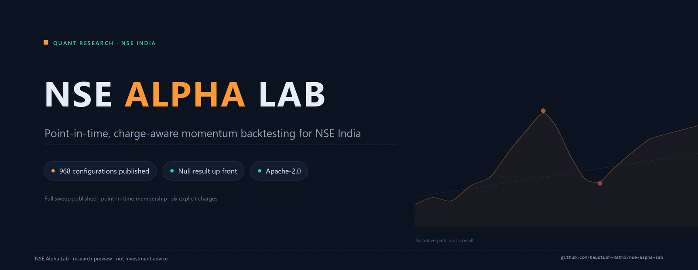
</p>

# NSE Alpha Lab

**Point-in-time, charge-aware momentum backtesting for NSE India.**

[](https://github.com/Kaustubh-Rathi/nse-alpha-lab/actions/workflows/ci.yml)
[](pyproject.toml)
[](LICENSE)
[](STATUS.md)
[](research/REPORT.md)
[](docs/PUBLISH.md)

NSE Alpha Lab is a Python research workspace for systematic equity strategies on the
National Stock Exchange of India. It contains a point-in-time NIFTY 500 universe, a
split/bonus-adjusted price store, a charge-aware momentum rotation engine, a
968-configuration sensitivity sweep with every row published, and a Streamlit UI for
writing and testing your own specifications.

The headline finding is a **null result**, and this README leads with it. The lab exists
to make a strategy falsifiable, not to produce a flattering backtest.

<!-- README walkthrough player. Once the compressed web encode is attached to the
     pinned "Walkthrough video (media host)" issue, insert the bare user-attachment
     URL on its own paragraph (blank lines around it, e.g.
     https://github.com/user-attachments/assets/<uuid>). Do not wrap it in <video>,
     an iframe, or Markdown link syntax, and do not delete the pinned issue: the
     README depends on its attachment. -->

<p align="center">
  <a href="https://github.com/Kaustubh-Rathi/nse-alpha-lab/raw/main/docs/assets/demo.mp4">
    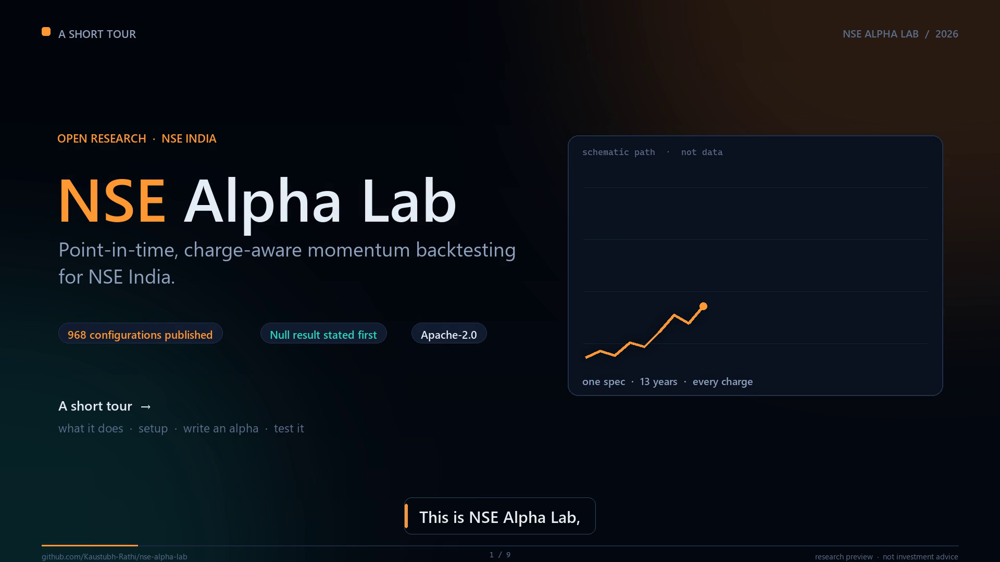
  </a>
  <br>
  <em>Full narrated walkthrough: the point-in-time pipeline, the 968-configuration sweep, and the null result.
  The poster and download link open the committed 1080p master.</em>
  <br>
  <a href="https://github.com/Kaustubh-Rathi/nse-alpha-lab/raw/main/docs/assets/demo.mp4"><strong>Download the 1080p master</strong></a> (MP4, H.264/AAC)
  &nbsp;·&nbsp;
  <a href="docs/assets/demo.srt">Captions (.srt)</a>
  &nbsp;·&nbsp;
  <a href="docs/assets/demo.gif">GIF preview</a>
  <br>
  <strong><a href="docs/HELLO_ALPHA.md">Write your first alpha</a></strong>
</p>

---

> ## ⚠️ Research preview — not validated, not investment advice
>
> This is an **early-stage research project**. It is a backtesting lab, not a trading
> system. Nothing here has been validated for live deployment, and none of it is
> investment advice, a recommendation, or a solicitation.
>
> **Read the multiple-testing disclosure in [Results](#the-968-configuration-sweep) before
> quoting any number from this repository.** The highest Sharpe ratio in the published
> table is the *maximum* of 968 trials, not the performance you should expect from a
> strategy. See [DISCLAIMER.md](DISCLAIMER.md) and [STATUS.md](STATUS.md).

---

## Contents

- [What this is](#what-this-is)
- [The result up front](#the-result-up-front)
- [How it works](#how-it-works)
- [Quickstart](#quickstart)
- [Write and test your first alpha](#write-and-test-your-first-alpha)
- [The research UI](#the-research-ui)
- [Data pack](#data-pack)
- [The 968-configuration sweep](#the-968-configuration-sweep)
- [What is not validated](#what-is-not-validated)
- [What is reproducible](#what-is-reproducible)
- [Repository map](#repository-map)
- [FAQ](#faq)
- [Citation and licence](#citation-and-licence)

---

## What this is

NSE Alpha Lab answers one question honestly: **does a simple cross-sectional momentum
rotation strategy on Indian equities beat the NIFTY 50, once every charge is paid and the
research is corrected for the number of configurations tried?**

The design rules are enforced in code, not just documented:

| Component | What it does |
|---|---|
| **Point-in-time universes** | Official NIFTY 500 / MidSmallcap 400 / Midcap 150 / Smallcap 250 / NIFTY 50 membership snapshots, keyed by date. The research harness applies membership as of date *T*; the CLI records the universe label but does not re-filter. |
| **Corporate-action handling** | Splits and bonuses are applied before the engine sees a price. Share actions, dividends, rights and demergers are tracked as dated events with provenance. |
| **Canonical engine** | `MomentumRotationEngine` in [`src/nse_pipeline/backtest/momentum.py`](src/nse_pipeline/backtest/momentum.py): equal-weight, long-only, integer shares, next-open fills, configurable lookback, cadence, position count, direction and exit overlays. |
| **Full Indian charge stack** | Brokerage, STT, stamp duty, exchange charges, GST and slippage, charged on every buy and every sell as explicit cash amounts that can be audited trade by trade. |
| **Sensitivity sweep** | A 968-configuration grid across five universes, six holding periods, both selection directions and 25 exit overlays. The complete result table is published. |
| **Benchmark-relative statistics** | Beta, Jensen alpha (linear and geometric), tracking error, information ratio, up/down capture, Newey-West t-statistics, block-bootstrap p-values, and drawdown depth and duration. |
| **Validation harness** | 348 fail-closed internal consistency checks that independently recompute accounting identities, charges, drawdowns and alpha regressions. |
| **Research UI** | Seven Streamlit pages: Home, Data, Create, Backtest, Results, Compare, Docs. Build a spec and put results next to the published sweep when a compatible pack is present; the current UI does not yet read the 1.0.0 pack layout. |

The enforced invariants: no look-ahead (a signal formed on close *T* can only execute at
the open of *T+1*), no invented prices, no invented corporate actions, deterministic
tie-breaking, integer shares only, and no network access during a backtest.

**Stack:** Python 3.12–3.14, pandas, NumPy, DuckDB, Parquet, Streamlit, Docker.
**Licence:** Apache-2.0 for code and documentation; data has separate terms.

---

## The result up front

<p align="center">
  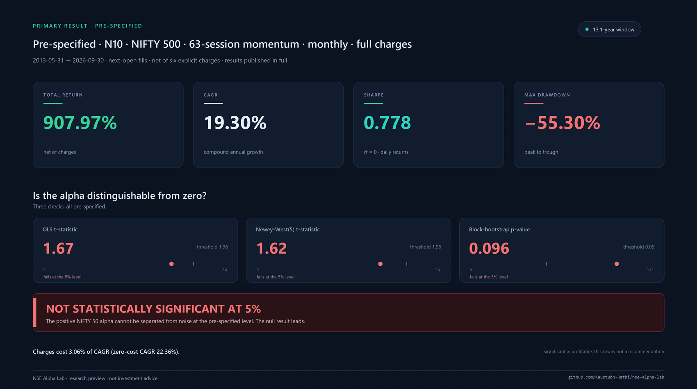
</p>

The pre-specified primary configuration — fixed before the sweep was run, not selected
from it — is `nifty500_top_N10_L63_monthly_none`: NIFTY 500, top 10 by 63-session
momentum, monthly rebalance, next-open fills, no exit overlay, full charges.

| Metric | Value |
|---|---|
| Window | 2013-05-31 → 2026-09-30 (13.1 years) |
| Starting capital | ₹10,000,000 |
| Final capital | ₹100,797,469 |
| **Total return** | **907.97%** |
| **CAGR** | **19.30%** |
| Annualised volatility | 27.62% |
| **Sharpe ratio (rf = 0)** | **0.7782** |
| **Maximum drawdown** | **−55.30%** (2018-08-28 → 2020-03-24, recovered 2021-04-06) |
| Trades | 2,080 (1,131 buys / 949 sells) |
| Charges paid | ₹15,178,940 (18.35 bps of turnover) |

Against the NIFTY 50 over the same window: beta 0.95, Jensen alpha 10.70% linear,
tracking error 23.04%, information ratio 0.38.

| Significance test | Value | Verdict |
|---|---|---|
| Alpha t-statistic, OLS | 1.67 | — |
| **Alpha t-statistic, Newey-West (5 lags)** | **1.62** | Below the 1.96 threshold |
| **Bootstrap p-value (21-session blocks, 2,000 reps)** | **0.096** | Above the 0.05 level |
| **Statistically significant at 5%?** | — | **No** |

**The primary configuration's alpha is economically large but not statistically
significant.** With t = 1.62 and a bootstrap p-value of 0.096, this data cannot
distinguish the result from noise. That is the finding. It is reported as the finding.

Charges matter: the same strategy with every charge set to zero compounds at 22.36%
instead of 19.30%. The charge stack costs **3.06% of CAGR**.

The full report, including segment analysis and caveats, is
[research/REPORT.md](research/REPORT.md). The 348-check validation record is
[research/validation.json](research/validation.json).

---

## How it works

<p align="center">
  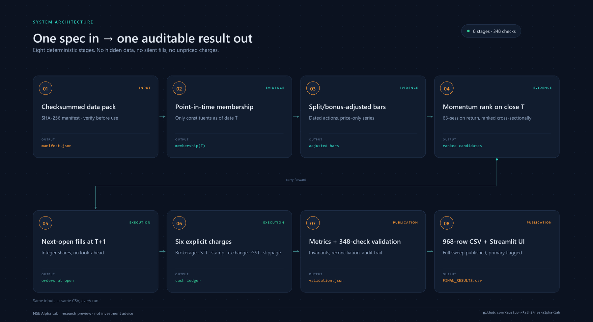
</p>

One specification in, one auditable result out:

1. **Load a checksummed pack.** Bars, membership snapshots and provenance come from a
   versioned pack whose SHA-256 digests are verified before use.
2. **Resolve the universe as of the signal date.** The research harness applies
   point-in-time membership; no today's-members backfill. If the evidence does not cover a
   date, the run records that rather than guessing.
3. **Rank trailing returns.** The canonical score is `close(T) / close(T-63) - 1` for
   the default 63-session lookback. The engine reads no bar after *T*.
4. **Fill at the next open.** A decision made on close *T* is executed at the open of
   *T+1*, with integer shares and deterministic tie-breaking.
5. **Charge every trade.** Six components are stored on each fill: brokerage, STT,
   stamp duty, exchange charges, GST and slippage.
6. **Recompute everything.** Metrics are calculated from the resulting equity curve and
   trade ledger. A separate harness re-derives accounting identities, charges,
   drawdowns and alpha regressions and fails closed on any mismatch.

The engine is pure: no I/O, no clock, no hidden state. Two runs over identical inputs
are byte-identical. The legacy `backtest/engine.py` is retained for shared loaders and
historical tests; every published number comes from `backtest/momentum.py`. See
[docs/ENGINE.md](docs/ENGINE.md) and [docs/ARCHITECTURE.md](docs/ARCHITECTURE.md).

---

## Quickstart

<p align="center">
  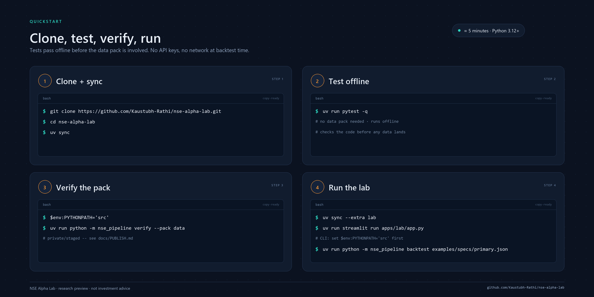
</p>

### Prerequisites

- Python **3.12–3.14**
- [uv](https://docs.astral.sh/uv/)
- Optional: Docker with Compose v2 for the container lane

No data pack is needed to install the package, import the library, run the test suite,
or open the UI.

### 1. Clone and sync

```bash
git clone https://github.com/Kaustubh-Rathi/nse-alpha-lab.git
cd nse-alpha-lab
uv sync
```

### 2. Run the offline test suite

```bash
uv run pytest -q
```

The suite is network-free and needs no data pack. CI runs it on Ubuntu with Python 3.14;
the current run is **1,952 passed, 68 skipped, 1 xfailed**. No Windows or macOS CI job
exists yet, so this repository does not claim three-OS CI.

### 3. Launch the research UI (optional)

```bash
uv sync --extra lab
uv run streamlit run apps/lab/app.py
```

Open **http://localhost:8501**.

### 4. Run the synthetic mechanics demo (no data pack)

This is the fastest way to see the CLI end to end. The bars are generated by a seeded
random number generator. **They are not market data, not a result, and must not be
cited.**

```bash
uv run python examples/synthetic_demo/build_pack.py

# PowerShell:
$env:PYTHONPATH='src'
uv run python -m nse_pipeline backtest examples/synthetic_demo/hello_alpha.json `
  --pack examples/synthetic_demo/pack `
  --out examples/synthetic_demo/result.json
```

```bash
# POSIX:
PYTHONPATH=src uv run python -m nse_pipeline backtest \
  examples/synthetic_demo/hello_alpha.json \
  --pack examples/synthetic_demo/pack \
  --out examples/synthetic_demo/result.json
```

Real output from this synthetic pack:

```text
Backtest: hello_alpha
=====================
  universe           synthetic_demo
  benchmark          nifty50
  top_n              10
  direction          top
  lookback_sessions  63
  cadence            monthly
  cost_model         full_charges
  start              2019-01-01
  end                2023-12-29

Ran 1304 sessions, 60 rebalances.
  trades            533
  exits             0
  skips             16
  final cash        27.5103245146
  final equity      8886353.0450245146
  total return      -11.1365%
  written to        examples\synthetic_demo\result.json

This is a research preview. Split/bonus-adjusted prices only, research universe is not official Nifty membership.
```

The negative return is not a finding about momentum. It is what this seeded synthetic
fixture produced. For a real run, follow [Data pack](#data-pack) and use
`examples/specs/primary.json`.

> **Why `PYTHONPATH=src`?** The project deliberately sets `[tool.uv] package = false`, so
> `uv sync` does not install the `src/` tree. The test suite handles this through
> `pythonpath` in `pyproject.toml`; the CLI needs the environment variable (or an
> editable install) when run from a source checkout.

### Docker (optional)

```bash
docker compose -f docker/compose.yaml up lab
```

Then open **http://localhost:8501**. The `lab` service is the default. Other lanes are
opt-in profiles:

```bash
# Shell inside the container (pytest, CLI commands)
docker compose -f docker/compose.yaml --profile cli run --rm cli

# Network-enabled lane: the only service that fetches data
docker compose -f docker/compose.yaml --profile fetch run --rm fetch --help

# PDF lane: builds with the optional `pdf` extra (AGPL; see NOTICE)
docker compose -f docker/compose.yaml --profile pdf build pdf
```

There is deliberately **no Postgres and no Redis**. Storage is an embedded DuckDB file
plus Parquet, opened in-process. Backtests never touch the network.

---

## Write and test your first alpha

<p align="center">
  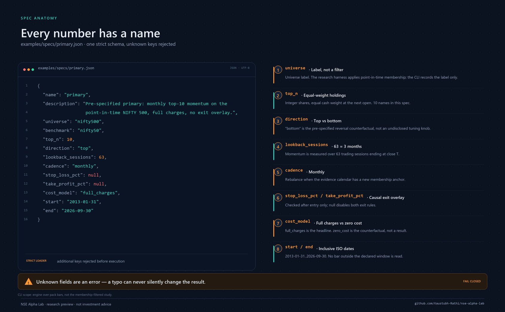
</p>

In this repository an **alpha is a strategy specification**, not a Python subclass. The
engine is fixed; the JSON file selects the test. The spec is explicit, while charge rates
and starting cash are fixed constants. Unknown fields are an error rather than silently
ignored.

`examples/specs/primary.json` is the pre-specified primary:

```json
{
  "name": "primary",
  "description": "Pre-specified primary: monthly top-10 momentum on the point-in-time NIFTY 500, full charges, no exit overlay.",
  "universe": "nifty500",
  "benchmark": "nifty50",
  "top_n": 10,
  "direction": "top",
  "lookback_sessions": 63,
  "cadence": "monthly",
  "stop_loss_pct": null,
  "take_profit_pct": null,
  "cost_model": "full_charges",
  "start": "2013-01-31",
  "end": "2026-09-30"
}
```

| Field | What it changes |
|---|---|
| `universe` | Any non-empty label. The shipped specs use `nifty50`, `nifty500`, `nifty200`, `msci400`, `midcap150`, `smallcap250` or `anderson_cio_index`. **The CLI records this label but does not re-filter the bars by membership**; the research harness applies point-in-time membership. |
| `top_n` | Number of equal-weight holdings. Integer shares only. |
| `direction` | `top` ranks the strongest momentum; `bottom` is the mirror-image counterfactual. |
| `lookback_sessions` | Trailing return window. `63` sessions is approximately three months. |
| `cadence` | Rebalance schedule: `monthly`, `quarterly`, `semiannual`, `annual`. |
| `stop_loss_pct` / `take_profit_pct` | Optional causal exit overlay. `null` disables it. An exit signal executes at the next open. |
| `cost_model` | `full_charges` for the published stack, or `zero_cost` for the gross counterfactual. |
| `start` / `end` | Inclusive ISO dates for the run. |
| `benchmark` | Validated label. The CLI does not emit benchmark-relative statistics; the published alpha table comes from the research harness. |

> **CLI scope, stated plainly.** `backtest` runs the canonical engine over the adjusted
> bars in the selected pack. It applies `start`/`end`, but `universe` and `benchmark` are
> labels: it does not re-apply point-in-time membership and does not compute the
> benchmark alpha. The published Table 1 was produced by the research harness with
> membership applied. Treat the CLI as a mechanics and trade-audit runner, not as a
> one-command replication of the published study.

Run your own copy:

```bash
$env:PYTHONPATH='src'   # PowerShell; use: export PYTHONPATH=src
uv run python -m nse_pipeline backtest my_alpha.json --out my_result.json
```

`--out` writes the summary plus the full result: equity curve, trades, exits, skips and
the itemised charge fields. The CLI prints a compact summary; the JSON is the audit
trail.

> **Changing a field after seeing the result is a new trial.** It is not a correction to
> the old one. The sweep exists to show what happens when you try many variants; it does
> not correct the multiple-testing bias for you.

### Three levels of testing

1. **Targeted engine tests** — causality, next-open fills, exit timing and charge sums:

   ```bash
   uv run pytest -q tests/test_backtest_momentum.py \
     tests/test_leakage_causality.py tests/test_backtest_exits.py
   ```

   Observed on this checkout: `84 passed, 1 xfailed`.

2. **The full offline suite** — `uv run pytest -q`. The suite uses frozen fixtures and a
   temporary DuckDB, with no network access. CI runs it on Ubuntu/Python 3.14.

3. **Published-artifact validation** — `research/validation.json` records **348 checks,
   0 failures** from the last published run. The harness independently recomputes
   accounting identities, charge components, drawdowns and alpha regressions. It needs
   `strategy-results.json`, `benchmark-series.json` and `alpha-results.json`; none of
   those three is in the public checkout, so the record is auditable but not regenerable
   from this tree alone. See [What is reproducible](#what-is-reproducible).

The full hands-on tutorial — setup, spec, run, output, common failures, and how to read
the result honestly — is **[docs/HELLO_ALPHA.md](docs/HELLO_ALPHA.md)**.

---

## The research UI

The Streamlit app is a research preview, not a production dashboard. These are real
screenshots from the current app, not mockups.

| Home | Create a specification |
|---|---|
| 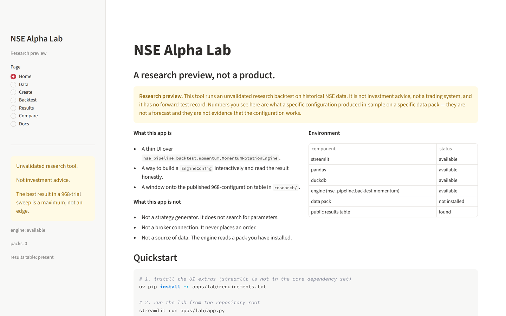 | 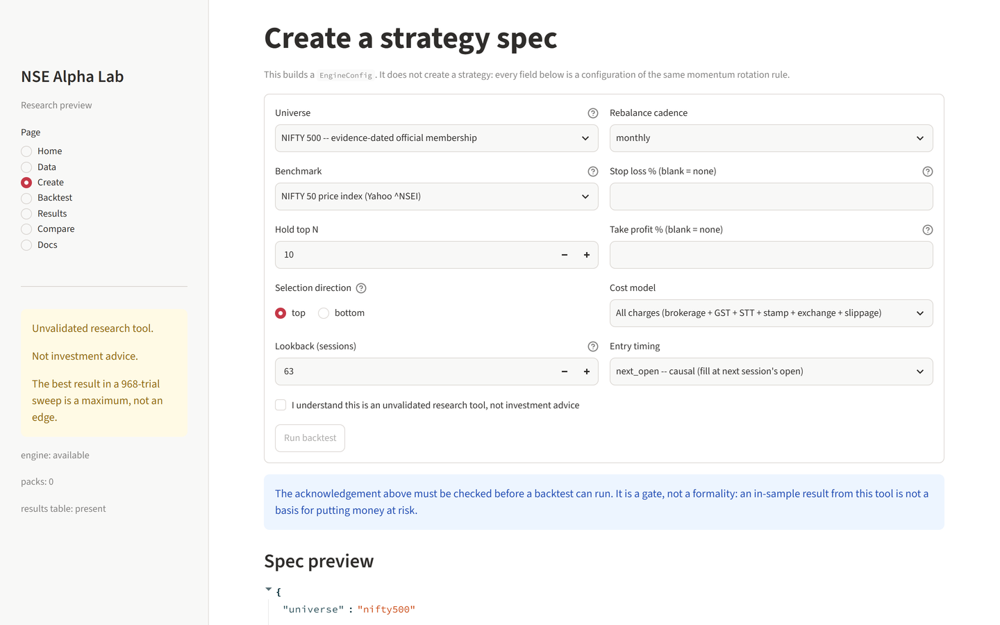 |

| Compare against the published sweep | Docs and limitations |
|---|---|
| 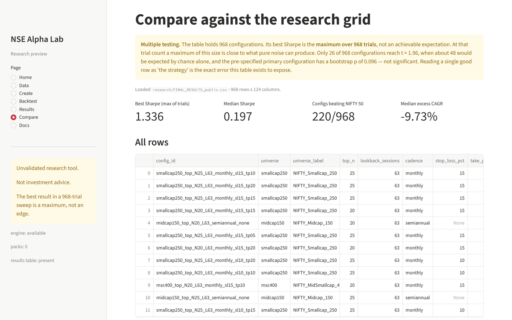 | 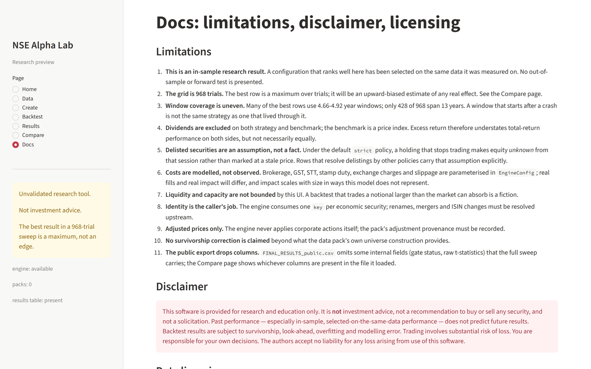 |

The pages are:

- **Home** — what the lab is and the research-preview warning.
- **Data** — whether a data pack is present, and what is missing if not.
- **Create** — build a specification in the form and see the JSON before running it.
- **Backtest** — run a spec when a data pack is available.
- **Results** — inspect equity, trades, exits and skips.
- **Compare** — load the 968-row published table under a multiple-testing warning.
- **Docs** — limitations, validation status and the disclaimer.

See [apps/lab/README.md](apps/lab/README.md) for the exact page behaviour.

> **UI scope.** The current UI's pack detector is narrower than the CLI's: it looks for a
> DuckDB file or the older partition layout under `data/`, and does not yet recognise the
> 1.0.0 pack's `processed/adjusted/adjusted_bars.parquet`. The screenshots above therefore
> show the no-data research-preview state. Use the CLI for a real pack today; the UI's
> Compare page can still read the published 968-row table without a pack.

---

## Data pack

The data pack is **not** distributed inside the git repository. It is a separate,
versioned, checksummed archive.

<p align="center">
  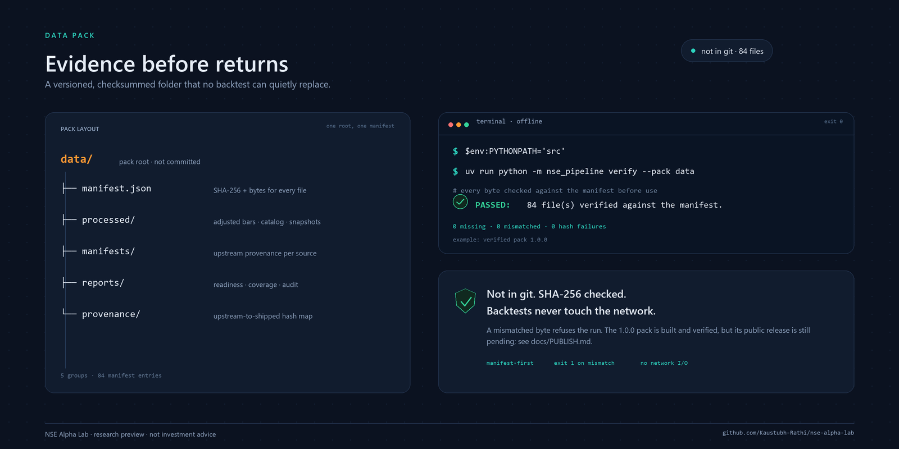
</p>

| Fact | Value |
|---|---|
| Pack version | 1.0.0 |
| Files in the tree | 85 |
| Manifest entries | 84 (`manifest.json` is not self-listed) |
| Unpacked size | 161,261,235 bytes (161.3 MB) |
| Archive size | 148,619,194 bytes (148.6 MB) |
| Archive SHA-256 | `bfc2140113b59480153841f641a37901120affb89374355da161f03eafe60708` |
| Bars coverage | 8,870,589 rows, 6,677 sessions, 5,810 stable keys, 2000-01-03 → 2026-11-06 |

> **Release status:** the 1.0.0 pack is built, verified file-by-file and uploaded to a
> private Hugging Face dataset (`manydream/nse-alpha-lab-data-pack`, commit `9cf24b8`).
> It is **not yet a public download**. [docs/PUBLISH.md](docs/PUBLISH.md) records the
> current host state, the access requirements, and the commands for each host. If you do
> not have access, use the [synthetic mechanics demo](#4-run-the-synthetic-mechanics-demo-no-data-pack).

### If you have access to the pack

```bash
$env:PYTHONPATH='src'   # PowerShell; use: export PYTHONPATH=src
uv sync --extra fetch
uv run python -m nse_pipeline fetch --source hf \
  --from manydream/nse-alpha-lab-data-pack --dest data
uv run python -m nse_pipeline verify --pack data
```

The private dataset needs a Hugging Face token with read access to that repository.

### If you received the archive

Unpack it so the repository root contains a `data/` directory, then verify it:

```bash
nse-alpha-lab/
└── data/
    ├── manifest.json         SHA-256 digest and byte size for every file below
    ├── processed/            Adjusted bars, catalog, universe snapshots
    ├── manifests/            Upstream provenance for every source series
    ├── reports/              Readiness, coverage and audit reports
    └── provenance/           Upstream-to-shipped hash map
```

```bash
$env:PYTHONPATH='src'   # PowerShell; use: export PYTHONPATH=src
uv run python -m nse_pipeline verify --pack data
```

A corrupted or incomplete pack reports a `MISMATCH` line per affected file and exits
non-zero. The CLI refuses to continue on a hash mismatch; it does not fall back to an
unverified file.

The engine looks for the data directory in this order:

1. `$NSE_DATA_DIR` (set automatically to `/app/data` inside Docker),
2. `./data` relative to the repository root.

Inside Docker, `./data` on the host is bind-mounted to `/app/data` in the container, so
the host CLI and the container agree on exactly one dataset.

> **`--pack` is not a synonym for the official pack root.** `backtest --pack DIR` expects
> a flat `DIR/adjusted_bars.parquet` and is used by the synthetic mechanics demo. The
> official 1.0.0 pack nests its bars under `processed/adjusted/`; point the CLI at it with
> `$NSE_DATA_DIR` or a `./data` directory instead. `verify --pack data` works for either
> layout because it reads the manifest, not the bars path.

### Data sources and terms

The pack is assembled from public NSE publications, index-membership snapshots and
cross-check series. Per-source provenance, the licence position for each source, and the
redistribution terms are documented in [DATA_LICENSES.md](DATA_LICENSES.md). Read that
file before redistributing the pack or derivatives.

If you prefer to build the pack yourself instead of downloading it, the acquisition and
verification pipeline is in `src/nse_pipeline/download/`, `src/nse_pipeline/nifty/` and
`scripts/`; it is network-enabled and deliberately separated from the backtesting code.

---

## The 968-configuration sweep

<p align="center">
  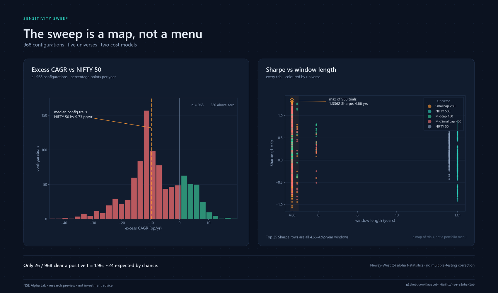
</p>

All numbers below are **net of the full charge stack**, **split/bonus adjusted**, and
**price-vs-price** (dividends excluded on both sides). The full table is
[research/FINAL_RESULTS_public.csv](research/FINAL_RESULTS_public.csv) — 968 rows, 124
columns, one per configuration, with a `validation_status` column on every row.
[research/FINAL_RESULTS.csv](research/FINAL_RESULTS.csv) is byte-identical in this
checkout. Column-by-column documentation is in
[research/CSV_COLUMNS.md](research/CSV_COLUMNS.md); the narrative is
[research/SWEEP_REPORT.md](research/SWEEP_REPORT.md).

### Read this before any number in the table

> ### 🚩 Multiple-testing disclosure
>
> **968 strategy configurations were tested.** The table is sorted by Sharpe ratio, so the
> top row is the *maximum* of 968 trials, not a strategy expectation. If you took the
> best of 968 coin flips you would also get a flattering number.
>
> - **No multiple-testing correction is applied anywhere in this repository.**
> - **Sharpe ratios are not comparable across rows.** Rows have different windows
>   (4.66 years to 13.1 years), different rebalance counts, and different amounts of time
>   parked in cash.
> - **The highest Sharpe belongs to the shortest window.** All 25 top-Sharpe rows span
>   only 4.66–4.92 years.
> - **Only 26 of 968 configurations have a positive Newey–West t above 1.96** — about the
>   **24** expected by chance in the upper 2.5% tail if no configuration had any edge —
>   while **43** are significantly negative.
>
> The pre-specified primary configuration is the result that matters, and it is **not
> statistically significant**.

### Sweep summary

| Statistic | Value | Reading |
|---|---|---|
| Configurations tested | **968** | Five universes, six holding periods, both directions, 25 exit overlays |
| Highest Sharpe in the table | **1.3362** | `smallcap250_top_N25_L63_monthly_sl15_tp10` — a **maximum over 968 trials** |
| Window of that row | 4.66 years | Smallest possible window in the grid |
| Window range, top 25 rows | **4.66 – 4.92 years** | Every top-Sharpe row is a short-window row |
| Rows spanning the full 13-year window | **428 / 968** | Comparable, long-window evidence for less than half the grid |
| Rows beating NIFTY 50 on CAGR | **220 / 968** | 22.7% — none of them a NIFTY 50 row |
| Median excess CAGR vs NIFTY 50 | **−9.73%** | The median configuration *lost* to the index by ~10 pp/yr |
| Rows with positive t > 1.96 | **26 / 968** | vs. ~**24** expected by chance; **43** significantly negative |
| Median Sharpe across all rows | 0.20 | The centre of the grid is close to zero |

Two things follow, and they point in opposite directions:

1. **There is structure in the data.** The top of the grid is not random: small and
   mid-cap universes with stop-loss overlays dominate the top 25, and the mirror-image
   "buy the weakest names" portfolio loses badly (−64.01% total, −15.46% alpha,
   Newey-West t = −2.13). Opposite signs on opposite selections is what a genuine momentum
   premium looks like.
2. **Most of the grid still loses to the index.** Only 22.7% of configurations beat
   NIFTY 50 on CAGR and the median configuration trails by 9.73 pp/yr. Beating the
   benchmark has not been shown to be a reliable property of this strategy family.

**Which configurations beat the index?** The 428 long-window rows break down as 278 NIFTY
500 rows (13.1 years) plus 150 NIFTY 50 rows (12.68 years). The 220 configurations that
beat NIFTY 50 on CAGR come from exactly four groups:

| Group | Rows beating NIFTY 50 | Out of | Window |
|---|---:|---:|---|
| NIFTY 500 | 58 | 278 | 13.1 years |
| MidSmallcap 400 | 61 | 180 | 4.66 years |
| Smallcap 250 | 61 | 180 | 4.66 years |
| Midcap 150 | 40 | 180 | 4.66–5.9 years |
| **NIFTY 50** | **0** | **150** | 12.68 years |

Two things stand out. First, **not one of the 150 NIFTY 50 configurations beat the index
it is built from** — unsurprising, since a 10-name subset of a 50-name index with charges
attached is not a route to beating it, but worth stating plainly. Second, the winners are
concentrated in the short mid/small-cap windows: **162 of the 220** come from the three
2017–2022 universes, whose runs span 4.66–5.9 years depending on the holding period. Over
the full 13-year window, **58 of 278 NIFTY 500 configurations (21%) beat the index** —
roughly one in five, which is the honest summary.

### Why the top of the table is not the answer

- **The window is short.** NIFTY Midcap 150 / Smallcap 250 / MidSmallcap 400 membership
  evidence covers 2017-07 to 2022-03 (4.75 years), and each run stops when its final
  scheduled holding period completes. A 4.66-year Sharpe is not comparable to a
  13.1-year Sharpe on the same scale.
- **Several of them sit mostly in cash.** With a stop-loss plus take-profit overlay on a
  long holding period, exit proceeds sit in cash until the next rebalance. That lowers
  volatility and inflates Sharpe. The `flag_exit_cash_until_rebalance` column marks every
  affected row.
- **The universes overlap.** Midcap 150 and Smallcap 250 are subsets of NIFTY 500, and
  MidSmallcap 400 overlaps it. They are segment views of one market, not independent
  confirmations.

---

## What is not validated

These are known, open limitations. They are listed so the results can be read with the
right amount of suspicion. [STATUS.md](STATUS.md) tracks the same list with the current
validation state of each item, and the gate remains **OPEN** for an alpha claim.

1. **Dividends are excluded — results are price-vs-price.** Prices are split/bonus
   adjusted only. The benchmark is also a price index, so the comparison is internally
   consistent, but both sides understate total return. **No row is a total-return result.**
2. **Post-2022 NIFTY 500 membership is point evidence at irregular dates.** Monthly
   official snapshots run to 2022-03-31; after that, membership is anchored to official
   events with `CoverageUnknown` between them. **After 2022 this is an event-anchored
   strategy, not a strict monthly one.**
3. **There is no NIFTY 750 test.** The repository has no point-in-time NIFTY Total Market
   or Microcap 250 constituent chain. A 750-name universe was not fabricated from today's
   constituents.
4. **Live execution is not modelled.** The engine fills at the next open with integer
   shares. It does not model market impact, ADV limits, circuit limits, suspensions or
   capital-gains tax. A ₹10M portfolio compounding to ₹100M in 10-name equal-weight
   positions would face capacity constraints this model ignores.
5. **Regime robustness is not established.** One 13-year sample, two large drawdowns, no
   out-of-sample holdout, no walk-forward analysis.
6. **Multiple-testing bias is uncorrected.** 968 configurations were evaluated and the
   best selected by Sharpe. No Deflated Sharpe, White's Reality Check or Bonferroni
   correction is applied. The lopsided tails — 26 positive versus 43 negative significant
   results, against ~24 expected positive — are the direct symptom.
7. **Terminal proceeds for delisted holdings are assumed.** The `last_close_writeoff`
   policy exits at the last observed close. That is optimistic if true proceeds were zero.
8. **The charge schedule is a 2026-style constant.** Brokerage, STT, stamp duty, exchange
   fees, GST and slippage are held fixed across 2013–2026. Indian rates changed several
   times; SEBI turnover fees, depository charges and capital-gains tax are not modelled.
9. **The headline benchmark is a single-vendor series.** The NIFTY 50 comparison uses the
   Yahoo `^NSEI` price series because it covers 2026. An NSE-spliced cross-check agrees to
   within 0.0008 index points on all 2,497 overlapping sessions and stops at 2025-12-31.

The full gate status, including `ready_for_alpha_claim: false`, is in
`data/reports/full-history-readiness.json` and summarised in
[STATUS.md](STATUS.md#not-yet-validated).

---

## What is reproducible

This distinction matters more than the word "reproducible" on a landing page.

| Task | From this checkout? | Notes |
|---|---|---|
| Install, import, run the offline tests | **Yes** | No data pack, no network. |
| Build and run the synthetic mechanics demo | **Yes** | Deterministic fixture; not a result. |
| Run the engine over a real pack | **With the data pack** | CLI mechanics run; `universe`/`benchmark` are labels, not membership filters. |
| Reproduce the published membership-filtered Table 1 | **No** | Needs the research harness, point-in-time membership inputs and benchmark artefacts, not all public. |
| Read the published 968-row table | **Yes** | `research/FINAL_RESULTS_public.csv`. |
| Regenerate the published table byte-for-byte | **No** | The sweep runner and validation harness need original artefacts (`research/benchmark-series.json`, the unexported `verification/` payload) that are not all in the public checkout. |
| Reproduce the 348-check validation run | **No** | The harness code is public; none of its three input JSON artefacts is in the public checkout. The published [validation.json](research/validation.json) record is. |

[docs/PUBLISH.md §7](docs/PUBLISH.md) records these gaps. The repository does not claim
that a clean clone can regenerate the sweep.

---

## Repository map

```text
nse-alpha-lab/
├── README.md                    This file
├── LICENSE / NOTICE             Apache-2.0 and third-party notices
├── CITATION.cff                 Machine-readable citation metadata
├── STATUS.md                    What is checked, what is not validated
├── DISCLAIMER.md                Not investment advice
├── DATA_LICENSES.md             Data provenance and redistribution terms
├── pyproject.toml               Dependencies and project metadata
├── uv.lock                      Locked dependency versions
│
├── src/nse_pipeline/            The library
│   ├── backtest/                Canonical momentum engine, accounting, charges, exits
│   ├── nifty/                   Point-in-time index membership and importers
│   ├── adjust/                  Split/bonus adjustment factors
│   ├── actions/                 Corporate-action evidence and verification
│   ├── universe/                Research eligibility and universe construction
│   ├── analytics/               Metrics and statistics
│   ├── audit/                   Calendar, gap and readiness audits
│   └── ...                      download, build, identity, schemes, fundamentals
│
├── tests/                       Offline pytest suite (no data required)
│   └── golden/                  Frozen golden-case JSON fixtures
│
├── research/                    The published study
│   ├── REPORT.md                Primary report: pre-specified config, alpha, charges
│   ├── SWEEP_REPORT.md          The 968-configuration sweep narrative
│   ├── FINAL_RESULTS_public.csv All 968 runs, curated public table
│   ├── FINAL_RESULTS.csv        The same 968 runs in this checkout
│   ├── FLAGSHIP_RESULTS.csv     The six headline configurations
│   ├── BENCHMARK.md             Benchmark construction and splice evidence
│   ├── validation.json          348 checks, 0 failures
│   └── *.py                     Build and validation scripts
│
├── apps/lab/                    Streamlit research UI
├── examples/specs/              Example strategy specification files
├── examples/synthetic_demo/     Deterministic mechanics demo; not a result
├── docs/                        Architecture, engine notes, tutorial and assets
│   └── assets/                  Diagrams, screenshots, video and generator scripts
├── docker/                      Multi-stage Dockerfile and Compose file
└── scripts/                     Data-build and verification utilities
```

**Where to start reading:** [research/REPORT.md](research/REPORT.md) for the primary
result, then [research/SWEEP_REPORT.md](research/SWEEP_REPORT.md) for the sensitivity
grid, then [STATUS.md](STATUS.md) for an honest list of what has and has not been checked.

---

## FAQ

### Do I need the data pack to try this?

No, for installing, importing, running the test suite, opening the UI and running the
synthetic mechanics demo. Yes, for a real backtest. The data pack is separate from git
because it is large and carries its own licence terms.

### Why is the headline a null result?

Because that is what the pre-specified test produced. The point estimate is large, but
the Newey-West alpha t-statistic is 1.62 and the block-bootstrap p-value is 0.096. The
data cannot distinguish the result from noise at the 5% level. Reporting that is more
useful than promoting the best row of a 968-trial sweep.

### Is the top Sharpe the best strategy?

No. It is the maximum of 968 trials. It comes from the shortest window in the grid, and
several high-Sharpe rows sit partly in cash between an exit and the next rebalance. The
multiple-testing disclosure explains why the ranking is a map, not a menu.

### Can I use my own data or another market?

The engine consumes adjusted bars with a stable key, date, open, close and volume, plus
point-in-time membership evidence. The shipped contract and loaders are in
`src/nse_pipeline/backtest/` and `src/nse_pipeline/universe/`. If you replace the
membership evidence, you own the survivorship-bias and provenance argument; the lab will
not invent it for you.

### Is this investment advice?

No. It is research and educational software. Past performance does not predict future
returns. Read [DISCLAIMER.md](DISCLAIMER.md).

### How were the docs and video made?

The documentation, diagrams and narrated walkthrough were built with multiple AI
coding agents working in parallel under human direction, then reviewed and edited by
the maintainer. The agents drafted prose and generated media; they did not originate
or validate the research result. The numbers, caveats and null result are the ones in
[STATUS.md](STATUS.md) and [research/REPORT.md](research/REPORT.md), and they stand
regardless of how the documentation was produced.

### How do I cite it?

Use [CITATION.cff](CITATION.cff) or the citation block below.

---

## Citation and licence

If you use this work, cite it:

```text
Rathi, Kaustubh (2026). NSE Alpha Lab (Version 0.1.0) [Computer software].
https://github.com/Kaustubh-Rathi/nse-alpha-lab
```

Machine-readable metadata is in [CITATION.cff](CITATION.cff).

- **Code and documentation:** [Apache License 2.0](LICENSE) — Copyright 2026 Kaustubh
  Rathi. See [NOTICE](NOTICE) for attribution and third-party licence notes.
- **Data:** see [DATA_LICENSES.md](DATA_LICENSES.md) for per-source provenance and
  redistribution terms. The data pack carries its own terms, separate from the code
  licence; public release is still pending.
- **PyMuPDF** is AGPL-3.0 and is used **only** in the optional `pdf` extra (PDF extraction
  in `research/pdf`). It is not required to run the lab, the CLI or the UI. Do not enable
  that extra in a deployment unless you can comply with AGPL-3.0.

## Disclaimer

Not investment advice. Past performance does not predict future returns. This is research
and educational software. Read [DISCLAIMER.md](DISCLAIMER.md) in full.
