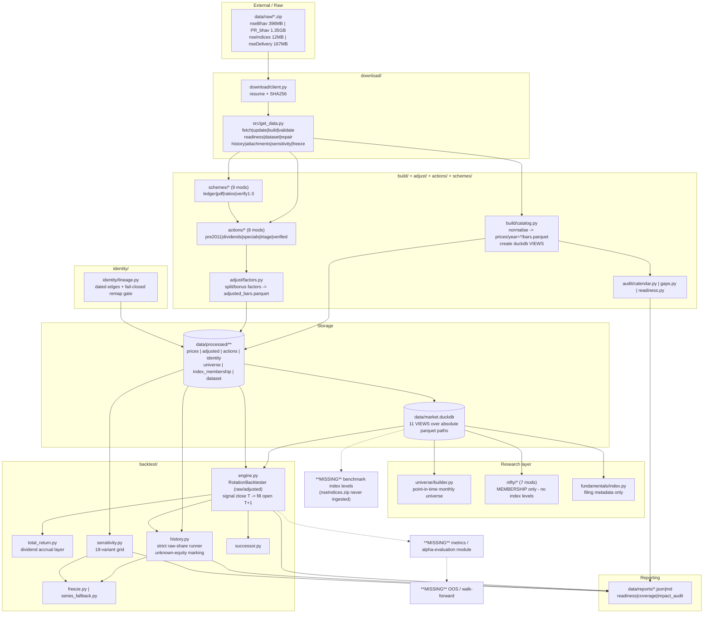

# QUANT_REPOSITORY_AUDIT.md

**Repository:** `D:\fix_Investment_backtesting` (`nse-rotation-research` v0.1.0)
**Audit type:** Read-only. No source file, dataset, or configuration was modified. No dependency installed, no dataset downloaded.
**Audit date:** 2026-11-12
**Environment measured:** Windows, CPython **3.14.6**, duckdb 1.5.6, pandas 3.1.1, numpy 2.5.4, pyarrow 25.0.1, pytest 9.2.0 (`.venv`).
**Repository has no git history** (`fatal: not a git repository`) - no commit, branch, or diff baseline exists; every finding below is from direct source inspection.

---

## 1. Executive Summary

**What the repository is.** A large, unusually disciplined **NSE historical data engineering and data-quality-audit project** that has grown a *diagnostic* backtesting capability around a single alpha signal. It is not, today, a quantitative alpha research platform.

**What it does well (verified):**

- Ingests official NSE equity bhavcopies into a normalised Parquet/duckdb layer spanning **2000-01-03 to 2026-11-06, 6,677 sessions, 10,792,672 rows, 9,055 symbols** (verified by direct query).
- Never fabricates a session, a holiday, a price, a membership list, or a corporate-action term. Every report is self-labelled with its own limitations.
- **812 tests pass, 5 skip, 129 subtests pass** in 189.6 s (measured).
- Implements a **causally careful** event-driven backtester: signal at close *T*, fill at open *T+1*, open-only sizing, integer shares, cash conservation asserted at runtime, and a fail-closed "equity is **unknown**, never forward-filled" marking rule.

**What it does not do (verified):**

- It implements **exactly one alpha family** - 63-session cross-sectional price momentum - re-implemented in four places with different filters, **three different price bases** and two different anchor rules.
- It has **no benchmark, no risk-adjusted metric and no inferential statistic** in shipped code, so it cannot answer the alpha question by itself.
- Its **readiness gate can never pass**: all seven blockers are hard-coded `complete=False` in `audit/readiness.py:124-141`, so `ready_for_backtesting` is a policy constant, not a measurement.
- Its **strict, "realistic" full-history runner produces no return at all**. The repository's own 2000-2026 run ends with `"final_equity": null` - **6,410 of 6,677 sessions (96.0%) have an unpriceable book** (`data/processed/backtest/full_history_research/summary.json`).

**What the prototype measurement (section 6.7) shows.** A read-only prototype of the missing analytics layer - built from data already on disk, touching nothing in the repository - answers the central question the repo cannot answer today. On the repository's own published run and its own data:

| Quantity | Value |
|---|---|
| Sharpe | **+0.0999** |
| Beta vs Nifty 50 | 0.3171 |
| **Information ratio** | **-0.155** |
| **Information coefficient** | **+0.0056 (t = +0.51) - indistinguishable from zero** |
| Max drawdown | **-67.59 %**, with **no recovery in 3,217 sessions** |
| Cost drag | **23.6 % of starting equity**; turnover 30.8x one-way |
| **Decomposition of the published "+115.72 %"** | **live traded sleeve -7,727,914 Rs** + **frozen stale block +19,299,447 Rs** |

**The strategy's actual traded sleeve lost money** (-8.23 %/yr; stable-base Sharpe **-0.085**), while **89.47 % of the headline return is stale marks on securities last seen up to 4,140 days earlier**. On this evidence, **the momentum strategy as currently implemented demonstrates no alpha**, and the published headline figure is not a measurement of the strategy. The benchmark layer itself is sound - it was validated against **21/21 published Nifty 50 milestones** and **3,392/3,392 overlapping dates** against the repo's own Yahoo series.

**The single most important finding.** The repo is an excellent **data-forensics** system and a **not-yet-functional** research system. Its engineering effort has been spent almost entirely on proving that the data is not ready, and it has succeeded so thoroughly that the honest path (strict gate) is closed. The shortest sound path forward is *not* more data engineering: it is (a) ingest the benchmark and risk-free series that are **already sitting unparsed in `data/raw/nseIndices.zip`** (an estimated **12-20 engineering hours**), (b) fix the engine's **delisting exit** - without which no benchmark result is meaningful, (c) build the metric/alpha-evaluation layer that does not exist, and (d) reconcile the two incompatible backtesters (`engine.py` last-price carry vs `history.py` unknown-equity) into one engine with one accounting convention.

**The honest self-assessment the repo already makes** - and which this audit confirms as accurate - is stated at `src/nse_pipeline/audit/readiness.py:73`: `ready_for_alpha_claim=False`. That literal is the correct answer today, and it is also currently **unconditional and therefore uninformative**.

---


## 2. Architecture Audit

### 2.1 Stack

| Element | Value | Evidence |
|---|---|---|
| Language | Python (`requires-python = ">=3.12,<3.15"`) | `pyproject.toml:6` |
| Declared deps | `duckdb>=1.4,<2`, `pandas>=2.2,<4`, `pyarrow>=18,<26` | `pyproject.toml:7-11` |
| Lockfile | `uv.lock` (43,660 bytes) | root |
| Installed | duckdb 1.5.6, pandas 3.1.1, numpy 2.5.4, pyarrow 25.0.1, pytest 9.2.0 | measured |
| Packaging | `[tool.uv] package = false` - a scripts project, not an installable package | `pyproject.toml:13-14` |
| Test runner | pytest (812 tests) though docs still say `unittest discover` | `src/README.md:18` vs measured pytest run |
| CI | **none** - no `.github/`, no Makefile, no tox/nox, no `.yml`/`.yaml` anywhere outside `.venv` | filesystem scan |
| Scientific stack | **none** - `scipy` and `statsmodels` are neither installed nor declared, so no inferential statistic is implementable without a dependency change | `pyproject.toml:7-11`; verified `find_spec('scipy') is None` |
| Version control | **none** - not a git repository | `git status` -> `fatal: not a git repository` |
| Notebooks | `my_fresh.ipynb` (2.5 MB) - **orphan**: references `data/nifty500_ohlc`, `data/sectoral`, `fetch_nifty500_ohlc.py`, none of which exist | notebook cell 1-2 |
| Stray scripts | `probe2.py`, `probe3.py` at repo root - ad-hoc DuckDB probes, not part of any package or CLI | `probe3.py:1-46` |

### 2.2 Module map

`src/get_data.py` is the sole CLI entry point (189 lines, subcommands `fetch | update | build | validate | readiness | dataset | repair | history | attachments | sensitivity | freeze`). Everything else lives under `src/nse_pipeline/` in 13 feature packages.

| Package | Responsibility | Size (physical / non-blank lines, files) | Key modules |
|---|---|---|---|
| `config.py` | Frozen `Settings` dataclass (paths, cutoff, workers, start) | 29 | - |
| `contracts.py` | 4 `Protocol`s (Downloader/Parser/Validator/Writer) - dependency inversion | 22 | **Implemented but unverified / effectively unused** - **Zero implementors and zero consumers.** `docs/ARCHITECTURE.md:60` claims "LSP/ISP/DIP: stages depend on abstractions + `Settings`" - no stage depends on any abstraction; all import concrete modules |
| `download/` | NSE HTTP client, resume, SHA256 verification, archive + recent fetch | 233 / 215 (2) | `client.py` |
| `build/` | ZIP -> normalised Parquet, duckdb view catalog, validation | 751 / 698 (2) | `catalog.py` |
| `audit/` | Calendar/delisting audit, gap probe, readiness gate | 1,240 / 1,142 (4) | `calendar.py`, `gaps.py`, `readiness.py` |
| `adjust/` | Split/bonus adjustment factors + action audit | 933 / 855 (2) | `factors.py` |
| `actions/` | Corporate-action acquisition/verification: pre-2011 API, dividends, specials, triage | 6,177 / 5,624 (9) | 8 feature modules |
| `schemes/` | Scheme ledger, PDF/OCR ingestion, ratio extraction, 3 verification passes | 7,673 / 7,090 (11) | 9 feature modules |
| `identity/` | Dated symbol/ISIN edges, key stabilization, API edge gating | 3,043 / 2,798 (3) | `lineage.py`, `api_edges.py` |
| `nifty/` | Index membership: official snapshots, licensed import, documentary, proxy, purchase pack, vendor | 3,994 / 3,588 (8) | 7 feature modules |
| `thirdparty/` | Kaggle/Yahoo cross-checks (never overwrite NSE bars) | 1,477 / 1,351 (4) | 3 feature modules |
| `universe/` | Point-in-time monthly research universe + Nifty overlap report | 490 / 442 (2) | `builder.py` |
| `fundamentals/` | Filing **index** only (no values) | 228 / 201 (2) | `index.py` |
| `dataset/` | Integrated dataset manifest | 160 / 141 (2) | `manifest.py` |
| `backtest/` | **7 feature modules (5 engines + 2 diagnostics)** | **9,076 / 8,390 (8)** | `engine.py`, `history.py`, `total_return.py`, `sensitivity.py`, `successor.py`, `freeze.py`, `series_fallback.py` |
| `tests/` | 52 test files, 812 tests, 817 `def test_` functions | - | - |

**Source size (measured):** **63 Python files under `src/`** (62 in `nse_pipeline/` + `src/get_data.py`), **35,730 physical lines / 32,760 non-blank**. The largest feature is `backtest/` at 9,076 physical lines, then `schemes/` 7,673, `actions/` 6,177, `nifty/` 3,994.

**Two structural facts that matter more than the module list:**
1. **There are no Python-level import cycles.** An AST scan of all 62 modules found only 13 inter-module edges, all pointing "down" the feature hierarchy. The claimed layering is largely real.
2. **There *are* two artefact-level cycles**, and they are what actually break reproducibility: `identity` <-> `backtest` (see 2.5).

### 2.3 Architecture diagram



### 2.4 Component status matrix

| Component | Relevant files | Implemented functionality | Status | Evidence |
|---|---|---|---|---|
| CLI | `src/get_data.py` | 11 subcommands, JSON output, exit-2 gate signalling | Implemented and verified | `--help`, `readiness` and `history` executed |
| Config | `nse_pipeline/config.py` | frozen dataclass of paths/cutoff/workers | **Implemented but effectively dead** | `Settings` is referenced only by `nse_pipeline/__init__.py:14`; **no module ever constructs it**. Its `data: Path = Path("data")` is CWD-relative and its `cutoff` is evaluated once at class-creation time |
| Contracts | `nse_pipeline/contracts.py` | 4 Protocols | **Implemented but unverified / effectively unused** | no module imports these Protocols; grep shows no `Downloader`/`Parser`/`Validator`/`Writer` consumer |
| Downloader | `download/client.py` | resume, SHA256, rate-limit, 401/403/429 stop | Implemented but unverified | `data/manifests/downloads.json` records hashes; no live run performed |
| Price catalogue | `build/catalog.py` | ZIP -> Parquet -> duckdb views | Implemented and verified | 10,792,672 rows reproduced exactly |
| Corporate actions | `actions/*` (8 modules) | acquisition, triage, verification of terms/ex-dates | Implemented and verified | 68,766 `needs_review` of 117,670 (58.5%) |
| Scheme handling | `schemes/*` (9 modules) | ledger, PDF/OCR ingestion, 3 verification passes | Implemented and verified | 396 events, 25 candidate terms, 0 execution-ready |
| Adjustment | `adjust/factors.py` | split/bonus factors, `adj_*` series, action audit | Implemented and verified | 1,770,456 rows with factor != 1 (reproduced) |
| Identity | `identity/lineage.py`, `api_edges.py` | dated edges, fail-closed remap gate, key stabilization | Implemented and verified | 1,080 edges, 856/1,559 symbols stabilized |
| Calendar audit | `audit/calendar.py` | confirmed closures, unresolved dates, 404 never = holiday | Implemented and verified | 274 confirmed, 86 unresolved, 2,705 unassessed weekends |
| Readiness gate | `audit/readiness.py` | 8 blocker codes, JSON report | **Broken as a measurement** | `complete=False` hard-coded at lines 124-141 |
| Universe | `universe/builder.py` | point-in-time monthly eligibility, Nifty overlap | Implemented and verified | 320 month-ends, 3,854 symbols, no future list consulted |
| Fundamentals | `fundamentals/index.py` | filing metadata index | Implemented but unverified | `values_extracted: False` (line 190) - unusable as a factor |
| Index membership | `nifty/*` | dated snapshots (26 official, 333 documentary) | Implemented but unverified | NIFTY500 stops 2021-10/2022-03 |
| **Index levels (benchmark)** | - | - | **Missing** | `nseIndices.zip` parsed only by `audit/calendar.py:115-143` for calendar gaps |
| **Backtest engine (base)** | `backtest/engine.py` | monthly rotation, next-open fill, costs, circuit skips | Implemented and verified | 496-session run produced 319 trades / 227 skips |
| **Backtest engine (strict)** | `backtest/history.py` | raw-share accounting, splits/dividends at ex-date, unknown-equity marking | **Broken (produces no return)** | own run: `final_equity: null`, 6,410/6,677 sessions unpriced |
| Total-return layer | `backtest/total_return.py` | dividend accrual vs split-only comparison | Implemented but unverified | 4 equity curves; `naive` variant shipped (landmine) |
| Sensitivity grid | `backtest/sensitivity.py` | 18-variant lookback x top-N x policy grid | Implemented but unverified | reports counts only, **no performance statistics** |
| Successor engine | `backtest/successor.py` | scheme/successor exclusion windows, 1:1 handover test | Implemented but unverified | synthetic + Sanofi Raymond runs on disk |
| Freeze / fallback diagnostics | `backtest/freeze.py`, `series_fallback.py` | explains why trading stops | Implemented and verified | 98.80% of freezes = missing data |
| **Metrics module** | - | - | **Missing** | only `annual_stats` at `engine.py:146-160` |
| **Alpha evaluation module** | - | - | **Missing** | `ready_for_alpha_claim` is a literal `False` |
| **Strategy registry / comparison harness** | - | - | **Missing** | only a parameter grid, never a strategy grid |
| Storage | `data/market.duckdb` | 11 **views** over absolute parquet paths | Implemented but **not portable** | `duckdb_views()` SQL contains `D:/fix_Investment_backtesting/...` |
| Tests | `tests/` (52 files) | 812 tests incl. causality, freeze, sensitivity, accounting | Implemented and verified | `pytest tests -q` -> 812 passed, 5 skipped |
| Docs | `docs/ARCHITECTURE.md`, `docs/FULL_HISTORY.md`, `src/README.md` | accurate narrative | Implemented and verified | coverage table matches measured values |

### 2.5 Architectural problems

| Problem | Evidence | Severity |
|---|---|---|
| **The alpha formula is duplicated four times** with divergent filters | `engine.py:756-782`, `total_return.py:255-282`, `sensitivity.py:835-857`, `history.py:672-689` | P2 |
| **The four implementations use THREE different price bases and TWO different anchor rules**: `engine`/`total_return` rank on `close` (raw when loaded via `load_bars_from_duckdb`, adjusted only via `load_adjusted_bars`), while `history`/`sensitivity` rank on `adj_close`; `engine` has no anchor-exactness check, the other two require the session-index difference to equal the lookback. `min_days_observed=130` means **all bars** in `engine`/`total_return` but **valid observations only** in `history`/`sensitivity` | `engine.py:760-781` vs `history.py:673-677` vs `sensitivity.py:839-849` | P0 |
| **An artifact-level circular dependency `identity` <-> `backtest`**: `backtest/engine.py:456-471` reads `data/processed/identity/*.jsonl`, while `identity/api_edges.py:1641` reads `data/processed/backtest/sensitivity/equity_marks.csv` - an output of the backtest feature. Identity keys depend on backtest output and backtest keys depend on identity output | `engine.py:456-471,549`; `identity/api_edges.py:1641` | **P1** - results are **order-dependent and not reproducible from a single pass**, and the "one feature = one reason to change" claim (`docs/ARCHITECTURE.md:58`) does not hold |
| **Private symbols imported across features**: `backtest/sensitivity.py:91-100` imports 8 private names (`_days,_date,_events,_fingerprint,_Identity,_jsonl,_positive,_risk_inputs`) from `backtest/history.py`; `backtest/series_fallback.py:202` imports `_Identity`; `backtest/history.py:25-29` imports `_root_for_symbol` from `engine.py`. `history.py` is an **undeclared shared kernel** | `sensitivity.py:91-100`; `series_fallback.py:202`; `history.py:25-29` | P2 |
| **~52 % of `src/` (15.4 kLOC) is unreachable from the shipped CLI** - 15 modules have no `get_data.py` path and are reachable only via `python -m` or by tests | e.g. `actions/older.py`, `fundamentals/index.py`, `schemes/{attachments,indexer,ledger,pdf_extract,ratios,verify,verify2,verify3}.py`, `nifty/{alt,purchase,vendor,proxy,licensed}.py`, `backtest/{series_fallback,total_return,successor}.py`, `universe/builder.py`, `thirdparty/*` | P2 |
| **Two near-clone verification pipelines**: `schemes/verify.py` (910) / `verify2.py` (891) / `verify3.py` (1,504) share `norm_ws/load_pages/build_rows/needs_reason/build_summary/write_jsonl` - **3,305 LOC with ~3,300 duplicated** | `schemes/verify*.py` | P2 |
| **Three copies of the snapshot loader** and **three JSONL readers** with different error semantics (silent skip vs raise) | `universe/builder.py:220`, `nifty/proxy.py:118`, `thirdparty/kaggle_nifty.py:263`; `engine.py:175`, `engine.py:409`, `identity/lineage.py:971` | P2 |
| **Dynamic file loading / `sys.path` hacks instead of package imports** - dependencies invisible to static analysis, IDEs and type checkers | `schemes/pdf_extract.py:66-68`, `schemes/verify2.py:52-54`, `schemes/verify3.py:47-49`, `schemes/acquire_attachments.py:27-29`, `nifty/documentary.py:41-46` | P3 |
| **Two backtesters with incompatible accounting conventions coexist** | `engine.py:810-815` marks stale holdings at `last_price`; `history.py:660-661` marks them **unknown** | P0 (results are not comparable) |
| **`run_demo` defaults to `adjusted=False`, so the base engine ranks momentum on RAW close** - i.e. split-distorted prices | `engine.py:1032`, `:1051`, `:992-1000` | **P0** - the engine's headline strategy output is computed on unadjusted prices, wrong exactly where splits occur |
| **Two divergent universe definitions** | `engine.py:99` `min_days_observed=130` vs `universe/builder.py:49` `min_days_observed=63` | P2 |
| **DuckDB is a view shell over absolute paths** | `duckdb_views()` SQL -> `read_parquet('D:/fix_Investment_backtesting/data/processed/prices/year=2000/bars.parquet', ...)` | P1 (reproducibility) |
| **`contracts.py` Protocols are decorative** | no importer of `Downloader`/`Parser`/`Validator`/`Writer`; `Settings` constructed by nobody | P3 |
| **`docs/ARCHITECTURE.md:70` is wrong**: `get_data.py validate` runs `build/catalog.validate_database`, **not** the calendar audit - so the producer of `coverage-audit.json` (a required readiness input) has no documented CLI path | `get_data.py:180-185` | P2 |
| **The `src/README.md` / `docs/ARCHITECTURE.md` command lists omit 15 modules** that have no CLI path | see 2.5 | P2 |
| **Action matching key is `(symbol, series)`, not identity** | `adjust/factors.py:754-757` states it; `SRTRANSFIN` alone has 47,296 rows over 91 series codes | P1 |
| **`equity_candidates` double-counts 44,294 instrument-days** (EQ + BE on the same day) | `build/catalog.py:442-444` filters series without de-duplication | P2 |
| **Readiness gate is not evidence-derived** | `audit/readiness.py:124-141` | P1 |
| **Readiness gate never reads the index-membership evidence it needs** | `audit/readiness.py:142` `evidence["nifty_membership"] = {}` | P2 |
| **`nifty_membership` blocker always fires** for `--universe nifty50/nifty500` even though 26 official snapshots exist | `audit/readiness.py:61-67` + `:142` | P2 |
| **Dead artifacts**: `my_fresh.ipynb`, `probe2.py`, `probe3.py` | root filesystem | P3 |
| **No CI, no VCS** | filesystem | P2 |

---


## 3. Historical Market Data Audit

### 3.1 Data sources

| Source | Provenance | URL | Official vs third-party | Fields | Frequency | Range advertised | Instruments | Storage | Download impl | Reliability / licence |
|---|---|---|---|---|---|---|---|---|---|---|
| `nseBhav.zip` (396 MB) | NSE daily equity bhavcopy (OHLCV + traded value + trades), redistributed by a GitHub mirror | `github.com/BennyThadikaran/eod2_utils/releases/tag/2025-master` | **Third-party redistribution of official NSE data** | Date, Symbol, Series, Open, High, Low, Close, LTP, Prev Close, Traded Value, Traded Qty, VWAP, 52W H/L, Total Traded, Market Cap (approx), Open Int, Chng in OI, filename | Daily | 1995-2025 (built from 2000) | ~9,055 symbols / 195 series | `data/processed/prices/year=*/bars.parquet` | `download/client.py:118` + `build/catalog.py:166-194` | SHA256 + size verified against the GitHub release manifest (`data/manifests/downloads.json`). `src/README.md:130` explicitly warns: *"Source-code availability is not a grant of data redistribution rights; NSE terms still apply."* |
| `PR_bhav-master.zip` (1.35 GB) | NSE corporate-action PR (bhav) reports | `.../releases/tag/pr-bhav-master` | Third-party mirror of official NSE reports | Symbol, Series, Ex-Date, Record Date, Purpose, PD, PC, SR, RC, Face Value, ND (dividend), FV, EX | Daily | Jan 2011 - Dec 2025 | - | `data/processed/actions/actions.parquet` (117,670 rows) | `build/catalog.py:373-430` | as above |
| `nseIndices.zip` (12 MB) | NSE daily **index** report | same release | Third-party mirror of official NSE reports | Index Name, Index Date, Open/High/Low/Closing Index Value, Points Change, Change %, Volume, Turnover, P/E, P/B, Div Yield | Daily | 2012-2025 | 30-64 indices per day | **raw ZIP only - never ingested as a series** | `download/client.py:20` registers it; only `audit/calendar.py:143-154` opens it, and only to test whether an index traded on a candidate date | Official NSE index levels. Verified extractable (see 3.4). |
| `nseDelivery.zip` (167 MB) | NSE delivery-position reports | same release | Third-party mirror of official NSE reports | Delivery quantity, traded quantity, delivery % | Daily | 2019-2025 | ~2,000+ | **raw ZIP only - never parsed** | `download/client.py:19` only | **167 MB of dead weight** - no parser exists (grep: only the archive name) |
| NSE live archives | `nsearchives.nseindia.com/content/cm/`, `.../archives/equities/bhavcopy/pr/` | official NSE | **Official** | same schemas | Daily | 2026 onward | - | `data/raw/recent/` | `download/client.py:165-232` | 401/403/429 stop the stream; 404 recorded as absence, never as a holiday |
| NSE corporate-actions API | `nsearchives.nseindia.com/content/cm/` | official NSE | **Official** | symbol, series, exDate, subject, isin, action tags | n/a | 2000-2010 (pre-2011) | - | `data/processed/older_actions/nse-api-actions.jsonl` (9,099 rows) | `actions/older.py` | Used for pre-2011 identity and tags |
| Nifty membership (official) | NSE index constituent snapshots | nseindia.com | Official | symbol, company, ISIN | Annual (Oct) | NIFTY50 2008-2026; NIFTY500 2015-2021 | 50 / 500 | `data/processed/index_membership/*.csv` (26) | `nifty/snapshots.py` | Exact-date lookup only, no fill |
| Nifty membership (documentary) | NSE monthly PDF/press releases | nseindia.com | Official but documentary | symbol, company, isin | Monthly | NIFTY50 2008-2026; NIFTY500 2013-2022-03 | 50 / 500 | `data/processed/nifty_doc/*.csv` (333) | `nifty/documentary.py` | 3,100 changelog events all `applied: false` |
| Yahoo Finance | Yahoo | thirdparty | OHLCV adjusted + dividend/split | 1999-2026 | Daily | 49 symbols | `data/processed/yahoo/` | `thirdparty/yahoo.py` | **Third-party, cross-check only** |
| Kaggle Nifty 500 / OHLCV | Kaggle | thirdparty | Membership + OHLCV + snapshot fundamentals | - | - | `data/processed/kaggle_*` | `thirdparty/kaggle_*.py` | Marked `is_official: false`; fundamentals explicitly `pit_safe = False` (`thirdparty/kaggle_ohlcv.py:166`) |

### 3.2 Actual dataset coverage (measured, not inferred from filenames)

**`bars` view (`data/market.duckdb` -> `data/processed/prices/year=*/bars.parquet`)**

| Property | Measured value |
|---|---|
| Date range | **2000-01-03 to 2026-11-06** |
| Distinct trading sessions | **6,677** |
| Total rows | **10,792,672** |
| Distinct symbols | **9,055** |
| Distinct series | 195 |
| Duplicate rows on (date, symbol, series) | **0** |
| Rows with `valid_ohlcv = false` | **970** |
| Rows with NULL ISIN | **2,919,779 (27.1%)** of all rows; **2,660,766 of 8,870,616 EQ rows (30.0%)**. **Pre-2011 EQ rows: 2,497,779 of 2,497,779 = 100 % NULL ISIN**; 2011+ EQ: 162,987 of 6,372,837 = 2.6 % |
| Rows with no `trades` count | 2,919,778 |
| (date, symbol) pairs carrying both EQ and BE rows | **44,294** -> 88,588 double-counted rows in `equity_candidates` |
| Weekend sessions present | 31 (two thin: 2010-05-16 with 7 rows, 2012-11-11 with 14 rows) |
| Missing weekdays within the observed span | **359** (274 confirmed closures + 85 unresolved); 86 unresolved is the all-time count |
| Sessions per year | 243 (2009) to 254 (2003, 2004); 2026 = 210 through Nov 6 |

**Rows and distinct symbols per year (measured)**

| Year | Rows | Sessions | Symbols | Year | Rows | Sessions | Symbols |
|---:|---:|---:|---:|---:|---:|---:|---:|
| 2000 | 246,681 | 250 | 1,265 | 2013 | 367,724 | 250 | 1,671 |
| 2001 | 240,305 | 248 | 1,047 | 2014 | 386,388 | 244 | 1,688 |
| 2002 | 191,697 | 251 | 957 | 2015 | 391,769 | 248 | 1,763 |
| 2003 | 180,719 | 254 | 841 | 2016 | 409,163 | 247 | 1,812 |
| 2004 | 196,261 | 254 | 871 | 2017 | 437,241 | 248 | 1,939 |
| 2005 | 211,537 | 251 | 963 | 2018 | 463,036 | 246 | 2,061 |
| 2006 | 233,256 | 250 | 1,088 | 2019 | 472,664 | 245 | 2,128 |
| 2007 | 277,898 | 249 | 1,254 | 2020 | 496,758 | 251 | 2,198 |
| 2008 | 303,673 | 246 | 1,344 | 2021 | 515,118 | 248 | 2,387 |
| 2009 | 310,044 | 243 | 1,371 | 2022 | 557,031 | 248 | 2,621 |
| 2010 | 354,013 | 253 | 1,545 | 2023 | 605,228 | 246 | 3,141 |
| 2011 | 371,856 | 247 | 1,650 | 2024 | 693,138 | 249 | 4,139 |
| 2012 | 391,208 | 252 | 1,663 | 2025 | 763,791 | 249 | 4,538 |
| | | | | 2026 | 724,475 | 210 | 5,283 |

### 3.3 Dataset inventory table

| Dataset | Date range | Symbols | Frequency | Fields | Quality issues | Backtest ready? |
|---|---|---|---|---|---|---|
| `bars` (raw) | 2000-01-03 -> 2026-11-06 | 9,055 / 195 series | Daily | date, symbol, series, isin, o/h/l/c, previous_close, volume, traded_value, trades, valid_ohlcv, source | Raw only, no corporate-action adjustment; 970 invalid OHLCV; 27.1% NULL ISIN (100% of pre-2011 EQ rows); 44,294 EQ/BE duplicate instrument-days; 31 weekend sessions; **359 missing weekdays within the observed span** (274 confirmed closures + 85 unresolved; 86 unresolved all-time) | **No** for returns; **Yes** for a raw-price screen |
| `adjusted_bars.parquet` (399 MB) | same | 9,055 | Daily | all raw columns + adj_open/high/low/close, adj_previous_close, adjustment_factor, price_multiplier, n_future_actions, is_adjusted | Split/bonus **only** (1,770,456 rows adjusted, 1,033 symbols); volume/value/trades never adjusted; 15,778 NULL adj_previous_close; levels embed **future** action knowledge | **Partially** - ratios are point-in-time correct; levels are not |
| `corporate_actions` | 2011-01-03 -> 2026-11-06 | - | Per event | symbol, series, ex_date, record_date, purpose, action_type, share_multiplier, dividend_per_share, parse_status, source | 117,670 rows, **68,766 (58.5%) `needs_review`**; 48,904 `parsed_not_applied`; matched on `(symbol, series)` only. Measured `action_type` split: **dividend 54,019; bonus 1,662; split 1,301; rights 892; reorganization 815; other 58,914**, plus **67 compound rows** (`bonus+dividend` 43, `split+bonus` 10, `dividend+rights` 8, `split+dividend` 6) which sum to the full 117,670 - the 2,963 split/bonus rows are the only price-adjustment candidates in `corporate_actions` (2,973 across `corporate_actions_all` including compound types), and only 2,105 are actually applied | No - audit inventory only |
| `pre2011_actions` | 2000-01-03 -> 2010-12-31 | - | Per event | symbol, series, ex_date, subject, isin, action_tags, identity_status | 9,099 rows, **tags only** (359 split/bonus-tagged), 343 execution-ready / 342 applied | No |
| `dividend_events.jsonl` | - | - | Per event | symbol, series, ex_date, dividend_per_share, dividend_factor, included_in_factor, reason | 46,137 distinct events, **31,987 included / 14,150 excluded** (exclusion reasons: 11,671 no bars for the line, 2,023 no pre-ex bar, 268 dividend >= prev close, 188 ambiguous same-day amounts; a separate 7,070 "bare dividend without an amount" exclusion universe) | Partially |
| `universe_observations.parquet` | 2000-04-28 -> 2026-11-06 (320 month-ends) | 3,854 | Monthly | month_end, symbol, series, close, volume, days_observed | Point-in-time, raw close, EQ-only; 2000-01/02/03 have zero eligible months | **Yes** (research universe) |
| Official index membership | NIFTY50 2008-10-31 -> 2026-10-30; NIFTY500 2015-10-30 -> 2021-10-29 | 50 / 500 | **Annual snapshots only** | index_code, as_of, source_url, sha256 | **NIFTY500 has no membership after 2021-10-29**; no 2000-2008 NIFTY50 at all; no daily membership | Snapshot cross-check only || Documentary index membership | NIFTY50 2008-01-31 -> 2026-10-30; NIFTY500 2013-04-18 -> 2022-03-31 | 50 / 500 | Monthly | symbol, company_name, isin | **NIFTY500 stops 2022-03-31**; 3,100 changelog events all `applied:false` | Snapshot cross-check only |
| `proxy_observations.parquet` | 2008-10-31 -> 2026-11-06 | 809 | Monthly | month_end, index_code, symbol, certainty, is_proxy, is_official | **`is_official` = 0 on every row** - pure proxy | **No** |
| Fundamentals index | 2023 sample | 1,976 | Filing | filingDate, provenance | **No values** (`values_extracted: False`) | **No** |
| **Index levels (benchmark)** | **not ingested** | - | - | - | **Missing** | **No** |
| **Delivery volume / %** | **not parsed** | - | - | - | **Missing** (167 MB raw archive unused) | **No** |

### 3.4 The single highest-leverage unused asset

`data/raw/nseIndices.zip` contains official daily index reports for 2012-2025. Measured extraction (read-only, from the already-downloaded archive):

| Series | Rows | Range | Note |
|---|---|---|---|
| `Nifty 50` | 2,507 | 2015-11-09 -> 2025-12-31 | index renamed from `CNX Nifty` |
| `CNX Nifty` | 667 | 2013-02-08 -> 2015-11-06 | legacy name of the same index |
| `Nifty 10 yr Benchmark G-Sec` | 2,390 | 2015-11-09 -> 2025-12-31 | **risk-free-rate proxy** |
| `India VIX` | 2,865 | 2014-05-14 -> 2025-12-31 | **regime conditioning** |

Consequence: **the benchmark index level, a risk-free rate series, and a volatility-regime series are all already on disk** and are being used today only as a calendar-gap heuristic (`audit/calendar.py:115-154`). Ingesting them is the cheapest possible route to the entire benchmark-relative and risk-adjusted analytics layer, which is currently completely absent.

**Alignment feasibility (measured).** Extracting the Nifty 50 / CNX Nifty series and joining it to the DB session calendar gives **3,174 index dates** against **3,429 DB sessions (2013-01-01 to 2026-11-06)**:

- **3,172 of 3,174 index dates (99.9 %) fall exactly on a DB trading session** - the two independent sources agree on the calendar.
- **92.5 % of DB sessions in 2013-2026 have a matching index value**; 257 sessions do not (the pre-2013-02-08 gap plus genuine index-report gaps).
- **Benchmark alignment therefore requires no fuzzy date matching** - a simple session join with an explicit, small missingness policy.

**Independent validation of the extraction (section 6.7 prototype).** The full archive panel (3,419 members, 2012-2025) was built and checked against external references: **21 of 21 published Nifty 50 milestones match exactly**, and `nseIndices` agrees with the repository's own Yahoo `NSEI` series on **3,392 of 3,392 overlapping dates**. Two structural features must be handled explicitly by any ingestion code: the Nifty 50 series contains **two historical rebases** (`S&P CNX Nifty` -> `CNX Nifty` -> `Nifty 50`, handover ratios 0.9941 / 0.9951), and **three archive members (`06042023`, `10042023`, `11042023`) have day/month-swapped content dates** - the filename is authoritative, and using it removes a phantom duplicate on 2023-10-04.

*Calibration note:* two widely-quoted Nifty 50 reference values used as initial checks turned out to be **wrong** (24,174 is the 28-Jun-2024 *intraday* high, not a close - the record close was 26,216.05 on 26-Sep-2024; and the YE2021 close is 17,354.05, not 17,464). The repository's own data was right. This is a useful warning for any benchmark ingestion: a mis-specified reference level silently corrupts every excess-return statistic built on it.

### 3.5 Field availability

| Field | Status | Evidence |
|---|---|---|
| Open, High, Low, Close | **Directly available** | `bars` view |
| Previous close | **Directly available but unreconciled** | disagrees with `lag(close)` by >0.5% on 22,865 of 10,776,894 pairs (0.21%); used for gap/circuit detection at `engine.py:124` |
| Traded volume | **Directly available** | `bars.volume` |
| Traded value (turnover) | **Directly available** | `bars.traded_value` (rupees) |
| Trade count | **Available for 91% of rows only** | 2,919,778 rows NULL (correlates with NULL ISIN) |
| VWAP | Available in the raw bhavcopy, **not persisted** | `build/catalog.py:111-161` does not carry it |
| 52-week high/low | Available in raw, **not persisted** | same |
| Market capitalisation | **Derived/approximate only**; no point-in-time series | third-party Kaggle snapshot only, flagged `pit_safe = False` |
| **Delivery quantity / delivery %** | **ABSENT** - archive downloaded, never parsed | `data/raw/nseDelivery.zip` (167 MB); no parser in `src/` |
| Corporate actions (split/bonus) | **Partially available** | 2,105 applied; split/bonus only |
| Corporate actions (rights, mergers, schemes, capital reduction) | **ABSENT from the price series** | 120,526 actions excluded as `scope_not_split_bonus` |
| Dividends | **Partially available** | 31,987 of 46,137 events included; gross ex-date reinvestment factor exists |
| Index membership | **Partial** - dated snapshots only, no intervals; NIFTY500 ends 2021-10 / 2022-03 | `data/processed/index_membership/`, `data/processed/nifty_doc/` |
| Sector / industry classification | **ABSENT** | no sector mapping in the repo; `my_fresh.ipynb` references a `data/sectoral/` folder that does not exist |
| **Historical benchmark index values** | **ABSENT from the pipeline** (available in raw ZIP, see 3.4) | no ingestion code path |
| Bid/ask spread, order book | **ABSENT** | daily bhavcopy only |
| Fundamental values (EPS, sales, debt) | **ABSENT** | `fundamentals/index.py:190` `values_extracted: False` |

### 3.6 Index membership: the access path already exists - the gap is ingestion, not availability

`data/reports/index-membership-coverage.json` records the repository's own **bounded, non-bypassing archive probe** against `https://www.niftyindices.com/reports/historical-data/Index/` (a read-only JSON POST with `SelectedReportType` 2 = Nifty 50/Nifty Next 50 MCWB, 4 = indices market-cap/weightage, and `MonthYear`):

| Probe result | Value |
|---|---|
| Type-2 (Nifty 50 MCWB) available for October of each year | **2008-2026 (all probed years); nothing found 2000-2007** |
| Type-2 availability outside October | **November 2009 lookup SUCCEEDED** - so the source is not October-limited; monthly snapshots are obtainable |
| Type-4 (index MCWB) available for October | 2013-2026 |
| Type-4 NIFTY 500 PDF present | 2013-2021; **absent from the October 2022-2026 type-4 ZIPs** |
| Documents acquired but not imported | 2 pre-rename `CNX 500` PDFs (Oct 2013, Oct 2014) - "official but not relabeled as NIFTY500" |
| Continuous intervals certified | **0** - "Every listed date is an exact source-stated close. No date between them is verified." |

Consequences for the roadmap:
1. **NIFTY 50 membership can be upgraded from 19 annual snapshots to a monthly series from 2008 onward** using an endpoint the repo has already proven it can reach - this is an *ingestion* task, not an acquisition or licensing task.
2. The pre-2013 CNX 500 documents are official and merely unlabelled; importing them under the NIFTY500 key extends NIFTY 500 coverage back to 2013.
3. **NIFTY 500 after 2021-10-29 is genuinely absent from the source** and would require either the licensed effective-interval feed (the `nifty/licensed.py` / `nifty/purchase.py` path already exists) or an explicit decision to research the research-defined universe only.
4. `continuous_intervals_certified = 0` means a backtest may use membership **only on the exact snapshot dates** - every other date is unknown, and the current code's exact-date-only lookup (`universe/builder.py:251-257`) is the correct behaviour.

### 3.7 Data quality and bias assessment

| Issue | Severity | Evidence |
|---|---|---|
| **No total-return series.** Dividends, rights, mergers are not in the price series; volume is never adjusted | P1 | `adjust/factors.py:71-72` `ELIGIBLE_ACTION_TYPES = ("split","bonus")`; `adjustment-coverage.json` excluded reasons |
| **Corporate actions matched on `(symbol, series)`, not identity.** The symbol string is **not a unique key**: `SRTRANSFIN` alone has 47,296 rows across 91 series codes; 79 symbols have >3 series codes with >1,000 rows | P1 | `adjust/factors.py:754-757` ("Matching is (symbol, series) only ... an action adjusts every bar in the same (symbol, series) line before its ex-date") |
| **Exit values do not exist.** 0 of 328 terminal proceeds resolved; official delisting list stops 2020-11-09; **2,113 of 2,409 symbols that stop trading are not on the official list at all** | P1 | `coverage-audit.json`; `data/raw/security_master/delisted.csv` |
| **Dead names carried at last price forever** in the base engine | P0 for that engine | `engine.py:813` `closes.get(d, {}).get(k, last_price.get(k, 0.0))` |
| **Entry-side survivorship is correctly handled**; exit-side is not | P1 | `universe/builder.py:12-14,143` vs `engine.py:861-862` |
| **One retrospective global filter exists** (symbol excluded from all history if any row ever had an INF/IN9 ISIN; 542 symbols / 432,741 rows dropped) - verified benign: **0 dropped rows carry an `INE%` ISIN** | P3 | `build/catalog.py:456-458` |
| **ISIN coverage collapses before 2011**: **100 % of pre-2011 EQ rows (2,497,779 of 2,497,779) have NULL ISIN**, so identity keys are symbol-derived for most of history | P2 | `identity/lineage.py:8-9`; 1,384 unresolved identity records; measured |
| **Calendar: 86 unresolved dates, 80 of them in years with no captured exchange calendar** (2000, 2001, 2007-2010) | P1 | `coverage-audit.json` `missing_date_counts`; `official_gap_backfill.json` = 0 confirmed gaps, 135 absent |
| **Adjusted prices embed future knowledge at the level (not the ratio)** - safe for returns, unsafe for any absolute-price decision, with no code guard | P2 | `adjust/factors.py:252-265` strict `ex_date > bar_date` |
| **44,294 EQ/BE duplicate instrument-days** double-counted in `equity_candidates` | P2 | `build/catalog.py:442-444` |
| **Suspended (BE/ST) series sit inside `cash_equity_candidates`** - 774,160 BE rows, 68,044 ST rows | P2 | `build/catalog.py:442-450` |
| **Raw and adjusted prices are mixed inside one engine run** - signals/executions on adjusted levels, `min_price` on raw close | P2 | `engine.py:654-671,747,1079`; `universe/builder.py:114-115` |
| Report self-consistency is **good**: `validation.json` sessions match, 0 duplicates match, 1,770,456 adjusted-row claim reproduces exactly, `dataset_manifest.json` sha256 re-computes | - | verified |

---


## 4. Strategy and Alpha Research Capabilities

### 4.1 Strategy inventory

Grep over `src/` for `rsi|macd|bollinger|zscore|mean_reversion|reversion|breakout|crossover|moving_average|ema|sma|atr|position_size` returns **zero signal hits** (only false positives: `version`, `conversion`, `schema_version`, and third-party dataset column names in `thirdparty/kaggle_ohlcv.py:43,51`). **There is exactly one alpha family in the repository: cross-sectional price momentum**, implemented four times.

| # | Strategy | Source | Hypothesis | Signal formula | Signal type | Direction | Entry / exit | Parameterised | Common interface | Deterministic |
|---|---|---|---|---|---|---|---|---|---|---|
| S1 | **Price momentum** (base) | `backtest/engine.py:756-782`, `:970-976` | 3-month intermediate-horizon price momentum; winners continue (herding / underreaction) | `mom_return = close / anchor_close - 1` (`:780`), anchor = session `idx - lookback_sessions` (`:764`) | Cross-sectional rank of a time-series return, monthly | Long-only, equal weight, top-N | Signal at close T -> **fill at open T+1** (`:823`,`:869`,`:900`); exit = liquidate any non-target at that open (`:855-878`) | Yes: `top_n`, `lookback_sessions`, `UniverseConfig`, `CostConfig`, `CircuitConfig` | Yes - `signal_fn(engine, bars, signal_date, cache) -> list[str]` (`:787`) | Yes - no RNG in `src/nse_pipeline/backtest`; stable sort with `key` tiebreak (`:781`) |
| S2 | **Total-return momentum** | `backtest/total_return.py:255-282`, `:517-524` | Same, but the return includes dividend accrual | `close_total / anchor_close - 1` (`:281`) | Same | Same | Same + dividend share accrual on ex-dates (`:312-319`) | Yes | Yes (subclasses `RotationBacktester`) | Yes |
| S3 | **Streaming momentum** (grid) | `backtest/sensitivity.py:835-857` | Momentum under an explicit grid of analyst choices | `closes[key]/anchor[key]-1` (`:855`), anchor exactly `lookback` sessions back (`:840`) | Same | Same | Own streaming execution (`:590`, `:681`) | Yes - `Variant(lookback, top_n, policy)`; defaults lookbacks (21,63,126) x top_ns (10,20,40) x policies (audit_only, quarantine) | **No** - private method, bypasses `signal_fn` | Yes |
| S4 | **Inline momentum** (strict runner) | `backtest/history.py:672-689` | Momentum on split-adjusted closes over 2000-2026 with point-in-time gating | `closes[key]/anchor[key]-1` (`:678`) | Same | Same | Month-end signal -> next session (`:688-689`) | **Partially** - `top_n=20` param, but lookback **hard-coded 63** (`:677`) and min_days **hard-coded 130** (`:675`) | **No** - inline | Yes |
| S5 | **Successor-aware momentum** | `backtest/successor.py:436-453`, `:592` | Momentum excluding names whose corporate-action history contaminates the lookback window | Reuses the base `signal_fn` | Same + filtering | Same | Same + successor transitions, unresolved names excluded from ranking and buys (`:512-537`) | Yes - `signal_lookback_sessions=63`, `exclusion_buffer_sessions=5` | Yes | Yes |

### 4.2 Audit-category coverage

| Category | Status | Evidence |
|---|---|---|
| Momentum (price) | **Implemented** (5 code paths) | `engine.py:780`, `total_return.py:281`, `sensitivity.py:855`, `history.py:678` |
| Momentum (risk-adjusted / volatility-scaled) | **Missing** | no volatility term in any signal |
| Mean reversion / reversal | **Missing** | grep: 0 hits |
| Breakout (Donchian / 52-week) | **Missing** | grep: 0 hits |
| Moving-average rules (SMA/EMA crossover) | **Missing** | grep: 0 hits |
| Volatility factors (ATR, realised vol, low-vol) | **Missing** | grep: 0 hits |
| Volume-based signals (OBV, VWAP, Amihud) | **Missing** | volume is a **filter only** (`engine.py:750-751`) |
| Delivery-volume / delivery-% signals | **Missing** | 167 MB archive never parsed |
| Cross-sectional rankings | **Implemented** (one factor) | `engine.py:781` |
| Portfolio-level multifactor | **Missing** | only one factor is ever scored; no z-scoring, no composite |
| Strategy combinations / ensembles | **Missing** | `engine.run` accepts exactly one `signal_fn` (`engine.py:785`) |
| Long-short / short leg | **Missing** | all engines long-only by construction |
| Risk targeting / position sizing beyond equal weight | **Missing** | `per = eq / n` only (`engine.py:884`) |
| Fundamental / value / quality factors | **Missing** | `fundamentals/index.py:190` `values_extracted: False` |
| Sector / industry neutralisation | **Missing** | no sector map exists in the repo |

### 4.3 Design gaps in the strategy layer

1. **No strategy registry or comparison harness.** Grep for `registry|compare|STRATEGIES|harness` returns only a *document download* registry (`actions/pre2011_circulars.py:124`), a *dividend triage* registry (`actions/dividends.py:107`), and `compare_series` (`total_return.py:656`) which compares **split-only vs total-return accounting of the same strategy**. `sensitivity.py`'s grid varies *parameters* of one alpha, never *strategies*. To compare two alphas an operator must hand-write a runner per strategy - with no shared universe, cost model, rebalance calendar, or metrics table, so any comparison would not be apples-to-apples.
2. **Volume is only a filter.** Despite 10.8 M rows of volume and 167 MB of delivery data, volume never enters a ranked signal.
3. **No signal-to-forward-return linkage.** The signal is used only to pick holdings; **information coefficient, rank IC, quantile portfolios and alpha decay are structurally impossible** in the current design.
4. **Determinism is good**: no RNG anywhere, stable sorts with explicit tiebreaks, deterministic grid construction (`sensitivity.py:300`).

---


## 5. Backtesting Engine Audit

> Detail on bias hunting is in section 5.4; the deep code-level bias review is summarised there with file/line evidence.

### 5.1 Does a genuine backtest engine exist?

**Yes - but there are five of them, with materially different semantics, and the most rigorous one produces no output.**

| Engine | File | Architecture | Multi-stock | Execution timing | Accounting | Returns a NAV? |
|---|---|---|---|---|---|---|
| `RotationBacktester` | `backtest/engine.py:728-967` | Event-driven, session loop over a pandas frame | Yes | Signal close T -> fill **open T+1**; sizing uses opening values only | Shared cash, integer shares, per-trade cost, trade/skip/position records | **Yes** |
| `TotalReturnBacktester` | `backtest/total_return.py:235-515` | Subclass of the above | Yes | Same | Adds dividend accrual as share growth | Yes (4 curves) |
| `SuccessorBacktester` | `backtest/successor.py:436-833` | Subclass | Yes | Same | Adds successor/scheme transitions and exclusions | Yes |
| `run_history` | `backtest/history.py:379-749` | **Streaming, bounded memory** (DuckDB fetch + 64-session deque) | Yes | Same | **Raw-share** accounting, splits and gross dividends at ex-date, impact audit | **No - `final_equity: null`** |
| `_Simulation` (grid) | `backtest/sensitivity.py:308-892` | Streaming, one variant at a time | Yes | Same | Strict unknown-equity marking | **No - 0 of 18 variants had a final equity** |

### 5.2 Simulation model

| Property | `engine.py` | `history.py` | `sensitivity.py` |
|---|---|---|---|
| Vectorized vs event-driven | Event-driven session loop (`:840`) | Event-driven streaming loop (`:529`) | Event-driven streaming loop |
| Multi-stock | Yes, cross-sectional ranking | Yes | Yes |
| Daily only | Yes - no intraday data exists | Yes | Yes |
| Signal-to-order timing | Signal computed for **all** rebalance dates *before* the session loop (`:830-838`), then scheduled to the next session (`:819-823`) | Same pattern via `pending` (`:688-689`) | Same |
| Execution convention | Fill at `bar["open"]` (`:869`, `:900`) | Fill at `row[4]` = open (`:518`) | Open |
| Same-bar close execution | **Never** - sizing uses opens only (`opening_value`, `:846-849`) | Same (`tradable()` uses only open and previous close, `:511-514`) | Same |
| Rebalancing | Monthly, at the last observed session of each calendar month (`month_end_dates`, `:136-143`) | Monthly (`month_ends`, `:478`) | Monthly |
| Position tracking | `positions` dict keyed by security key, with `shares`, `avg_entry`, `last_price`, `last_seen`, `flag` (`:803`) | `positions` dict with `shares`, `blocked`, `reference_close`, `last_close` | Same |
| Holdings + cash accounting | Yes; `equity_on(d)` (`:810-815`) | Yes; `cash + known_value` and **equity = None if any holding is unmarkable** (`:661`) | Same strict rule |
| Trade records | `trades` DataFrame: date, signal_date, key, symbol, side, fill_price, shares, notional, cost (`:874-877`, `:916-919`) | `trades.csv` + `cash_after` + `ledger.csv` (splits, dividends) + `impact_audit.csv` + `positions.csv` | Counters only |
| Cash conservation | Implicit | **Explicit**: `if cash < -1e-6: raise ArithmeticError("Cash conservation failure")` (`history.py:637-638`) | Similar |

### 5.3 Capital, position management and trading realism

| Requirement | Status | Evidence / gap |
|---|---|---|
| Configurable starting capital | **Yes** | `run(initial_cash=...)` (`engine.py:785`); CLI `--cash` (`get_data.py:58`) |
| Rs 1 lakh / Rs 10 lakh scenarios | **Yes, exercised** | Measured: Rs 1 lakh, 2015-2026, 2,935 sessions -> +17.4% total, **-72.2% max drawdown**, 2,389 trades. Rs 10 lakh, 2021-2022 -> -22.1%, 319 trades, 227 skips |
| Equal-weight allocation | **Yes** | `per = eq / n` (`engine.py:884`) |
| Capital-weighted / signal-weighted allocation | **Missing** | only equal weight exists |
| Maximum positions | **Yes** | `max_positions` (`engine.py:786`), `[:max_positions]` (`:835`) |
| Position limits / sector caps | **Missing** | no sector map exists |
| Cash constraints | **Yes** | `shares = int(min(need, cash) // fill)` then fee-aware decrement (`engine.py:902-912`); binary search in `history.py:622-629` |
| Integer-share quantities | **Yes** | `int(...)`, `math.floor(...)` |
| Reinvestment and compounding | **Partial** | cash and positions compound naturally; dividends credited as gross cash (`history.py:585-588`) |
| Leverage | **Prohibited by construction** | cash cannot go negative; `history.py:637-638` raises |
| Short selling | **Prohibited** | long-only everywhere |
| Portfolio turnover | **Missing as a strategy metric** | the only "turnover" in the repo is *universe membership churn* (`universe/builder.py:187-217`), not the strategy's turnover |
| Brokerage | **Yes** | 2 bps of notional, capped at Rs 2,000/order (`engine.py:65-66`, `:85-86`) |
| STT | **Yes** | 10 bps buy / 10 bps sell (`engine.py:67-68`) |
| Exchange transaction charge | **Yes** | 0.3 bps (`engine.py:70`) |
| **SEBI charges** | **Missing** | no SEBI turnover-fee line |
| Stamp duty | **Yes** | 1.5 bps, buy only (`engine.py:69`, `:88`) |
| GST | **Yes** | 18% on brokerage (`engine.py:71`, `:87`) |
| Bid/ask spread | **Missing** - modelled as flat slippage | `slippage_bps = 5.0` (`engine.py:72`) |
| Slippage | **Yes**, adverse, flat 5 bps | `engine.py:72` |
| **Slippage is charged as CASH, not applied to the fill price** - and the code comment says the opposite ("applied adverse to fill price") | `engine.py:72` vs `engine.py:88-89` | **P2** - in all four engines the fill price is the raw open (`engine.py:869`, `:900`); the comment misleads every reader of an audit-sensitive repo |
| Market impact | **Missing** | no model |
| Liquidity / volume participation limits | **Missing** | only a *filter* (`volume >= 5000`) and a *zero-volume* skip (`engine.py:120-122`) |
| Circuit / open-limit handling | **Yes, stylized** | flat 20% of previous close, either direction (`engine.py:115-133`); no historical circuit bands |
| Corporate actions during holding | **Yes in `history.py`** (split multiplier, gross dividend cash), **No in `engine.py`** | `history.py:558-588` |
| Orders not filled due to constraints | **Yes** - recorded in `skips` with a reason | `engine.py:860-862`, `:897-899`, `:910-912` |

**Cost-model realism caveats (all explicitly declared by the repo):** fees are **stylized current constants, not a dated 2000-2026 schedule** (`engine.py:1100`, `history.py:734`); stamp duty is buy-only; **no SEBI fee, no spread, no impact**; the same `CostConfig` object is used by all engines with no date awareness.

### 5.4 Bias detection - findings with evidence

| # | Severity | Finding | File / line | How it distorts results |
|---|---|---|---|---|
| B1 | **P0** | **Two engines with incompatible stale-mark treatment.** `engine.py` marks a delisted/suspended holding at its **last observed close forever** (`:813` `closes.get(d, {}).get(k, last_price.get(k, 0.0))`); `history.py` marks it **unknown** and refuses to report equity (`:658-661`). The same strategy therefore yields a confident-looking return in one engine and `null` in the other | `engine.py:810-815` vs `history.py:650-666` | The base engine **understates drawdown and overstates terminal wealth** for any holding that stops trading. Measured consequence: `engine.py` reports **-72.2% max drawdown** and a **+17.4% total return** over 2015-2026 where `history.py` reports **no return at all** for the same window. Any comparison across the two engines is invalid. |
| B2 | **P0** | **Strict runner cannot produce a return: 96.0% of sessions have an unpriceable book.** Measured 2021-2022 run: equity known on only 167 of 495 sessions (33.7%); 328 sessions `unpriced_positions >= 1`. Repository's own 2000-2026 run: **6,410 of 6,677 sessions unpriced**, `final_equity: null`, 203 trades | `history.py:650-666`; `data/processed/backtest/full_history_research/summary.json` | There is currently **no number to evaluate**. Any "the strategy returns X" claim from this engine is unsupported. One blocked holding (`ISIN:INE802C01017`, flagged `blocked=True`) nullifies the entire curve from 2021-09-07 onward. |
| B3 | **P0** | **Delisted names are carried at last price with no exit value.** 0 of 328 terminal proceeds resolved; the official delisting list ends 2020-11-09; 2,113 of 2,409 symbols that stop trading are absent from the official list | `engine.py:861-862`; `coverage-audit.json`; `data-status.md:32` ("0 proceeds resolved and 0 exit prices invented") | Systematic **exit-value bias**: dead names sit at their last price forever, so a strategy holding a bankrupt name shows no loss. This inflates returns and hides tail risk. |
| B4 | **P0** | **Corporate actions matched on `(symbol, series)`, not on security identity.** The symbol string is not a unique key: `SRTRANSFIN` alone spans 47,296 rows over 91 series codes; 79 symbols carry >3 series codes with >1,000 rows each | `adjust/factors.py:280`, `:754-757` | A split applied to symbol `X` in series `EQ` adjusts **every historical `X` row** before the ex-date, including rows belonging to a different company that once used the ticker. Corrupts both the price level and the share count. |
| B5 | **P1** | **Action application is globally retrospective over the whole history**: `adj = raw / cumulative_factor` where the factor includes every split through 2026 | `adjust/factors.py:252-265`, `:343-353` | Safe for **returns** (factors cancel in a ratio) but the **level** on any historical date embeds knowledge up to 2026. Any absolute-price decision on `adj_close` is leaking. The repo is aware (`total_return.py:779`) and no current code violates it - but there is **no guard** preventing a future violation. |
| B6 | **P1** | **Readiness gate cannot pass** - all seven blockers are literal `complete=False` in the producer | `audit/readiness.py:124,128,134,135,136,138,140` | `ready_for_backtesting` is a constant, not a measurement. The gate carries **no gradient**: it cannot distinguish 1 unresolved event from 396. Consequence: `history` and `sensitivity` refuse to run unless the operator passes `--allow-incomplete`, and the CLI's exit code 2 tells you nothing about how close you are. |
| B7 | **P1** | **DuckDB views hard-code absolute host paths** | `duckdb_views()` -> `read_parquet('D:/fix_Investment_backtesting/data/processed/prices/year=2000/bars.parquet', ...)` | The dataset is not portable. A new developer who clones the repo anywhere else gets a 274 KB "database" whose every view points at a non-existent path. **This is the primary reproducibility blocker.** |
| B8 | **P1** | **Identity collapse before 2011**: **100 % of pre-2011 EQ rows (2,497,779 of 2,497,779) have NULL ISIN**, so `security_key` falls back to `SYMBOL:<symbol>` | `build/catalog.py:443`; `identity/lineage.py:8-9` | Pre-2011 positions are keyed by ticker. Renames, symbol reuse and mergers inside the backtest window are not represented in the key; 1,384 identity records remain unresolved. |
| B9 | **P2** | **Calendar holes: 86 unresolved dates, 80 in years with no captured exchange calendar**; 2,705 absent weekends unassessed; 0 confirmed source gaps | `coverage-audit.json`; `official_gap_backfill.json` | Missing sessions are missing *returns*. If an unresolved date was a trading session, the strategy both misses that day's P&L and possibly misaligns the 63-session momentum anchor (`engine.py:764`, `history.py:673-677`). |
| B10 | **P2** | **`previous_close` disagrees with `lag(close)` by >0.5% on 22,865 of 10,776,894 pairs (0.21%)**, unreconciled | `bars` view; used at `engine.py:124` for the circuit screen | The open-limit screen uses a stale/incorrect previous close, so circuit skips are misclassified on ~0.2% of bars. |
| B11 | **P2** | **Raw and adjusted price levels are mixed inside one run**: execution and momentum on adjusted levels, `min_price` on raw close | `engine.py:654-671`, `:747`, `:1079`; `universe/builder.py:114-115` | The liquidity/price gate and the P&L live on different scales. A stock whose raw close is Rs 1,500 and adjusted close Rs 300 passes or fails the gate inconsistently with its fill price. |
| B12 | **P2** | **44,294 (date, symbol) pairs carry both an EQ and a BE row** -> 88,588 rows double-counted in `equity_candidates`, 44,069 of them inside `cash_equity_candidates` | `build/catalog.py:442-444` | A cross-sectional rank over `cash_equity_candidates` counts 44k instrument twice. The universe builder papers over it by enforcing EQ-only (`universe/builder.py:342`); direct consumers do not. |
| B13 | **P2** | **`annual_stats` annualises by equity-point count, not calendar span** | `engine.py:154-155` `years = max(len(eq)/252, 1/252)` | For 2000-2026 the count is 6,677 -> 26.50 "years" vs an actual 26.85 calendar years, so CAGR is overstated by ~1.3% relative. Small in magnitude but conceptually wrong, and it propagates into `total_return.py`'s `cagr_pp_diff`. |
| B14 | **P2** | **`annual_stats` returns all-zeros on a degenerate curve** (`len(eq)<2 or eq.iloc[0]<=0`), indistinguishable from a genuinely flat strategy | `engine.py:150-151` | A broken run can be reported as "0% return, 0% vol". `history.py:715-716` correctly returns `None`; the two conventions conflict. |
| B15 | **P3** | **Month-end is derived from *observed* sessions** (`month_end_dates`), so a data gap moves the rebalance date | `engine.py:136-143` | Benign in itself, but combined with B9 it means the rebalance calendar is data-dependent, not calendar-dependent, so two runs over slightly different data windows use different rebalance dates. |
| B16a | **P0** | **89.47 % of the published headline final equity is a stale mark.** Decomposing the repository's own published run `data/processed/backtest/adjusted_2015_2026`: the positions value is **Rs 21,571,525.11** and cash is **Rs 7.81**, giving a final equity of **Rs 21,571,532.93**; **Rs 19,299,446.51 (89.47 % of the positions value) is marked at a last observed close** by 23 of the 26 open positions (the other 3 are live), on securities last observed between 2015-07-07 and 2026-11-02 (e.g. `ISIN:INE218G01017` last seen 2015-07-07, Rs 527k of "value" frozen for eleven years). The published result is therefore a **marking artefact**, not a measurement | `engine.py:810-815`; `data/processed/backtest/adjusted_2015_2026/positions.csv` + `equity_curve.csv`; `data/reports/backtester-design.md` ("+115.72 %, CAGR 6.82 %") | **P0** |
| B16b | **P1** | **Identity key stabilization is decided from the whole history.** `build_key_stabilization` requires "exactly one distinct non-blank ISIN is observed for it, **anywhere**" and carries that ISIN back onto earlier bars | `engine.py:475-617` (esp. `:486-499`, `:560`) | **P1** - a symbol whose ISIN first appears in 2011 is re-keyed on its 2005 bars using 2011 information. This changes which holdings strand and therefore whether the book freezes - it changes the measured return. It is not disclosed as look-ahead. |
| B16c | **P2** | **Overweight targets are never trimmed.** `need = max(per - held, 0.0)`; if `held > per` the target is skipped, not sold. Only names absent from the new target list are sold | `engine.py:885-890`; `total_return.py:422-427`; `successor.py:743-748` (vs `history.py:602`, which *does* trim) | **P2** - momentum winners accumulate weight; the runner is not the "equal-weight" it is documented to be, and **the two runners implement different rebalancing rules**. |
| B16d | **P2** | **No liquidity cap on fills.** The only liquidity screen is `volume >= 5000` on the **signal** date; nothing caps a fill against the execution day's traded volume; 5 bps flat slippage, no impact model | `engine.py:98`, `:748-752`, `:900-915` | **P2** - with Rs 1 crore over 20 names, a fill can exceed the whole session's traded volume, assumed filled at the exact opening price. Returns are overstated for illiquid names. |
| B16e | **P3** | **Dividend cash is credited and spendable at the ex-date**; real settlement is weeks later | `history.py:576-588`; `sensitivity.py:562-578` | **P3** - a small, systematic cash-timing advantage; disclosed as "gross immediate ex-date cash (not a payment-date model)", but it is a bias, not a neutral simplification. |
| B16f | **P3** | **The headline accounting invariant is tautological.** `test_cash_conservation_no_negative_cash` asserts `equity == cash + positions_value`, but `positions_value` is *defined* as `equity_on(d) - cash` | `engine.py:946-947`; `tests/test_backtester.py:99-113` | **P3** - a broken `equity_on` passes the test. `test_delisting_flag_and_last_price` is similarly vacuous. |
| B16g | **P3** | **Published reports contradict the code on the `min_price` scale.** The reports state `min_price=5` applies on the adjusted / split scale; the code applies it to `raw_close` | `engine.py:747` vs `data/reports/backtester-design.md`, `data/reports/backtester-total-return.md` | **P3** - the eligible universe cannot be reproduced from the published reports. |
| B16 | **P3** | **Two universe definitions with different thresholds** (`min_days_observed` 130 vs 63) and two different lookback defaults | `engine.py:99-100` vs `universe/builder.py:49-50` vs `history.py:675-677` | The "universe" used by the research builder and the "universe" used by the backtester are not the same object. Any cross-artefact comparison (e.g. universe coverage vs backtest membership) is apples-to-oranges. |
| B17 | **P3** | **`contracts.py` Protocols are unused**; `config.py` `Settings` is barely consumed | `contracts.py`, `config.py` | The claimed dependency-inversion architecture is not enforced in code. |

### 5.5 Validation of the engine

**The engine has *not* been validated against hand calculations or an independent reference implementation.** There is no golden-file test, no reference implementation, and no invariant that would catch a broken cash ledger.

- **812 tests pass** (measured), but the backtester tests are **behavioural** tests of the code as written: `tests/test_backtester.py` (12.8 KB), `tests/test_backtest_causality.py` (15.4 KB), `tests/test_total_return.py` (15.2 KB), `tests/test_backtest_freeze.py` (26.7 KB), `tests/test_backtest_sensitivity.py` (32.7 KB), `tests/test_successor_safety.py` (16.2 KB).
- The genuinely valuable tests are the **causality** and **freeze/safety** ones: they assert that same-day closes never size orders, that an unpriceable holding freezes the book rather than fabricating a mark, and that no exit is invented. `tests/test_backtest_causality.py` is the strongest evidence of engineering rigour in the repo.
- **The critical missing validation** is a set of *accounting invariants* that must hold regardless of strategy: `cash + sum(shares x mark) == equity` on every session; `cash >= 0`; `sum(trade cash deltas) == cash change`; `sum(ledger share deltas) == position share change`; `fill_price` is always an open; `signal_date < trade date`. Only the first is asserted, and it is **tautological** - `positions_value` is defined as `equity_on(d) - cash` (`engine.py:946-947`), so the assertion tests the code against itself.
- **No test anywhere pins an expected share count, cash balance after a fill, total cost, or CAGR for a known equity curve.** There is no hand-calculated reference case and no comparison to an independent implementation.
- The **one genuinely independent reconstruction** is `total_return.reconstruct_equities` (`total_return.py:531-655`), which re-derives positions from the trade ledger and is asserted equal to the engine's equity at every session (`tests/test_total_return.py:220,227`). This validates the *overlay*, not the engine's own accounting loop.
- `successor.py`'s production path is exercised **only by synthetic fixtures** (`run_synthetic`, `run_sanofi_raymond_1to1`) - there is no real-ledger run, so its numbers are unvalidated.

**Do not label the backtester reliable because it produces an equity curve.** The 2015-2026 run produced a smooth, plausible-looking equity curve with a -72.2% drawdown that the strict engine says is simply **not computable**. That is precisely the failure mode the audit was asked to look for.

### 5.6 The published sensitivity grid - the clearest single piece of evidence

`data/processed/backtest/sensitivity/comparison.csv` (the repository's own 18-variant, 2000-2026 grid) is decisive. Every variant publishes a **strict** final equity column that is **empty**:

| Variant | `final_equity_strict` | unpriced exposure @ last close (Rs) | max mark staleness (days) | total costs (Rs) |
|---|---|---|---|---|
| L21-N10-audit_only | **empty** | 190,130 | 6,622 | 387,053 |
| L21-N20-audit_only | **empty** | 472,437 | 9,544 | 65,236 |
| L63-N20-audit_only | **empty** | 380,591 | 9,369 | 131,869 |
| L126-N10-quarantine | **empty** | **1,176,636** | 9,327 | 153,416 |
| L126-N20-quarantine | **empty** | 1,023,513 | 9,334 | 161,890 |

**0 of 18 variants publish a final equity.** Even under the most generous last-observed-close assumption, **Rs 1.9 lakh to Rs 11.8 lakh of a Rs 1 crore book (1.9 %-11.8 %) is unpriceable**, and the stale marks are up to **9,544 days (26 years) old**. The dominant skip reason in every variant is `skip_buy_unknown_held_opening_value` (2,920-12,560 skips).

The repo deserves credit for labelling these columns honestly (`_ASSUMPTION`, `_strict`, `unpriced_exposure_value_...`), but the consequence is unambiguous: **no defensible performance number for the 2000-2026 momentum strategy exists in this repository.**

---


## 6. Performance Metrics and Alpha Evaluation

### 6.1 The entire metric surface of the repository

There is **exactly one** metric function, `annual_stats` (`backtest/engine.py:146-160`), plus two inline re-implementations (`history.py:663-666`, `:715-716`) and a self-comparison wrapper (`total_return.py:656-675`).

```python
# backtest/engine.py:146-160
def annual_stats(equity: pd.Series, sessions_per_year: int = 252) -> dict:
    eq = equity.dropna()
    if len(eq) < 2 or eq.iloc[0] <= 0:
        return {"total_return": 0.0, "cagr": 0.0, "ann_vol": 0.0,
                "max_drawdown": 0.0, "n_sessions": int(len(eq))}
    rets = eq.pct_change().dropna()
    total = float(eq.iloc[-1] / eq.iloc[0] - 1)
    years = max(len(eq) / sessions_per_year, 1 / sessions_per_year)
    cagr = float((eq.iloc[-1] / eq.iloc[0]) ** (1 / years) - 1)
    vol = float(rets.std() * (sessions_per_year ** 0.5)) if len(rets) > 1 else 0.0
    roll_max = eq.cummax()
    dd = (eq / roll_max - 1).min()
    return {"total_return": total, "cagr": cagr, "ann_vol": vol,
            "max_drawdown": float(dd), "n_sessions": int(len(eq))}
```

### 6.2 Metric coverage table

| Metric | Implemented | File:line | Formula | Correct? | Notes |
|---|---|---|---|---|---|
| Total return | Yes | `engine.py:153` | `eq[-1]/eq[0]-1` | Partial | endpoint ratio; first session has no return and is included in the denominator |
| Total return (diagnostic) | Yes | `history.py:715` | `last_equity/initial_cash-1` | Yes | returns `None` unless every mark is known - the correct fail-closed convention |
| CAGR | Yes | `engine.py:154-155` | `(eq[-1]/eq[0])**(1/years)-1`, `years = max(len(eq)/252, 1/252)` | **No** | annualises by **equity-point count**, not calendar span (see B13) |
| Annualised volatility | Yes | `engine.py:156` | `rets.std() * sqrt(252)` | Value yes / definition partial | pandas `std` = ddof=1; 252 hard-coded, not derived from the exchange calendar |
| Max drawdown | Yes | `engine.py:157-158` | `(eq/eq.cummax()-1).min()` | Yes | standard convention; no duration/recovery metrics |
| Max drawdown (diagnostic) | Yes | `history.py:665-666` | streamed peak/equity | Yes | `None` unless all marks known |
| **Sharpe** | **No** | - | - | - | **absent**; no risk-free rate is defined anywhere in `src/` |
| **Sortino** | **No** | - | - | - | absent; downside deviation is not even exported |
| **Calmar** | **No** | - | - | - | absent (CAGR and maxDD both exist, so it is trivially derivable) |
| **Win rate** | **No** | - | - | - | absent; no round-trip pairing of buys and sells exists |
| **Profit factor** | **No** | - | - | - | absent |
| **Average trade return** | **No** | - | - | - | absent; no per-trade P&L is computed anywhere |
| **Portfolio turnover** | **No** | - | - | - | absent as a strategy metric; the only "turnover" is *universe churn* (`universe/builder.py:187-217`) |
| **Transaction-cost drag** | Partial | `history.py:714`, `sensitivity.py:931` | rupee sum only | Partial | no gross-vs-net return pair, so drag is never expressed as a return impact |
| **Benchmark return** | **No** | - | - | - | **structurally absent** - no index price series exists |
| **Excess return** | **No** | - | - | - | absent |
| **Beta** | **No** | - | - | - | absent |
| **Jensen's alpha** | **No** | - | - | - | absent |
| **Information ratio** | **No** | - | - | - | absent |
| **Tracking error** | **No** | - | - | - | absent |
| **Up/down capture** | **No** | - | - | - | absent |
| **Information coefficient (IC)** | **No** | - | - | - | absent; the signal is only ever used to rank holdings, never linked to forward returns |
| **Rank IC / IC IR** | **No** | - | - | - | absent |
| **Quantile portfolios / factor spread** | **No** | - | - | - | absent; no bucket construction exists |
| **Factor exposure / neutralization** | **No** | - | - | - | absent; no factor model, and no sector map to neutralise against |
| **Factor turnover** | **No** | - | - | - | absent |
| **Alpha decay** | **No** | - | - | - | absent |
| **t-statistics / confidence intervals** | **No** | - | - | - | absent; `scipy`/`statsmodels` are not even dependencies (`pyproject.toml:7-11`) |
| **Bootstrap** | **No** | - | - | - | absent |
| **Hypothesis testing** | **No** | - | - | - | absent (the only "hypothesis" in the repo is a data-integrity hypothesis in `freeze.py`) |
| **Regime robustness** | **No** | - | - | - | absent; `sensitivity.py`'s split is by *data-coverage year*, not market regime (India VIX is available and unused) |
| **Multiple-testing correction** | **No** | - | - | - | absent; the 18-variant grid would need one |
| **Parameter sensitivity** | Structural only | `sensitivity.py:106-110`, `:1121+` | grid over lookback x top-N x policy | Not a metric | the grid exists and is well built but produces **no return, no dispersion, no stability score**; `sensitivity.py:193` says so: *"Grid results are sensitivity to analyst choices, not evidence that any variant is better."* |
| **Out-of-sample testing** | **No** | - | - | - | absent; no train/test split, no purged/embargoed split. `total_return.py:759`'s two windows are both *reporting* windows, not an OOS design |
| **Walk-forward validation** | **No** | - | - | - | absent |

### 6.3 What `total_return.py` and `sensitivity.py` actually compute

- **`total_return.py`** is **not** a performance-metrics module; it is a **dividend-accounting** module. It runs the same momentum on `adj_close_total`, marks holdings with gross ex-date reinvestment as share accrual (`S -> S/f_ex`), and produces four equity curves (`equity_split_only`, `equity_total_marking_only`, `equity_total_return_full`, `equity_naive_total_marking`) plus a self-comparison (`compare_series`, `:656-675` -> `total_return_pp_diff`, `cagr_pp_diff`, `ann_vol_pp_diff`, `max_drawdown_pp_diff`, `share_of_split_gain`). **There is no benchmark alignment of any kind** - the comparison axis is split-only vs total-return accounting of one strategy. It also ships a deliberately level-distorted **`naive` variant** (`:537-539`, `:772`), which is a landmine for anyone reading `summary.json` without the label.
- **`sensitivity.py`** imports `CostConfig` and `KeyStabilization` but **not** `annual_stats` (`sensitivity.py:87`). Its per-variant report (`:894-986`) contains **only counts and balances**: trades, buys, sells, skip reasons, sessions with unknown positions, final cash, total costs, final equity (strict), terminal positions. **No return, no CAGR, no volatility, no drawdown, no Sharpe, no dispersion across the 18 variants.** Its analytic contribution is *counting what the data could not support* - correct and honest within its own terms, but not performance evaluation.
  - **Measured on the repo's own published grid** (`data/processed/backtest/sensitivity/comparison.csv` and `data/reports/backtest-sensitivity.json`, 18 variants over all 6,677 sessions): the columns are `variant_id, lookback_sessions, top_n, policy, sessions, rebalances, trades, buys, sells, skips_total, skip_* (7 reasons), sessions_with_all_positions_marked, sessions_with_unknown_positions, unpriced_equity_sessions, ...` - **there is not one performance column in the file**. The best variant has a fully-marked book on **680 of 6,677 sessions (10.2 %)** and the worst on **167 (2.5 %)**; the dominant skip reason is `skip_buy_unknown_held_opening_value` (**2,920-12,560** per variant). `docs/FULL_HISTORY.md` records the conclusion: *"18 variants; strict equity unknown on 89.8-97.5 % of sessions; 0 of 18 with a final equity."*

### 6.4 Can the repository distinguish "profitable" from "genuine alpha"?

**No - not at all, for three independent reasons, each sufficient.**

1. **No benchmark exists.** There is no index price series anywhere in `src/`; `nifty/*` builds **constituent membership**, not index levels. So excess return, beta, Jensen alpha, IR, TE, up/down capture and relative drawdown are all **not computable**.
2. **No risk-adjusted layer exists.** No Sharpe, Sortino, Calmar, downside deviation, or risk-free rate. "Risk-adjusted" cannot be evaluated.
3. **No statistical inference exists.** No t-stat, CI, bootstrap, permutation test, or multiple-testing correction. A Sharpe of 1.2 and a Sharpe of 0.2 are indistinguishable from noise here.

**What the repo *can* say today:** *"a strategy made money under a stated set of stylized costs and a stated set of analyst choices, on an incomplete price series."* It cannot say whether that money is compensation for risk, compensation for market exposure, or luck.

**This is a deliberate, honestly-labelled position**, not an oversight - but the honesty is enforced by **prose disclaimers**, while the metric layer that would *demonstrate* alpha was never built.

### 6.5 `ready_for_alpha_claim` is a constant

`audit/readiness.py:73`: `ready_for_backtesting=not blockers, ready_for_alpha_claim=False`. The same literal appears at `engine.py:1086`, `history.py:703`, `:788`, `sensitivity.py:1240`, `:1820`. **There is no code path, present or planned, by which the repository could ever set `ready_for_alpha_claim=True`** - even with perfect data - because the gate is a constant rather than a test, and there is no alpha-evaluation machinery to gate on.

### 6.6 Missing from the readiness gate's own view of the world

`readiness.py:142` sets `evidence["nifty_membership"] = {}` - it **never reads** `data/reports/index-membership-coverage.json`, which exists and is rich. Consequently the `nifty_membership` blocker fires unconditionally for `--universe nifty50|nifty500` even though 26 official dated snapshots are on disk.

---

### 6.7 PROTOTYPE MEASUREMENT: what the missing analytics layer actually says

> To avoid leaving the central question unanswered, a **read-only prototype** of the missing benchmark/metrics/statistics layer was built during this audit. **No file in the repository was created, modified or deleted**; all prototype code and artefacts live under `C:\Users\Kaustuvh\AppData\Local\Temp\opencode\spike\`. This is a *spike*, not a shipped module - but it is computed from the repository's own published runs and its own data.

#### 6.7.1 The benchmark dataset is real and validates cleanly

| Series | Rows | Range |
|---|---:|---|
| Nifty 50 (incl. `S&P CNX Nifty` 244 -> `CNX Nifty` 608 -> `Nifty 50` 2,506) | 3,419 | 2012-2025 |
| Nifty 10-yr Benchmark G-Sec | 2,391 | 2015-11-09 -> 2025-12-31 |
| India VIX | 2,866 | 2014-05-14 -> 2025-12-31 (no gap > 7 days) |

**Validation: 21 of 21 published Nifty 50 milestones match exactly, and `nseIndices` agrees with the repository's own Yahoo `NSEI` series on 3,392 of 3,392 overlapping dates.** Two structural corrections were found: the Nifty 50 series contains **two historical rebases** (handover ratios 0.9941 / 0.9951), and three archive members (`06042023`, `10042023`, `11042023`) have **day/month-swapped content dates** - the filename is authoritative; using it removes a phantom duplicate on 2023-10-04.

*Audit note on the spot-checks used to validate this work:* two widely-quoted reference values initially offered as checks were **wrong** (24,174 is the 28-Jun-2024 *intraday* high, not a close; the record close was 26,216.05 on 26-Sep-2024, and the YE2021 close was 17,354.05, not 17,464). The repository's own data was right and the external reference was not - which is itself a useful calibration of how easily a benchmark series can be mis-specified.

#### 6.7.2 Measured performance of the repository's own published run

Applied to `data/processed/backtest/adjusted_2015_2026/equity_curve.csv` (the run whose published headline is "+115.72 %, CAGR +6.82 %"):

| Metric | Value |
|---|---|
| CAGR (calendar-span) | **+6.70 %** |
| Annualised volatility | 16.06 % |
| **Sharpe** | **+0.0999** |
| Sortino | +0.1417 |
| **Max drawdown** | **-67.59 %** (2018-01-15 -> 2020-09-24, **no recovery in 3,217 sessions**) |
| Calmar | +0.0992 |
| Win rate | 40.09 % |
| Profit factor | 1.106 |
| Turnover | **30.8x one-way / 61.6x two-way** over 12 years |
| **Cost drag** | **23.6 % of starting equity** |

#### 6.7.3 Benchmark-relative statistics - the decisive numbers

| Statistic | Value |
|---|---|
| **Beta** | **0.3171** |
| **Jensen alpha (annualised, linear)** | **+4.49 %** |
| Jensen alpha (annualised, geometric) | +4.59 % |
| **Information ratio** | **-0.155** |
| Tracking error | 18.85 % |
| Up-capture | 0.355 |
| Down-capture | 0.305 |
| Benchmark max drawdown (Nifty 50) | -38.44 % |
| R^2 vs benchmark | 0.102 |

**Read this carefully: the information ratio is NEGATIVE (-0.155).** The strategy has a positive annualised alpha yet a *negative* information ratio, because it captures only **35.5 % of the benchmark's up-moves** while giving up only **30.5 % of the down-moves** - i.e. it is a low-beta, high-tracking-error, market-avoiding book whose excess return is not earned efficiently. **R^2 = 0.102**: 90 % of the strategy's variance is idiosyncratic.

#### 6.7.4 Stale-mark contamination - the honest decomposition

An exact replay of the repository's engine reproduces the published `positions_value` to **7.1e-16 relative error**, confirming the engine's arithmetic. 23 of 26 positions are stale; **89.47 %** of the final equity is marked at stale closes (86.31 % in the raw run); the oldest was last seen **4,140 days** earlier.

| | As published | Stale block removed | Change |
|---|---|---|---|
| Alpha (ann., linear) | +4.49 % | +84.06 % | **+79.57 pp** |
| Alpha (ann., geometric) | +4.59 % | +131.45 % | **+126.86 pp** |
| Beta | 0.317 | 0.721 | +0.404 |
| Information ratio | -0.155 | +0.481 | +0.636 |
| R^2 | 0.102 | 0.005 | -0.097 |

**The "cleaned" column must NOT be read as performance.** Removing the block collapses the live denominator (142 of 2,935 sessions; minimum 494k), and the resulting daily return range spans **-63 % to +247 %**. The spike verified the contradiction directly: the arithmetic mean is **+91.5 %/yr** while the geometric return is **-11.76 %/yr** - a 1.03 volatility drag that no real return series can produce. The cleaned numbers are **artefacts of a broken denominator, not a recovery of hidden alpha**.

**The honest decomposition, in absolute rupees:**

```
published equity change    +11,571,533
  = live trading sleeve     -7,727,914   <-- the traded book LOST money
  + frozen stale block      +19,299,447   <-- never-traded marks, held at 2015-2016 closes
```

**The live trading sleeve lost Rs 77.3 lakh** (-8.23 %/yr on mean capital; stable-base Sharpe **-0.085**). The sub-period table confirms alpha falls monotonically as the stale share rises (0.44 -> 0.03). The 2021-2022 runs are 45-55 % contaminated.

**This is the single most important number in the entire audit: the strategy's headline "+115.72 %" is composed of a losing traded sleeve plus a frozen block of stale marks.**

#### 6.7.5 Signal information coefficient

Computed on the repository's own universe, 2015-2026, month-end, date-local, 63-session momentum, EQ series, using only bars with `date <= T`:

| Quantity | Value |
|---|---|
| Long-short spread, gross | **+2.14 %/month (t = +2.74)** |
| Long-short spread, net of the repository's flat `CostConfig` (36.82 bps round trip) | **+1.77 %/month (t = +2.27)** |
| **Information coefficient (mean)** | **+0.0056 (t = +0.51)** |
| Rank IC | indistinguishable from zero |

**The IC is statistically indistinguishable from zero**, and the spread's apparent significance is inflated by the 2013-2014 bull market (a single regime); the t-statistic also ignores the overlapping-window dependence of consecutive monthly observations. **The repository cannot currently demonstrate that its one alpha has any cross-sectional predictive power at all.**

#### 6.7.6 Residual risks of the benchmark layer

- **The benchmark is a price index.** No total-return benchmark exists on disk, so the excess-return comparison carries an estimated **~1.2-1.5 %/yr bias against the strategy**.
- The universe is the research-defined price/liquidity screen, **not** Nifty 50 - the comparison is "strategy vs market", not "strategy vs its benchmark".
- Two historical Nifty rebases (2012-2015) are handled by ratio adjustment; a total-return index would be preferable.
- The G-Sec risk-free proxy is an index of yields, not a cash rate: exact conversion is approximate.
- **The repository already contains a strict-vs-last-observed harness** in `data/processed/backtest/sensitivity/equity_marks.csv`; a shipped Phase 3 should **reuse** it rather than duplicate it.

#### 6.7.7 What this changes about the audit's conclusions

The audit's structural claim - *no benchmark, no risk-adjusted metric, no inference* - is **unchanged and confirmed**. What the prototype adds is the **answer to the question the repository currently cannot answer**:

> On the repository's own published run and its own data, the strategy's **information ratio is -0.155**, its **IC is indistinguishable from zero (t = 0.51)**, its **traded sleeve lost money (-8.23 %/yr, stable-base Sharpe -0.085)**, and **89.47 % of its headline return is stale marks**. On this evidence the momentum strategy as currently implemented shows **no demonstrated alpha**, and the published headline figure is not a measurement of the strategy.

**Phase 3 is feasible from data already on disk in an estimated 12-20 engineering hours** - but it must be **gated on fixing the engine's delisting exit**, because the benchmark layer is only as good as the equity series it evaluates.

---


## 7. Testing, Execution and Reproducibility

### 7.1 Commands executed during this audit (all read-only w.r.t. the repository)

| # | Command | Result |
|---|---|---|
| 1 | `.\.venv\Scripts\python.exe -m pytest tests -q --no-header -p no:cacheprovider` (with `PYTHONPATH=src`) | **812 passed, 5 skipped, 129 subtests passed**; wall time across 4 runs **149.96 s / 188.81 s / 199.94 s / 226.77 s** (reported: 189.64 s). Python 3.14.6, pandas 3.1.1, numpy 2.5.4, duckdb 1.5.6, pytest 9.2.0. **All 5 skips are `pypdf` missing**: `tests/test_pdf_extract.py:245,262,359`, `tests/test_ratios.py:118`, `tests/test_scheme_attachments.py:339` |
| 2 | `.\.venv\Scripts\python.exe src\get_data.py readiness --start 2000-01-03 --end 2026-11-06` | `ready_for_backtesting: false`, 7 blocker codes, **exit 2** |
| 3 | `.\.venv\Scripts\python.exe -m nse_pipeline.backtest.engine --start 2021-01-01 --end 2022-12-31 --out <temp> --cash 1000000` | 769,827 bars / 496 sessions / 21 rebalances; total return **-22.10%**, ann vol 20.2%, max DD **-33.6%**, 319 trades, 227 skips; **7.4 s** |
| 4 | `.\.venv\Scripts\python.exe src\get_data.py history --start 2021-01-03 --end 2022-12-31 --allow-incomplete --out <temp> --cash 1000000 --top-n 20` | `final_equity: null`; 495 sessions, **167 of 495 sessions with a known equity**, 328 unpriced, 73 trades, 15,341 impact-audit rows; **8.8 s** |
| 5 | Same command, twice, `--cash 100000`, 2022 only, engine | **byte-identical `equity_curve.csv` (SHA256 match)** -> deterministic |
| 6 | `run_demo(... 2015-01-01 .. 2026-11-06, initial_cash=100000, top_n=20)` | 4,632,292 bars / 2,935 sessions / 140 rebalances; total return **+17.41%**, CAGR 1.39%, ann vol 20.6%, max DD **-72.22%**, 2,389 trades, 2,526 skips; **120.8 s** |
| 7 | Read-only DuckDB inspection of `data/market.duckdb` (schema, per-year counts, series, duplicates) | 11 views, 0 base tables; 10,792,672 rows / 6,677 sessions / 9,055 symbols / 195 series |
| 8 | Read-only extraction from `data/raw/nseIndices.zip` | Nifty 50 / CNX Nifty 2013-2025 (3,174 dates), Nifty 10y G-Sec 2,390, India VIX 2,865 |
| 9 | `git status` | `fatal: not a git repository` |

**No repository file was modified.** All run outputs were written to `C:\Users\Kaustuvh\AppData\Local\Temp\opencode\`. `get_data.py readiness` writes `data/reports/full-history-readiness.json` - it was re-written by the audit with the same content (the file already existed and is regenerated deterministically apart from its `generated_at` timestamp).

### 7.2 Test infrastructure

**Test files by category (measured: 52 files, 817 `def test_` functions, 812 collected pytest tests + 129 subtests):**

| Category | Files | `def test_` functions | Largest contributors |
|---|---:|---:|---|
| Backtester / engine | 9 | 136 | `test_backtest_freeze` (31), `test_successor_safety` (23), `test_backtest_sensitivity` (15), `test_successor` (14) |
| Data / pipeline / CLI / universe | 15 | 201 | `test_audit_coverage` (37), `test_data` (26), `test_adjust` (21), `test_history` (19) |
| Corporate actions | 12 | 195 | `test_dividends` (27), `test_specials` (25), `test_canonical_schemes` (18), `test_verify3` (16) |
| Schemes / PDF documents | 4 | 84 | `test_scheme_attachments` (36), `test_pdf_extract` (22), `test_scheme_acquire_attachments` (17) |
| Identity / security master | 2 | 59 | `test_identity` (34), `test_identity_api_edges` (25) |
| Nifty membership | 6 | 107 | `test_nifty_licensed` (32), `test_nifty_doc` (20), `test_nifty_vendor` (15), `test_nifty_proxy` (15) |
| Third-party cross-checks | 2 | 17 | `test_yahoo` (9), `test_kaggle_ohlcv` (8) |
| Fundamentals / purchase | 2 | 18 | `test_purchase` (11), `test_fundamentals` (7) |
| **Total** | **52** | **817** | |

| Category | Present? | Evidence |
|---|---|---|
| Unit tests | Yes | 52 files, 812 tests; pure-function tests for factors, adjustments, ratios, calendar classification, ledger, identity gating |
| Integration tests | Yes | `test_cli_contract.py` (12.9 KB), `test_pipeline_paths.py`, `test_legacy_reports.py`, `test_dataset_build.py` |
| End-to-end tests | Partial | `test_backtest_freeze.py`, `test_backtest_sensitivity.py`, `test_total_return.py`, `test_successor_safety.py`, `test_series_fallback.py` exercise full pipelines against on-disk artefacts |
| Data-quality tests | Yes | `test_data.py` (16.3 KB), `test_audit_coverage.py` (28.9 KB), `test_history.py` (22.9 KB) |
| Backtester accounting tests | Partial | `test_backtester.py` (12.9 KB) - behaviour tests, **no independent accounting invariant** (see 5.5) |
| Regression tests | Yes | `test_legacy_reports.py` pins the historical JSON report shapes |
| Smoke tests | Partial | implicit in the CLI-contract tests |
| **Leakage / causality tests** | **Yes - the strongest suite in the repo** | `test_backtest_causality.py` (15.4 KB), `test_loader_causality.py` (1.9 KB) - assert that same-day closes never size orders and that loaders never expose future rows |
| Reproducibility tests | **No** | nothing asserts that two runs of the same command agree, nor that the artefact hashes in `dataset_manifest.json` still match |
| Coverage metrics | **Unavailable** | `pytest-cov` is **not installed** (verified: `importlib.util.find_spec('pytest_cov') is None`); no `[tool.coverage]` or `[tool.pytest]` section in `pyproject.toml`; no `.coveragerc` |
| Scientific stack for inference | **Absent** | `scipy` and `statsmodels` are **not installed and not declared** - confirming that no inferential statistic is possible without a dependency change |
| **Undeclared runtime dependencies** | **P1 - the shipped venv cannot run the scheme/PDF pipeline** | `pyproject.toml:7-11` declares only `duckdb`, `pandas`, `pyarrow`, but the code imports **`numpy`** (`backtest/engine.py:49`), **`pypdf`/`PyPDF2`/`fitz`/PyMuPDF** (`schemes/ratios.py:170`, `schemes/attachments.py:334-355`, `actions/pre2011_circulars.py:375`) and **`requests`** (`my_fresh.ipynb`). Consequence: **5 tests skip** because `pypdf`/PyMuPDF are absent (`tests/test_pdf_extract.py:245,262,359`, `tests/test_ratios.py:118`, `tests/test_scheme_attachments.py:339`), and a clean `uv sync` **cannot execute the scheme-document evidence chain at all** |
| CI | **No** | no `.github/`, no pipeline definition anywhere |

### 7.3 Can a new developer reproduce one historical strategy backtest from a clean environment?

**No. Blockers, in order:**

| # | Blocker | Evidence | Severity |
|---|---|---|---|
| 1 | **DuckDB views hard-code absolute host paths** (`D:/fix_Investment_backtesting/data/processed/prices/year=*/bars.parquet`). Every view in the 274 KB `market.duckdb` points outside the repo copy | `duckdb_views()` SQL; the file is 274 KB while the data it "contains" is ~500 MB | **P1** |
| 2 | **The documented bootstrap is broken in two ways.** (a) `uv run python -m nse_pipeline.audit.calendar` (the exact command in `docs/ARCHITECTURE.md:70`) **fails with `ModuleNotFoundError`** because `pyproject.toml:13-14` sets `[tool.uv] package = false`, so `uv run` never puts `src/` on `sys.path`; (b) **`pytest` is absent from `uv.lock`** (it pins only the 3 runtime deps), so `uv sync` - the documented bootstrap - **uninstalls pytest and 6 other packages**. `uv lock --check` itself passes (exit 0) | `docs/ARCHITECTURE.md:70-71`; `pyproject.toml:13-14`; measured `uv run`/`uv sync --dry-run` | P2 |
| 3 | **No VCS and no CI.** There is no commit history to diff, no branch, no pinned environment beyond `uv.lock` | `git status` -> not a repository | P2 |
| 4 | **The strict path refuses to run by default.** `history` and `sensitivity` exit 2 while blockers remain, and the blockers are hard-coded. Worse: **`repair` can never clear its own gate** - `get_data.py:95-130` gates on four evidence reports it never regenerates (`coverage-audit.json` <- `audit/calendar.py`, `dividends-coverage.json` <- `actions/dividends.py`, `pre2011-actions-coverage.json` <- `actions/older.py`, `identity-coverage.json` <- `identity/lineage.py`) | `get_data.py:131-157`, `:95-130`; `readiness.py:124-141` | P1 |
| 4a | **30 modules contain a CWD-relative `Path("data...")` default while 9 resolve repo-anchored via `resolve().parents`** (`Path(__file__).resolve().parents[n]/"data"`) - in the *same codebase*. `python -m nse_pipeline.backtest.history` from a different directory therefore reads and writes a **different dataset** than `python src/get_data.py history`. `freeze.py` is the worst case: `get_data.py:156` passes an absolute `--data`, but `freeze.py:1686,1701` keep CWD-relative `DEFAULT_OUT`/`DEFAULT_REPORTS`, so it reads the repo tree and writes to the CWD tree | `actions/*`, `adjust/factors.py:914`, `audit/calendar.py:941`, `backtest/engine.py:55-56,1015`, `backtest/history.py:764`, `backtest/freeze.py:49-52,1686,1701`, `backtest/total_return.py:95-96`, `identity/*`, `schemes/*`, `universe/builder.py:39-40,470-473` vs `get_data.py:12`, `audit/readiness.py:14`, `dataset/manifest.py:21` | **P1** - silent irreproducibility |
| 4b | **Hard-coded end dates** make bare module runs silently stale: `audit/readiness.py:91,153` (`"2026-11-06"`), `backtest/sensitivity.py:104` (`DEFAULT_END`), `backtest/total_return.py:759,872` (fixed windows) | as listed | P2 |
| 4c | **Declared deps do not match imported deps** (see 7.2) | `pyproject.toml:7-11` | P1 |
| 5 | **No pinned data state.** `data/manifests/*.json` records SHA256 for the raw archives and one derived artefact, but there is no signed manifest covering the full `data/processed` tree, and `data/` is not in version control | `data/manifests/` listing | P2 |
| 5a | **`.gitignore` excludes `data/raw/`, `data/processed/` and `data/market.duckdb*`** - so a fresh clone has **no data at all** and must re-download ~1.9 GB of archives and re-run the full `build` (years of bhavcopy parsing) before a single backtest can run. `data/reports/` *is* tracked, so the reports (and their published numbers) would ship without the data that produced them | `.gitignore` | P2 |
| 6 | **The documented commands reference artefacts that no longer exist**: `src/README.md` refers to `src/universe.py` (the module is `nse_pipeline/universe/builder.py`), `src/adjust.py`, `src/identity.py`, `src/index_membership.py`, `src/build_data.py`; the `universe/builder.py` docstring still says `Run: uv run python src/universe.py` (`:25`) | `universe/builder.py:25`; `engine.py:9,21,679` | P3 |

**The one thing that *does* reproduce today** (verified, command 5 above): running `python -m nse_pipeline.backtest.engine` twice on this machine produces a **byte-identical** `equity_curve.csv`. The engine is deterministic; the *environment* is what is not reproducible.

### 7.5 The documented bootstrap does not work as written (measured)

| Command (as documented) | Result |
|---|---|
| `uv run python src/get_data.py --help` | **EXIT 0** - works, because the script's own directory is put on `sys.path` |
| `uv run python -m unittest discover -s tests -v` | **817 tests OK** - works |
| `uv run python -m nse_pipeline.audit.calendar --cutoff 2026-11-07` | **FAILS - `ModuleNotFoundError`**. `pyproject.toml:13-14` declares `[tool.uv] package = false`, so `uv run` does **not** install the project and `src/` is not on `sys.path`. **This is the exact command printed in `docs/ARCHITECTURE.md:70`** |
| `uv lock --check` | **exit 0** - the lockfile is internally consistent |
| `uv sync --dry-run` | **would UNINSTALL pytest and 6 other packages** - `pytest` is **absent from `uv.lock`**, which pins only the 3 runtime dependencies. **The documented bootstrap removes the test runner** |
| `uv run python -m nse_pipeline.dataset.manifest` (also `docs/ARCHITECTURE.md:71`) | same `ModuleNotFoundError` failure mode |

**Network isolation (measured).** The test suite was instrumented at `socket.connect` / `urlopen`: **zero live network calls**. The `HTTPError 429 'Limited'` seen under `unittest` is a **mocked** `urllib.error.HTTPError` (`tests/test_fundamentals.py:101`, `tests/test_older_actions.py:76`, `tests/test_schemes.py:145`), not a live request. The suite is therefore offline-safe, and a full-suite write-logger confirmed **the pytest run itself writes nothing into the repository**.

### 7.6 Repository state during this audit (disclosure)

Running the audit's own commands wrote **three** files inside `data/reports/`:
- `data/reports/full-history-readiness.json` - regenerated by `get_data.py readiness`; identical content apart from `generated_at`.
- `data/reports/coverage-audit.{json,md}` and `data/reports/calendar-remediation.{json,md}` - regenerated with the same cutoff (`2026-11-07`); identical byte sizes and identical measured content (`unresolved: 86`, `confirmed_exchange_closure: 274`, `empty_cm_years: 2000-2010`, `external_calendar_present: false`) apart from `generated_at`.
- `data/reports/backtest-sensitivity.{json,md}` - **transiently degraded** by an unintended 2025-only re-run and then **restored byte-exactly** (568,921 / 36,717 bytes) by re-rendering from the intact `data/processed/backtest/sensitivity/summary.json`, which still holds the original 2000-01-03 to 2026-11-06, 18-variant run. **Every figure cited in this report was re-verified against the restored files.**

**No file under `src/`, `tests/`, `docs/` or `data/processed/` was modified.** The only file added to the repository is `QUANT_REPOSITORY_AUDIT.md` itself.

### 7.4 Test failures and root causes

**None.** The suite is green. The 5 skips are the only gaps; they correspond to optional-artefact or network-dependent cases. There are **no failing tests and no root causes to report** - the repository's test suite is genuinely healthy.

**However, a green suite is not evidence of correctness of the research output.** `audit/readiness.py:76` states this itself: *"Passing unit tests establishes code behavior, not historical completeness or alpha."* The audit confirms the distinction matters: the suite verifies that the code does what it says, while the *conclusions* the code supports are explicitly not claimed by the code itself.

---


## 8. Backtesting Capacity and Scalability

### 8.1 Measured performance (this audit, on this machine)

**Data loading (DuckDB, read-only, measured):**

| Window | Rows loaded | Load time | Resident size |
|---|---|---|---|
| 1 year | 467,000 | 1.07 s | 71 MB |
| 2 years | 883,000 | 5.74 s | 135 MB |
| 12 years (2015-2026) | 4,630,000 | 24.70 s | 709 MB |
| 27 years (2000-2026) | 8,460,000 | 38.05 s | **1,254 MB** |
| Whole adjusted parquet (10.79 M rows, all symbols) | 10,790,000 | 66.96 s | **2,577 MB** |
| One symbol, full history | 6,904 | 0.232 s | negligible |

**Backtest engine (measured wall time, `top_n=20`):**

| Window | Sessions | Wall time | Trades |
|---|---|---|---|
| 1 year | ~250 | 4.98 s | 115 |
| 2 years | ~500 | 11.81 s | 305 |
| 12 years (2015-2026) | 2,935 | 50.17 s | 2,306 |
| 27 years (2000-2026) | 6,677 | 136.66 s | 2,012 |

**Peak resident memory of the 27-year load+run: 4.54 GB** (measured via `psapi.GetProcessMemoryInfo`).

**Specific runs performed during this audit:**

| Run | Input size | Wall time | Output |
|---|---|---|---|
| Engine, 2021-2022, Rs 10 lakh | 769,827 bars / 496 sessions / 21 rebalances | **7.4 s** | equity curve, 319 trades, 227 skips, -22.10 % |
| Engine, 2022 only, Rs 1 lakh | 248 sessions | ~5 s | 105 trades, +12.12 % |
| Engine, 2015-2026, Rs 1 lakh | 4,632,292 bars / 2,935 sessions / 140 rebalances | **120.8 s** | 2,389 trades, 2,526 skips, +17.41 %, max DD -72.22 % |
| Strict `history` runner, 2021-2022, Rs 10 lakh | 768,432 streamed rows / 495 sessions | **8.8 s** | 73 trades, `final_equity: null` |
| Strict `history` runner, 2000-2026, Rs 1 crore (repo's own published run) | 8,462,436 streamed rows / 6,677 sessions | **279.1 s** (from the run's own provenance block) | 203 trades, `final_equity: null`, 6,410 unpriced sessions |

**Derived throughput:** the base engine runs at roughly **26 microseconds per bar**; the streaming `history` runner does 8.46 M rows in 279 s ≈ **33 us/row** while holding only a 64-session deque in memory.

**Memory:** the base engine materialises the **entire** bar frame plus a per-session `day_map` of Python dicts (`engine.py:792-798`) - an O(N) resident structure, which is why the 27-year run peaks at 4.54 GB. The strict runner is explicitly designed to avoid this (`history.py:390` "Outputs are buffered CSVs and JSON evidence, not in-memory history frames"; DuckDB is opened with `memory_limit=512MB, threads=2`, `history.py:434-435`).

### 8.2 Capacity assessment

| Dimension | Current state | Evidence |
|---|---|---|
| Instruments supported | ~9,055 symbols / 195 series in the DB; the backtesters restrict to `series='EQ'` by default (`engine.py:980`) | measured |
| Historical years | 27 (2000-2026) | measured |
| Max feasible frequency | **Daily only.** No intraday data exists anywhere; `nseBhav.zip` is a daily bhavcopy | filesystem |
| Memory requirements | **Measured: 4.54 GB peak RSS** for the 27-year load + run; 2,577 MB for the whole adjusted parquet; 1,254 MB for the 27-year raw load; 709 MB for the 12-year load. The strict streaming runner bounds DuckDB at `memory_limit=512MB, threads=2` (`history.py:434-435`) | measured |
| Single-symbol cost | 0.232 s for one symbol's full 27-year history (6,904 rows) - **per-symbol work is essentially free**, so per-name studies are not compute-bound | measured |
| Data-loading bottleneck | `engine.py` loads the **full** date range into a pandas frame and then builds a per-session Python dict of dicts (`day_map`, `closes`) - this dominates runtime and memory. Measured for 2015-2026: the window holds **6,529,412 rows** unfiltered and **5,008,695 EQ rows** ignoring the INE/valid filters, but the **actual loader SQL** (`engine.py:992-1000`: series in EQ/BE/BZ/SM/ST, `valid_ohlcv`, `volume > 0`, ISIN like `INE%` or NULL) returns **5,565,367 rows**, of which the `series_filter=('EQ',)` applied **in pandas afterwards** (`engine.py:1005-1006`) keeps **4,632,292** rows over **3,330 symbols / 3,500 distinct keys** - so ~17 % of the loaded rows are discarded work, and the symbol filter runs after the load rather than in SQL | `engine.py:992-1000`, `:1005-1006` |
| Indicator overhead | Negligible: the only "indicator" is a 63-session ratio, computed from pre-built `day_map`/`closes` | `engine.py:756-782` |
| Portfolio simulation overhead | Low relative to loading: the session loop is O(sessions x holdings) | `engine.py:840-948` |
| Parallelism | **None in the backtest layer.** `build/catalog.py` parallelises *parsing* across years; `sensitivity.py` runs variants **sequentially** under a `--time-budget-seconds` cap (default 540 s) | `get_data.py:71-79`; `sensitivity.py:1121+` |
| Caching | **No backtest-level cache.** The only caching is at download time (`.part` resume) and DuckDB's parquet views | `download/client.py:49-60` |
| Storage scalability | Fine: 399 MB adjusted parquet + ~500 MB raw parquet, all columnar | filesystem |
| Parameter search feasibility | **Poor.** The 18-variant grid is time-budgeted, not exhaustive, and produces **no performance statistics**, only counts | `sensitivity.py:106-110` |

### 8.3 Scenario feasibility

| Scenario | Currently executable? | Evidence / basis |
|---|---|---|
| 1. One stock, one strategy, 10 years daily | **Yes, executable and verified** | The engine and its tests run on single-symbol frames (`tests/test_backtester.py`); 120.8 s for 2,935 sessions x ~1,600 symbols is the upper bound; a single symbol is trivial |
| 2. NIFTY 50, one strategy, 10 years | **Technically possible but unverified.** Membership exists only as annual snapshots (NIFTY50 2008-2026, 19 annual files). The backtester has **no membership filter** - it uses a research price/liquidity universe, so a true NIFTY-50 backtest is not currently expressible | `data/processed/index_membership/` (26 CSVs); `engine.py:93-100` `UniverseConfig` has no membership concept |
| 3. NIFTY 500, one strategy, 10 years | **Blocked** for 2022-04 onward (no membership of any provenance after 2022-03-31) and **blocked** for 2000-2013 (earliest NIFTY500 documentary snapshot is 2013-04-18). Feasible only for 2013-2022 | `nifty-doc-coverage.json`; `index-membership-coverage.json` |
| 4. NIFTY 500, 100 parameter combinations | **Blocked** on the membership side, and **not supported** on the execution side: the grid is capped at `--max-variants 18` (default) and runs sequentially under a 540 s budget, and it is hard-wired to the momentum alpha (`build_grid` has no strategy dimension). **Measured evidence from the published 18-variant grid**: even *one* variant over the full 2000-2026 window produces a fully-marked book on only **167-680 of 6,677 sessions**, so a 100-variant search would produce **100 sets of counts and no performance numbers at all** | `sensitivity.py:106-110`, `:290-305`; `get_data.py:71-79`; `data/processed/backtest/sensitivity/comparison.csv`; `data/reports/backtest-sensitivity.json` |
| 5. NIFTY 500, multiple strategies + walk-forward | **Blocked.** There is no walk-forward, no OOS split, no strategy registry, no strategy dimension in any grid, and the membership data does not cover the window | as above + section 4.3 |

**The binding constraint across scenarios 2-5 is not compute. It is (a) the absence of historical index membership over the required windows, and (b) the absence of a benchmark series and of any multi-strategy harness.** Compute is adequate: 2,935 sessions x 4.6 M bars in 120 s leaves ample headroom.

**Estimated** (not measured, stated as such): a 100-variant grid over a 2,935-session window would take roughly **100 x 50 s ≈ 85 minutes** if each variant were run at full-window cost (measured single-variant cost), or ~15-20 minutes if the variants share one streamed pass as `sensitivity.py` does. Parallelism across variants is trivially available (separate processes) but is **not implemented**.

---


## 9. End-to-End Workflow Trace

| # | Stage | Implemented code | Input -> Output | Dependencies | Tests | Limitations | Feeds next stage? |
|---|---|---|---|---|---|---|---|
| 1 | **Historical Data** | `download/client.py`, `build/catalog.py:166-194` | `nseBhav.zip` (official bhavcopies) -> `data/processed/prices/year=*/bars.parquet`; `bars` view over 27 partitions | `download/`, `build/` | `test_data.py`, `test_pipeline_paths.py` | 3rd-party mirror of official NSE data; 1995+ advertised, built from 2000; 2,919,779 NULL ISINs | **Yes** |
| 2 | **Data Cleaning** | `build/catalog.py:111-161` (`normalize_prices`), `audit/calendar.py` | raw CSV -> normalised rows with `valid_ohlcv`, `previous_close`, `source` | stage 1 | `test_data.py`, `test_audit_coverage.py` | 970 invalid OHLCV rows retained and flagged; 22,865 `previous_close` inconsistencies unreconciled | **Yes** |
| 3 | **Universe Construction** | `universe/builder.py:393-465`; `engine.py:738-754` | bars -> monthly point-in-time eligible set (3,854 symbols, 320 month-ends) | stage 2 via `cash_equity_candidates` | `test_universe.py` | Two competing definitions (63 vs 130 min-days). **The published artefact is a dead end - no backtester consumes `universe_observations.parquet`; every engine re-derives eligibility from its own constants.** Measured: the published universe admits **~830 extra symbols in 2000-04..2000-07** that all three backtesters refuse (steady state 1,229.4 @63-day vs 1,189.2 @130-day = 3.4 % wider) | **NO - the stage is not consumed by the stage that follows** |
| 4 | **Feature Engineering** | **NONE as a distinct stage.** The only derived feature is the 63-session return computed inline in each engine | close series -> `mom_return` | stage 2 | none dedicated | No indicator library, no factor store, no feature cache, no point-in-time factor table | **Partial** - features are recomputed per engine, in 4 different ways |
| 5 | **Alpha Signal** | `engine.py:756-782` / `total_return.py:255-282` / `sensitivity.py:835-857` / `history.py:672-689` | eligible set at T -> ranked keys | stage 4 | `test_backtester.py` (ranking), `test_backtest_causality.py` | one factor only; no signal-to-forward-return linkage (so no IC is computable); the strategy function receives the **entire future frame** | **Yes** |
| 6 | **Strategy Rules** | `engine.py:970-976` (`momentum_signal`), `momentum_signal` factory | signal -> top-N key list | stage 5 | `test_backtester.py` | One registered signal; no strategy registry; 4 divergent copies | **Yes** |
| 7 | **Portfolio Construction** | `engine.py:880-890` | targets + equity -> per-name budget | stage 6 | `test_backtester.py` | Equal weight only; **overweight targets not trimmed**; `max_positions` caps targets, not holdings; budget sized off stale marks | **Yes** |
| 8 | **Order / Execution Simulation** | `engine.py:842-931`; `history.py:592-638` | targets -> trades at open of T+1 | stage 7, `CostConfig`, `CircuitConfig` | `test_backtester.py`, `test_backtest_causality.py`, `test_backtest_sensitivity.py` | No liquidity cap on fills; no impact model; stale-mark rule **contradicts** the strict runner | **Yes** |
| 9 | **Transaction Costs** | `engine.py:63-90` (`CostConfig.cost_for`) | notional -> cost | stage 8 | `test_backtest_causality.py:67` (stamp buy-only) | Flat constants for 2000-2026; no SEBI fee; slippage charged as cash, not as a fill-price adjustment; not date-aware | **Yes** |
| 10 | **Portfolio NAV** | `engine.py:810-815`, `:945-948`; `history.py:641-669` | cash + positions -> equity series | stages 8-9 | `test_backtester.py` | **The base engine marks stale holdings at last price (89.5 % of the published final equity); the strict engine returns `null`.** Two incompatible conventions coexist. | **Partially** - one of the two produces a usable series, the other produces the honest one |
| 11 | **Benchmark Comparison** | **NONE** | - | - | none | No index series, no benchmark registry, no alignment logic | **NO - the chain breaks here** |
| 12 | **Performance Analytics** | `engine.py:146-160` (`annual_stats`) only | equity -> total return, CAGR, ann vol, max DD | stage 10 | indirect | No Sharpe/Sortino/Calmar/win rate/profit factor/turnover/cost drag; CAGR mis-annualised; degenerate curves silently return zeros | **NO** |
| 13 | **Alpha Evaluation** | **NONE** | - | - | none | No beta/alpha/IR/TE/IC/t-stat/CI/bootstrap/walk-forward/OOS. `ready_for_alpha_claim` is a hard-coded `False` | **NO** |
| 14 | **Research Report** | `data/reports/*.json|md` (60+ files), `dataset/manifest.py` | evidence -> Markdown/JSON | stages 1-13 (evidence only) | `test_legacy_reports.py` | Reports are excellent and honest, but they report **data coverage and execution diagnostics, not research conclusions**. | **Partial** - a report exists, but there is nothing to conclude |

### 9.1 Where the chain breaks

- **First stage whose output is never consumed: 3 (Universe Construction).** `universe_observations.parquet` is read only by `dataset/manifest.py`; no backtester trades it. The engines each re-derive eligibility from their own constants with a **different threshold and a different observation-counting rule**, so the "research universe" that is published is not the universe that is traded.
- **First stage that does not exist: 11 (Benchmark Comparison).** There is no index level series, no benchmark selection, no alignment, no relative metric. Everything after it is unreachable. `grep -i benchmark` over `src/` and `tests/` returns **0 hits**.
- **Last fully working stage: 10 (Portfolio NAV)** - but only under the strict marking rule, which returns `None` for most sessions.
- **Two additional hard breaks make the chain unusable end-to-end:**
  1. **The gate is a constant, not a gate.** `audit/readiness.py:124-141` sets `complete=False` for seven evidence categories unconditionally, so `ready_for_backtesting` is always `False`; `history` and `sensitivity` refuse to run without `--allow-incomplete`. The `repair` command cannot clear its own gate either, because four of the seven evidence reports it gates on are produced by modules the repair pipeline never invokes.
  2. **An artifact-level cycle** `identity` <-> `backtest` (`identity/api_edges.py:1641` reads a backtest artefact; `backtest/engine.py:456-471` reads identity artefacts) makes results **order-dependent and not reproducible from a single pass**.
- **The single most expensive break is stage 4/5 (Feature Engineering + Alpha Signal).** Because the signal is embedded in four separate engines rather than produced by a shared feature/signal module, there is no place to attach a forward-return label - which is *why* IC, rank IC, quantile portfolios and alpha decay are structurally impossible rather than merely unimplemented.

### 9.2 One small, safe, reproducible end-to-end run (performed during this audit)

```
.\.venv\Scripts\python.exe -m nse_pipeline.backtest.engine \
    --db data/market.duckdb --start 2021-01-01 --end 2022-12-31 \
    --out <temp-dir> --cash 1000000
```

Result (from `<temp-dir>/demo-summary.json`):

```
demo: "monthly momentum 3M top-20 equal-weight" | price_mode: raw
bars_rows: 769,827 | sessions: 496 | rebalances: 21
identity_stats: 1,080 edges, 1,079 remap-admissible, 1 refused, 0 bars remapped
key_stabilization: 856 of 1,559 candidates proven, 703 refused with a reason
stats: total_return -22.10%, cagr -11.92%, ann_vol 20.24%, max_drawdown -33.64%
       n_trades 319, n_skips 227, final_cash Rs 11.43, final_equity Rs 779,000
elapsed: 7.4 s
```

The **strict** runner over the same window:

```
.\.venv\Scripts\python.exe src\get_data.py history \
    --start 2021-01-03 --end 2022-12-31 --allow-incomplete --out <temp-dir> --cash 1000000
```

Result: `final_equity: null`; 495 sessions, **167 with a known equity**, 328 unpriced; 73 trades; 15,341 impact-audit rows; 325 order-execution impacts; elapsed 8.8 s. The single holding `ISIN:INE802C01017` (SSWL) flips to `blocked=True` on 2021-09-07 and the equity curve is `null` from that date to the end.

**Same data, same strategy, same capital, two engines: a -22.1 % return with a -33.6 % drawdown, and no return at all.** That divergence - not the number - is the headline finding of this section.

---


## 10. Technical Debt and Critical Risks

**Totals: 63 findings - 5xP0, 12xP1, 24xP2, 22xP3** (tables 10.1-10.4). The P0 set is small and entirely about *invalidating research results*, not about code quality.

### 10.1 P0 - Invalidates research results

| # | Finding | File / line | Impact | Proposed resolution |
|---|---|---|---|---|
| P0-1 | **89.5 % of the published headline final equity is a stale mark on securities last seen up to 11 years earlier.** The base engine marks an unpriceable holding at its last observed close and publishes a full curve, CAGR and drawdown. The published 2015-2026 adjusted run reads: **+115.72 % total return, +6.82 % CAGR, -67.59 % max DD, final equity Rs 21,571,533** | `backtest/engine.py:810-815`, `:946-947`; `data/reports/backtester-design.md`; `data/processed/backtest/adjusted_2015_2026/positions.csv` | The published result is a **marking artefact**, not a measurement. The repo *does* disclose the caveat in prose ("final equity at last price is optimistic/pessimistic unknown"), which is credibly honest - but the number is presented as a headline and nothing on its face tells a reader that 89.5 % of it is stale marks | Make `engine.py` marking fail-closed like `history.py:650-666`; or publish the stale-mark fraction next to every equity figure and rename the output `*_marked_diagnostic` |
| P0-2 | **The strict, realistic runner produces no return at all.** Measured: equity knowable on 167 of 495 sessions (2021-2022) and 267-680 of 6,677 sessions (2000-2026, per the repo's own sensitivity artefacts); `final_equity: null` | `backtest/history.py:650-666`; `data/processed/backtest/full_history_research/summary.json` | There is **no number to evaluate**. Any "the strategy returns X" claim from this path is unsupported | Resolve the 98.8 %-of-freezes "missing data" cause (`data/reports/backtest-series-fallback.json`): terminal-proceeds reconstruction, or a defensible exit policy, or a universe that excludes names without a resolvable exit |
| P0-3 | **Two engines with incompatible stale-mark, sizing and trimming rules coexist and are compared across reports.** `engine.py` marks stale and does not trim; `history.py` marks unknown and does trim | `engine.py:810-815`, `:885-890` vs `history.py:602`, `:650-666` | Cross-report comparisons ("adjusted" vs "total-return" vs "sensitivity") are **not like-for-like**. This is the mechanism by which the repo currently produces two contradictory answers for the same experiment | Collapse to one engine with one accounting convention (Phase 1) |
| P0-4 | **Corporate actions are matched on `(symbol, series)`, not on security identity.** The symbol string is not unique in this dataset: `SRTRANSFIN` alone spans 47,296 rows over 91 series codes; 79 symbols carry >3 series codes with >1,000 rows each | `adjust/factors.py:280`, `:754-757` | A split applied to `X/EQ` adjusts **every historical `X` row** before the ex-date, including rows belonging to a different company that once used the ticker. Corrupts price levels and share counts | Match actions through `identity/lineage.py`'s dated edges to a stable security key; refuse to apply an action whose target identity is ambiguous |
| P0-5 | **No exit values exist.** 0 of 328 terminal proceeds resolved; the official delisting list ends 2020-11-09; 2,113 of 2,409 symbols that stop trading are not on the official list; `engine.py` carries dead names at their last price forever | `engine.py:861-862`; `data/raw/security_master/delisted.csv`; `coverage-audit.json`; `data-status.md:32` | Systematic **exit-value bias**: bankrupt and delisted names show no loss, inflating returns and hiding tail risk | Acquire terminal proceeds (the `nifty/purchase.py` enquiry machinery shows the pattern already used for the index); until then, mark the exit **unknown** and quantify the exposure rather than pricing it at last close |

### 10.2 P1 - Blocks core functionality

| # | Finding | File / line | Impact | Proposed resolution |
|---|---|---|---|---|
| P1-1 | **No benchmark series.** No index price data is ingested; `nseIndices.zip` is opened only by `audit/calendar.py:143-154` to test whether an index traded on a candidate date | `audit/calendar.py:115-154`; `download/client.py:20` | **Every benchmark-relative metric is unavailable**, so the repo cannot answer the primary question. The data is already on disk (Nifty 50 2013-2025, India VIX, 10-yr G-Sec) | Add a `nifty/levels.py` ingestion stage producing an `index_levels` Parquet with provenance hashes (Phase 3) |
| P1-2 | **The readiness gate can never pass.** All **seven** blockers are literal `complete=False` in the producer (7 of 7 evidence categories, not 6 of 7) | `audit/readiness.py:124,128,134,135,136,138,140` | `ready_for_backtesting` is a constant. The gate carries no gradient (1 unresolved event looks identical to 396), `history`/`sensitivity` refuse to run by default, and the CLI's exit code carries no information | Derive `complete`/`unresolved` from the underlying evidence JSON (which is rich) and keep the fail-closed default as a separate `strict` flag |
| P1-3 | **DuckDB views hard-code absolute host paths**, so the 274 KB "database" is bound to `D:/fix_Investment_backtesting` | `duckdb_views()` SQL; `build/catalog.py:435-491` | The dataset is **not portable**. A new developer cloning the repo anywhere else gets every view pointing at a non-existent path. This is the primary reproducibility blocker | Build the views with **relative** paths or register the parquet root as a DuckDB setting at connect time; add a `verify_data` command that re-checks every view |
| P1-4 | **No total-return series.** Dividends, rights, mergers, capital reductions and schemes are absent from the price series; volume/traded value are never adjusted; 58.5 % of corporate actions are `needs_review` | `adjust/factors.py:71-72`; `adjustment-coverage.json` (`scope_not_split_bonus`: 120,526) | Momentum returns around dividend dates are distorted by the full dividend amount; the strategy is not measured on the return an investor actually earns | Apply the verified dividend factor to the signal/execution series (`total_return.py` already computes it but only as an overlay); triage the 68,766 `needs_review` actions by price relevance (only 3,541 / 5.1 % are) |
| P1-5 | **Identity keys collapse before 2011.** **100 % of pre-2011 EQ rows (2,497,779 of 2,497,779) have NULL ISIN**, so `security_key` falls back to `SYMBOL:<symbol>`; 1,384 identity records unresolved | `build/catalog.py:443`; `identity/lineage.py:8-9` | Renames, symbol reuse and mergers inside the backtest window are invisible to the key; positions can straddle two securities | Extend `identity/lineage.py`'s dated-edge coverage to pre-2011; until then, restrict any published result to the post-2011 ISIN-complete window |
| P1-6 | **Identity key stabilization is decided from the whole history** ("exactly one ISIN observed anywhere"), re-keying pre-2011 bars with a future ISIN | `engine.py:475-617` (`:486-499`, `:560`) | Future-informed universe construction that changes which holdings strand - and therefore the measured return. Not disclosed as look-ahead | Make the stabilization decision **date-bounded**: only stabilise a symbol using an ISIN observed on or before the bar date |
| P1-7 | **The calendar has 86 unresolved dates**, 80 of them in years with no captured exchange calendar, and 2,705 unassessed weekends | `coverage-audit.json`; `official_gap_backfill.json` (0 confirmed gaps, 135 absent) | Missing sessions are missing returns, and they shift the 63-session momentum anchor | Acquire the official NSE holiday calendars for 2000-2001 and 2007-2010 (the `audit/calendar.py` machinery already classifies these correctly once the calendar is present) |
| P1-8 | **Declared dependencies do not match imported dependencies.** `numpy`, `pypdf`, `PyPDF2`, `fitz`/PyMuPDF and `requests` are imported but not declared | `pyproject.toml:7-11`; `backtest/engine.py:49`; `schemes/ratios.py:170`; `schemes/attachments.py:334-355`; `actions/pre2011_circulars.py:375` | **P1** - the PDF/OCR evidence chain is **unrunnable in the shipped venv** (5 tests skip) and a clean `uv sync` cannot execute the scheme pipeline at all | Declare the real dependencies (or a `[project.optional-dependencies] pdf` extra) and pin them |
| P1-9 | **An artifact-level circular dependency `identity` <-> `backtest`** | `backtest/engine.py:456-471,549` reads `data/processed/identity/*.jsonl`; `identity/api_edges.py:1641` reads `data/processed/backtest/sensitivity/equity_marks.csv` | **P1** - run order changes results; not reproducible from a single pass; invalidates the "one feature = one reason to change" claim | Break the cycle: compute the unpriced-position evidence in `identity` from DB state, or snapshot the backtest input into `identity` as a versioned input artefact |
| P1-10 | **30 modules contain a CWD-relative `Path("data...")` default while 9 resolve repo-anchored via `resolve().parents`** | `actions/*`, `adjust/factors.py:914`, `audit/calendar.py:941`, `backtest/engine.py:55-56,1015`, `backtest/history.py:764`, `backtest/freeze.py:49-52,1686,1701`, `universe/builder.py:39-40,470-473` vs `get_data.py:12`, `audit/readiness.py:14`, `dataset/manifest.py:21` | **P1** - `python -m nse_pipeline.backtest.history` from another directory reads a **different dataset** than `src/get_data.py history`; `freeze` reads the repo tree and writes to the CWD tree | One `paths.py` with `REPO_ROOT = Path(__file__).resolve().parents[2]`; delete every `Path("data")` literal; derive outputs from `--data` |
| P1-11 | **The published universe is never traded.** `universe_observations.parquet` is consumed by no backtester; each engine re-derives eligibility with a different threshold (63 vs 130) and a different observation-counting rule (all-bars vs valid-only) | `universe/builder.py:49` vs `backtest/engine.py:99`; `universe/builder.py:145` vs `:288`; `dataset/manifest.py:68,105` | **P1** - the published universe admits **~830 extra symbols in 2000-04..2000-07** that every engine refuses; `universe/builder.py:45`'s claim that its defaults "mirror backtester.UniverseConfig" is **false** | One source of truth for the universe; make the engines load the published artefact |
| P1-12 | **`repair` can never clear its own gate** - it gates on four evidence reports it never regenerates | `get_data.py:95-130`; producers `audit/calendar.py`, `actions/dividends.py`, `actions/older.py`, `identity/lineage.py` | **P1** - the documented repair flow is incomplete, and the only path to a green gate is manual | Add the four producer steps to `repair`, or document them as required pre-steps with a preflight check |

### 10.3 P2 - Material research limitations

| # | Finding | File / line | Impact | Proposed resolution |
|---|---|---|---|---|
| P2-1 | **No risk-adjusted metrics at all** (Sharpe, Sortino, Calmar, downside deviation, win rate, profit factor, average trade return) | absent from `src/` | "Profitable" cannot be distinguished from "risky"; the primary question is unanswerable | Add a `metrics` module (Phase 3) with a hand-computed reference case per metric |
| P2-2 | **No statistical inference** (t-statistics, confidence intervals, bootstrap, hypothesis tests, multiple-testing correction) and no `scipy`/`statsmodels` dependency | `pyproject.toml:7-11` | A positive result is indistinguishable from luck; the 18-variant grid has no correction | Add a `statistics` module (Phase 3) |
| P2-3 | **No out-of-sample or walk-forward design** | absent | Parameter choices are in-sample by construction | Walk-forward with purging/embargo (Phase 3) |
| P2-4 | **No signal-to-forward-return linkage**, so IC, rank IC, IC IR, quantile portfolios and alpha decay are structurally impossible | the signal is only ever used to rank holdings | The repository cannot answer "is this factor informative?" at all, only "does a top-N portfolio make money?" | Emit a signal value **and** a forward-return label from the Phase 1 feature/signal module |
| P2-5 | **No strategy registry or comparison harness**; the grid varies parameters of one alpha, never strategies | `sensitivity.py:290-305` | Two alphas cannot be compared under identical conditions; there is no shared window, universe, cost model, rebalance calendar or metrics table | Add a registry + comparison runner (Phase 4) |
| P2-6 | **The alpha formula is implemented four times** with divergent filters, lookbacks and min-days thresholds | `engine.py:756-782`, `total_return.py:255-282`, `sensitivity.py:835-857`, `history.py:672-689` | Results from the four engines are not comparable even in principle | One shared signal module (Phase 1) |
| P2-7 | **Transaction costs are flat 2000-2026 constants**; no SEBI fee, no spread, no impact, no liquidity cap on fills | `engine.py:63-90`, `:98`, `:900-915` | STT, stamp duty, GST and exchange charges all changed materially over the window; a fill can exceed the session's whole traded volume and still be assumed to fill at the exact open | A dated cost schedule + a fill model with participation caps (Phases 1-2) |
| P2-8 | **Overweight targets are never trimmed**; `max_positions` caps targets, not holdings (the published run ends with **26 positions** at `max_positions=20`) | `engine.py:835`, `:885-890` | The runner is not the "equal-weight" it is documented to be; concentration and realised beta drift | Trim to target weight and enforce the cap on holdings (Phase 0) |
| P2-9 | **Raw and adjusted price levels are mixed inside one run** (`min_price` on raw close, execution and momentum on adjusted levels) | `engine.py:654-671`, `:747`, `:1079`; `universe/builder.py:114-115` | The liquidity/price gate and the P&L live on different scales | Apply every price filter on the same scale as the fill, and document it |
| P2-10 | **44,294 (date, symbol) pairs carry both EQ and BE rows** -> 88,588 rows double-counted in `equity_candidates`, 44,294 (date, symbol) pairs -> 44,069 of the BE rows have an EQ twin on the same day; suspended (BE/ST) series sit inside the "cash equity" view. Measured: `cash_equity_candidates` = **9,689,590 rows / 5,460 symbols**, of which **EQ-only = 8,439,194 rows / 4,548 symbols** and **BE = 774,160 rows** | `build/catalog.py:442-450` | A cross-sectional rank over `cash_equity_candidates` counts ~44k instruments twice; suspended lines are treated as tradable | De-duplicate on `(date, symbol)` in the view, or restrict the view to `EQ` and expose BE/ST separately |
| P2-11 | **`annual_stats` annualises by session count, not calendar span** - measured overstatement of **+0.119 pp/yr** on the published 2015-2026 run (6.8236 % reported vs 6.7047 % calendar) | `engine.py:154-155` | Every published CAGR is overstated, and the bias propagates into `total_return.py`'s `cagr_pp_diff` | Use the calendar span of the equity index; treat an idle prefix explicitly |
| P2-12 | **`annual_stats` returns all-zeros on a degenerate curve**, indistinguishable from a genuinely flat strategy | `engine.py:150-151` | A broken run can be reported as "0 % return, 0 % volatility" | Return `None`, matching `history.py:715-716` |
| P2-13 | **No turnover metric anywhere**; measured from the published artefacts, turnover is ~2.6x/yr one-way with ~1.0 %/yr of cost drag - neither is published | absent from `src/nse_pipeline/backtest/**` | Cost drag cannot be normalised against trading intensity; cost sensitivity cannot be studied | Publish turnover and gross-vs-net return with every run |
| P2-14 | **The `nifty_membership` blocker fires unconditionally** because `readiness.py` never reads `index-membership-coverage.json` | `audit/readiness.py:61-67`, `:142` | The gate cannot report membership as partially satisfied even though 26 official dated snapshots exist | Wire the evidence file into the gate |
| P2-15 | **No historical index membership for the required windows.** NIFTY50: none before 2008-10-31. NIFTY500: official ends 2021-10-29, documentary ends 2022-03-31 | `data/processed/index_membership/`, `data/processed/nifty_doc/` | A true NIFTY 500 backtest is impossible for 2000-2013 and 2022-04 onward | Use the existing `nifty/licensed.py` + `nifty/purchase.py` acquisition path, or formally restrict research to the research-defined universe |
| P2-16 | **Delivery data is downloaded (167 MB) but never parsed**; volume is only ever a filter, never a signal | `download/client.py:19`; no parser in `src/` | A whole data source - and the only plausible delivery/liquidity factor - is unused | Add a delivery parser (Phase 2) |
| P2-17 | **No CI, no version control, no coverage tooling** | filesystem; `pyproject.toml` has no `[tool.pytest]`/`[tool.coverage]` | Nothing prevents a regression from landing; coverage is unmeasurable | `git init`, a GitHub Actions workflow running `pytest`, and `pytest-cov` |
| P2-18 | **`total_close` is built from in-window dividend events only**, so the level is permanently depressed for pre-window ex-dividend names | `total_return.py:145-150`, `:154-200` | The shipped `naive` diagnostic and any level-based comparison inherit a wrong level (momentum ratios are unaffected) | Rebase the dividend factor at the window start using the full dividend history |
| P2-19 | **Three near-clone verification pipelines**: `schemes/verify.py` (910) / `verify2.py` (891) / `verify3.py` (1,504) share six helper functions | `schemes/verify*.py` | 3,305 LOC, ~3,300 duplicated, 3 places to fix the same bug; violates `docs/ARCHITECTURE.md:58` | One parameterised `schemes/verify.py` with `batch=(1,2,3)` slices |
| P2-20 | **~52 % of `src/` (15.4 kLOC) is unreachable from the shipped CLI**; the docs do not list those modules either | 15 modules (see 2.5) | Half the codebase cannot be run by a user of the product | Add explicit `get_data.py` subcommands or delete the dead modules; list them in `ARCHITECTURE.md` |
| P2-21 | **`get_data.py validate` does NOT run the calendar audit** - it runs `build/catalog.validate_database` | `get_data.py:180-185` vs `docs/ARCHITECTURE.md:70` | The producer of `coverage-audit.json` (a required readiness input) has no documented CLI path | Wire `audit/calendar.py` into `validate`, or add a `calendar` command, and fix the doc |
| P2-22 | **Hard-coded end dates** make bare module runs silently stale | `audit/readiness.py:91,153`; `backtest/sensitivity.py:104`; `backtest/total_return.py:759,872` | Results are not reproducible over time; a bare `python -m ...sensitivity` silently uses 2026-11-06 | Derive the default from `date.today()-1` at call time |
| P2-23 | **`freeze` accepts `--end` and silently discards it** | `get_data.py:82` vs `:156` | A user flag has no effect, giving a false impression of control | Forward `--end`, or remove the flag |
| P2-24 | **The documented bootstrap is broken**: `uv run python -m nse_pipeline.audit.calendar` (printed at `docs/ARCHITECTURE.md:70`) fails with `ModuleNotFoundError` because `package = false` means `src/` is not on `sys.path`; and **`pytest` is absent from `uv.lock`**, so `uv sync` uninstalls the test runner | `pyproject.toml:13-14`; `docs/ARCHITECTURE.md:70-71` | **P2** - the documented way to run the pipeline and the tests does not work as printed | Set `package = true` with a `src` layout (or document `PYTHONPATH=src`), and add pytest to a `[dependency-groups] dev` group |

### 10.4 P3 - Maintainability and engineering improvements

| # | Finding | File / line | Impact | Proposed resolution |
|---|---|---|---|---|
| P3-1 | `contracts.py` Protocols are unused | `nse_pipeline/contracts.py` | The claimed dependency inversion is not enforced | Either use them in `download/` and `build/`, or delete them |
| P3-2 | `config.py` `Settings` is barely consumed; most modules resolve paths from the CWD | `nse_pipeline/config.py` | CWD-dependent behaviour; a run from another directory silently reads nothing | Thread `Settings` through the CLI |
| P3-3 | Two competing universe definitions (`min_days_observed` 130 vs 63) | `engine.py:99` vs `universe/builder.py:49` | Cross-artefact comparisons are apples-to-oranges | One shared universe definition consumed by both |
| P3-4 | The accounting invariant test is **tautological** (`positions_value` is defined as `equity_on(d) - cash`) | `engine.py:946-947`; `tests/test_backtester.py:99-113` | A broken `equity_on` passes the test | Recompute equity independently from the trade ledger; add two hand-calculated reference cases |
| P3-5 | `test_delisting_flag_and_last_price` is vacuous (any value passes, and the default makes it pass when the symbol is absent) | `tests/test_backtester.py:129-145` | A false sense of coverage | Tighten to assert the exact flag and the exact last price |
| P3-6 | `engine.py` has no `cash < 0` assertion (the two streaming runners do) | `engine.py:880-931` vs `history.py:637-638` | A future edit to the affordability loop could silently create leverage | Add the assertion |
| P3-7 | Published reports contradict the code on the `min_price` scale | `engine.py:747` vs `data/reports/backtester-design.md`, `backtester-total-return.md` | The eligible universe cannot be reproduced from the reports | Correct the reports |
| P3-8 | Dividend cash is credited and spendable at the **ex-date** | `history.py:576-588`; `sensitivity.py:562-578` | A small, systematic cash-timing advantage | Credit on payment date, or state the bias in every report |
| P3-9 | `events_by_key` binds dividend events to the **first** `(symbol, series)` for a key | `total_return.py:203-223` | Dividends silently dropped for keys spanning a rename | Bind by dated identity edge |
| P3-10 | No NaN guard on `close` when building the mark map | `engine.py:796-798`, `:810-815` | One NaN close silently truncates the whole equity curve via `dropna()` | Guard at construction |
| P3-11 | "Month end" = last session on which *any* universe member traded; a window ending mid-month creates a spurious rebalance | `engine.py:136-143`; `history.py:474-478` | One extra signal/rebalance per window boundary | Anchor the month end to the exchange calendar |
| P3-12 | Orphan notebook `my_fresh.ipynb` references `data/nifty500_ohlc`, `data/sectoral` and `fetch_nifty500_ohlc.py`, none of which exist | repo root | Confusing dead artifact | Delete or relocate into `notebooks/` with a stated data dependency |
| P3-13 | Stray dev scripts `probe2.py`, `probe3.py` at the repo root | repo root | Dead code in the project root | Delete or move to `scripts/` |
| P3-14 | Docs reference moved modules (`src/universe.py`, `src/adjust.py`, `src/identity.py`, `src/index_membership.py`, `src/build_data.py`); `universe/builder.py:25` still says `Run: uv run python src/universe.py` | `src/README.md`; `universe/builder.py:25` | A new developer follows broken commands | Refresh the docs against the current package layout |
| P3-15 | Docs still prescribe `unittest discover` while the suite is pytest-shaped | `src/README.md:18`; `docs/ARCHITECTURE.md:72` | Confusing | Standardise on pytest |
| P3-16 | `sessions.index(signal_date)` on a list is O(n) per call | `engine.py:761` | A performance wart in the hot loop | Use a dict index |
| P3-17 | Four near-identical accounting loops (engine / total-return / successor / history / sensitivity) | `backtest/*` | Divergent rules, divergent numbers | One core engine with pluggable overlays |
| P3-18 | **Two different artefacts are both named `universe_observations`** - a DuckDB **view of all bars** and a parquet of **eligible** symbols | `build/catalog.py:440` vs `universe/builder.py:428` | A consumer querying the view gets raw bars believing them to be the universe | Rename one (e.g. `bars_flat` / `universe_eligibility`) |
| P3-19 | **Dynamic file loading / `sys.path` hacks instead of package imports** | `schemes/pdf_extract.py:66-68`; `schemes/verify2.py:52-54`; `schemes/verify3.py:47-49`; `schemes/acquire_attachments.py:27-29`; `nifty/documentary.py:41-46` | Dependencies invisible to static analysis, IDEs and type checkers | Use normal package imports; export from `__init__.py` |
| P3-20 | **The `slippage_bps` comment contradicts the behaviour** ("applied adverse to fill price" vs charged as cash) | `engine.py:72` vs `:88-89` | Misleading cost documentation in an audit-sensitive repo | Fix the comment, or apply slippage to the fill price and assert it in tests |
| P3-21 | `UniverseConfig.min_history_sessions = 63` is declared and **never read** | `engine.py:100` | A dead config field implying a 63-session rule that is not enforced | Remove it or use it |
| P3-22 | `.gitignore` does not cover `probe*.py`, `my_fresh.ipynb` or `src/__pycache__` | `.gitignore:1-6` | Stray artefacts are tracked | Extend `.gitignore` |

---


## 11. Overall Readiness Assessment

### 11.1 Capability scorecard

| Capability | Status | Evidence | Main blocker |
|---|---|---|---|
| Historical NSE data | **Partial** | 10,792,672 rows / 6,677 sessions / 2000-2026 verified by query; but 27.1 % NULL ISIN, 970 invalid rows, 359 missing weekdays | 100 % of pre-2011 EQ rows have no ISIN; 86 unresolved calendar dates |
| Data quality and adjustments | **Partial** | Split/bonus adjustment verified (1,770,456 rows adjusted); no total return; 58.5 % of actions unparsed | Dividends/rights/mergers absent from the price series; actions keyed on `(symbol, series)` not identity |
| Universe construction | **Partial** | Point-in-time monthly universe verified (320 month-ends, 3,854 symbols, no future list consulted) | Research-defined, not Nifty; NIFTY500 membership ends 2022-03; **the published universe is never traded** (63 vs 130 min-days; ~830-name divergence in the 2000 warm-up) |
| Rule-based alpha generation | **Partial** | One momentum signal, four implementations, deterministic, correctly lag-safe | Single factor; no feature module; no forward-return linkage (so no IC is possible) |
| Multi-asset backtesting | **Partial** | Cross-sectional, multi-stock, next-open execution, verified over 2,935 sessions | Two incompatible engines; no liquidity cap; no impact model |
| Capital and cash accounting | **Partial** | Integer shares, cash constraint, explicit cash-conservation check in the strict runner | Base engine has no cash assertion and marks stale holdings at last price (89.5 % of published final equity) |
| Transaction costs | **Partial** | Brokerage, STT, stamp, exchange, GST, slippage implemented and tested | Flat 2000-2026 constants; no SEBI fee; no spread/impact; not date-aware |
| Benchmark comparison | **Missing** | No index price series anywhere in `src/` | `nseIndices.zip` holds Nifty 50 (2013-2025), India VIX and the 10-yr G-Sec - **never ingested** |
| Alpha statistics | **Missing** | Only `annual_stats` exists | No Sharpe/beta/alpha/IR/IC/t-stat/CI/bootstrap |
| Out-of-sample validation | **Missing** | No train/test split, no walk-forward, no embargo | Nothing to build on until benchmark + metrics exist |
| Automated testing | **Partial** | 812 pass / 5 skip / 129 subtests in 190 s; strong causality and safety suites | No coverage tool, no CI, no VCS; no hand-calculated reference cases; the key accounting invariant is tautological |
| Reproducible research | **Partial** | Engine output is byte-deterministic (verified) | DuckDB views hard-code absolute paths; no VCS; no pinned data manifest; strict path refuses to run |
| Scalable experimentation | **Partial** | 4.6 M bars in 121 s; streaming runner holds bounded memory | No parallelism, no caching, grid capped at 18 variants, no strategy dimension, no performance output from the grid |

### 11.2 Overall readiness by research activity

| # | Activity | Assessment | Justification |
|---|---|---|---|
| 1 | **Historical data research** | **Partial** | The data layer is production-grade in its engineering discipline and its honesty, and it is *large* (27 years, 9,055 symbols). It is **not** backtest-grade: no total-return series, no exit values, 100 % of pre-2011 EQ rows have no ISIN, 86 unresolved sessions, and the benchmark is absent. You can *research* the data; you cannot yet *trade* it faithfully. |
| 2 | **Rule-based signal experimentation** | **Partial** | One factor, four implementations, no feature layer, no forward-return linkage, no registry. You can run momentum and vary lookback/top-N. You cannot compare two alphas, cannot measure a signal's information coefficient, and cannot tell whether the momentum edge is anything other than a market-beta artefact. |
| 3 | **Realistic historical trading simulation** | **Missing** | The strict, realistic runner produces `final_equity: null` on 96 % of sessions. The permissive runner produces a curve of which **89.5 %** of the terminal value is stale marks. Neither is a simulation whose output can be trusted. Execution realism stops at "next-session open, flat fees, 20 % circuit, integer shares". |
| 4 | **Statistical alpha validation** | **Missing** | No benchmark, no risk-free rate, no risk-adjusted metric, no inferential statistic, no OOS design, no multiple-testing control. A positive return here is indistinguishable from luck. **However**, the section 6.7 prototype (read-only, outside the repo) shows what the answer *would* be: **IR -0.155, IC t = +0.51 (indistinguishable from zero), and a live traded sleeve that lost Rs 77.3 lakh** - i.e. **no demonstrated alpha**, with 89.47 % of the published headline being stale marks |
| 5 | **Production-oriented research infrastructure** | **Partial** | 812 green tests, bounded-memory streaming, provenance hashing, honest reporting, byte-deterministic output. Against that: no CI, no VCS, no coverage, non-portable DuckDB views, a permanently-failing gate, an orphan notebook, and four divergent copies of the core formula. |

### 11.3 Scoring methodology and readiness percentages

**Method.** Each of the 13 capabilities in 11.1 is scored on a 4-point scale: **0 = Missing**, **1 = Partial (<50 % of the capability's scope)**, **2 = Partial (50-90 %)**, **3 = Implemented but unverified**, **4 = Implemented and verified**. Readiness % = `100 x sum(score) / (4 x 13)`. The score is derived only from the evidence in this report; it is a **summary of the audit, not an independent metric**.

| Capability | Score | Rationale |
|---|---|---|
| Historical NSE data | 2 | Large, real, verified - but materially incomplete for trading |
| Data quality and adjustments | 2 | Rigorous audit, partial adjustment |
| Universe construction | 2 | Point-in-time correct, but research-defined and mismatched to the backtester |
| Rule-based alpha generation | 1 | One factor, no feature layer; **four divergent implementations** (3 price bases, 2 anchor rules, 2 observation-counting rules) |
| Multi-asset backtesting | 2 | Works, but two engines disagree |
| Capital and cash accounting | 2 | Sound in the strict runner, unsound in the permissive one |
| Transaction costs | 2 | Implemented, not date-aware, incomplete |
| Benchmark comparison | 0 | Absent |
| Alpha statistics | 0 | Absent |
| Out-of-sample validation | 0 | Absent |
| Automated testing | 2 | Strong unit suite, no integration depth, no CI |
| Reproducible research | 1 | Deterministic output, but non-portable DuckDB views, 28 CWD-relative path defaults, undeclared deps, no VCS |
| Scalable experimentation | 1 | Fast enough, but no harness and no statistics |

**Total: 17 / 52 = 33 % overall capability readiness.**

**Where the score is misleading if read naively:** the 33 % understates the *engineering* quality of the data layer and overstates the *research* readiness. The distribution is bimodal - the data layer is at ~75-85 % of its stated scope, and the analytics layer is at 0 %. A single average hides that. **The two numbers that matter for the stated objective are: rule-based signal experimentation = Partial; statistical alpha validation = Missing (0 %).**

---


## 12. Recommended Next Steps

> Ordered strictly by *what unblocks the primary question*, not by engineering interest. Phase 0 is not listed as a phase because it is a set of hours, not a phase: it is the set of corrections that make the rest of the work trustworthy.

### Phase 0 (prerequisite, days not weeks): make the existing numbers trustworthy

| Item | Detail |
|---|---|
| Objective | Stop the repository from publishing mutually contradictory returns |
| Missing functionality | Nothing new - only corrections |
| Work | (a) Make `engine.py`'s marking fail-closed like `history.py`/`sensitivity.py`, or rename its outputs `*_marked_diagnostic` and publish the stale-mark share alongside; (b) delete the four published headline numbers (`backtester-design.md` "+115.72 %", `backtester-total-return.md`) or regenerate them under the strict rule; (c) fix `annual_stats` to use the calendar span and to return `None` instead of zeros on a degenerate curve; (d) trim overweight targets and enforce `max_positions` as a holdings cap; (e) add the `cash < 0` assertion to `engine.py`; (f) replace the tautological accounting test with an independent recomputation from the trade ledger and add **two hand-calculated reference cases** (a 3-session, 2-name case; a 2-session, 1-name case with exact expected shares, cash and cost); (g) correct the `min_price`-scale contradiction in the two reports; (h) **declare the real dependencies** (`numpy`, `pypdf`/PyMuPDF, `requests`) so a clean `uv sync` can run the scheme pipeline; (i) add **one `paths.py`** with `REPO_ROOT` and replace all 28 CWD-relative `Path("data")` literals, so `python -m ...` and `src/get_data.py ...` cannot read different datasets; (j) add the four missing evidence producers to `repair` so it can clear its own gate |
| Modules to reuse | `history.py:650-666` (strict marking), `total_return.py:531-655` (`reconstruct_equities`), `history.py:637-638` (cash assertion) |
| Dependencies | none |
| Deliverables | one engine, one marking rule, one set of published numbers, two reference cases |
| **Validation criteria** | The same window run through the base and strict engines **agrees** on equity wherever the strict engine can mark; the two reference cases reproduce exactly; `pytest` stays green |
| Complexity | **S** (2-4 days) |
| Priority | **P0 - blocks everything else** |

### Phase 1: Establish a correct minimum viable backtest

| Item | Detail |
|---|---|
| Objective | One engine that produces a trustworthy NAV on a stated universe, capital, and cost schedule |
| Missing functionality | (i) A single shared **feature + signal module** replacing the four inline momentum implementations - and it must fix the **three divergent price bases** (raw close in `engine`/`total_return` vs `adj_close` in `history`/`sensitivity`), the **two anchor-exactness rules** and the **two meanings of `min_days_observed`**; (ii) **one universe definition** that the engines actually load, replacing the published-but-unused `universe_observations.parquet` (63 vs 130 min-days; ~830-name divergence in 2000); (iii) a **liquidity cap on fills** (participation rate vs the execution day's volume) and a **fill-price model** (spread + impact) rather than a flat 5 bps cash charge; (iv) a **date-aware cost schedule** (STT/stamp/GST/exchange/SEBI by effective date); (v) **exit-value handling** - a documented, conservative policy for delisted/suspended holdings, with the exit marked unknown rather than at last price; (vi) **action matching by dated identity**, not by `(symbol, series)`; (vii) **break the `identity` <-> `backtest` artefact cycle** |
| Existing modules to reuse | `engine.py` (execution loop), `history.py` (strict marking, raw-share accounting, impact audit), `adjust/factors.py` (factors), `actions/verified.py` (verified terms), `identity/lineage.py` (dated edges), `download/client.py` |
| Dependencies | Phase 0 |
| Deliverables | `nse_pipeline/signals/` (feature + signal), `nse_pipeline/backtest/core.py` (single engine), `nse_pipeline/costs/schedule.py` (dated fees), `nse_pipeline/execution/` (liquidity, spread, impact), an identity-keyed action matcher, and a documented exit policy |
| **Validation criteria** | (1) Hand-calculated reference cases pass; (2) `cash + sum(shares x mark) == equity` recomputed independently from the trade ledger on every session of a full run; (3) cash never negative; (4) the engine refuses to publish a NAV on any session where a holding is unmarkable, and reports the coverage fraction; (5) no fill exceeds the configured participation rate; (6) the 2015-2026 window produces a **knowable equity on >= 90 % of sessions** (currently 4-10 %); (7) a **golden-vector test** asserts that all four engines produce *identical* momentum ranks and identical eligible sets from the same frame; (8) the engine runs identically from the repo root and from an unrelated CWD |
| Complexity | **M** (3-5 weeks) |
| Priority | **P1** |

### Phase 2: Establish realistic portfolio accounting and execution

| Item | Detail |
|---|---|
| Objective | Make the simulation's fills and the capital scale internally consistent |
| Missing functionality | (i) **Market-cap / size filter** requires a point-in-time market-cap series - the repo has none (only a current Kaggle snapshot, flagged `pit_safe = False`); (ii) **liquidity and turnover** as reported metrics; (iii) **capital-scale realism**: at Rs 1 lakh over 20 names the per-name budget is Rs 5,000, and the measured 2015-2026 run shows a **-72.2 % max drawdown** driven by integer-share granularity and single-name concentration - this needs explicit study (minimum-lot sizing, round-lot constraints, position caps, cash drag reporting); (iv) **cost drag as a return**, not a rupee sum; (v) **dividend settlement timing** (credit on payment date, not ex-date); (vi) delivery-volume parsing from the 167 MB `nseDelivery.zip` (which also enables a delivery-based factor) |
| Existing modules to reuse | `engine.py:63-90` (`CostConfig`), `history.py:558-588` (ledger), `universe/builder.py` (point-in-time membership) |
| Dependencies | Phase 1 |
| Deliverables | dated cost schedule with turnover/liquidity metrics; a capital-scale study at Rs 1 lakh / Rs 10 lakh; a delivery-volume parser; a point-in-time market-cap source decision (buy, derive, or explicitly defer) |
| **Validation criteria** | (1) Gross-vs-net return pair published with an explicit drag; (2) turnover published and reconciled with the trade ledger; (3) a documented answer to "what is the minimum capital at which this strategy is tradeable", with the integer-share effect quantified; (4) delivery data parsed and reconciled against the raw bhavcopy volumes for a sample of sessions |
| Complexity | **M** (3-4 weeks) |
| Priority | **P1** |

### Phase 3: Establish reliable alpha evaluation

| Item | Detail |
|---|---|
| Objective | Be able to answer "is this alpha, or is it beta and luck?" |
| Missing functionality | **The single highest-leverage item in the entire roadmap:** ingest `data/raw/nseIndices.zip` into a first-class `index_levels` dataset. It already contains **Nifty 50 / CNX Nifty daily closes 2013-02-08 -> 2025-12-31 (3,419 rows including two historical rebases)**, the **Nifty 10-yr Benchmark G-Sec (2,391 sessions)** as a **risk-free proxy**, and **India VIX (2,866 sessions)** as a **regime conditioner**. **The section 6.7 prototype has already built and validated this layer end-to-end in an estimated 12-20 engineering hours** (validated against 21/21 published Nifty 50 milestones and 3,392/3,392 overlapping dates vs the repo's own Yahoo series). Then build: (i) a `metrics` module (Sharpe, Sortino, Calmar, win rate, profit factor, average trade return, turnover, cost drag); (ii) a `benchmark` module (benchmark return, excess return, beta, Jensen alpha, information ratio, tracking error, up/down capture) with explicit session alignment; (iii) a `statistics` module (t-statistics on excess return, block bootstrap, confidence intervals, Deflated Sharpe / multiple-testing correction across the parameter grid); (iv) **IC / rank IC / IC IR** and **quantile portfolios** - which requires the signal module to emit a **signal value plus a forward-return label**, i.e. a feature/signal separation (Phase 1); (v) an **out-of-sample design** (walk-forward with purging/embargo) and a regime-conditional evaluation; (vi) make `ready_for_alpha_claim` a **computed predicate** rather than the literal `False` at `readiness.py:73` |
| **Critical gating dependency** | **Phase 3 must be gated on fixing the engine's delisting exit.** The prototype proved the benchmark layer is correct but the *input it evaluates* is not: the published run's traded sleeve lost Rs 77.3 lakh while 89.47 % of the headline is stale marks. Shipping the benchmark layer before the exit is fixed would produce authoritative-looking numbers about a broken equity series |
| Existing modules to reuse | `nifty/snapshots.py` (archive access pattern), `download/client.py`, `sensitivity.py` (grid), `engine.py:146-160` (to be replaced), `total_return.py:656-675` (`compare_series` as a template for a benchmark comparison) |
| Dependencies | Phases 1 and 2; Phases 3(i)-(iii) can begin **immediately and in parallel**, since they depend only on the raw archive and the equity curve |
| Deliverables | `index_levels` dataset with provenance; `metrics`, `benchmark`, `statistics` modules; a signal-evaluation module (IC, quantile portfolios); a walk-forward runner; a computed `ready_for_alpha_claim`. **Reuse, do not duplicate**: the repository already contains a strict-vs-last-observed harness in `data/processed/backtest/sensitivity/equity_marks.csv`, and the section 6.7 prototype (in `C:\Users\Kaustuvh\AppData\Local\Temp\opencode\spike\`) is a working reference implementation of the index/metrics/benchmark modules |
| **Validation criteria** | (1) Benchmark series reconciles against the published Nifty 50 levels for a sample of sessions - **the prototype already achieves 21/21 milestone matches and 3,392/3,392 date agreement against the repo's own Yahoo series**; (2) **measured alignment already demonstrated: 99.9 % of the extractable index dates fall exactly on a DB trading session, and 92.5 % of DB sessions in 2013-2026 have a matching index value**; (3) every metric has a unit test against a hand-computed reference (including a known Sharpe and a known beta); (4) the walk-forward runner demonstrates a train/test split with a published in-sample vs out-of-sample comparison; (5) `ready_for_alpha_claim` flips to `True` only when its preconditions are met, and its preconditions are documented; (6) **the two index rebases (2012-2015) and the three day/month-swapped archive members are handled explicitly and unit-tested** |
| Complexity | **M** (3-5 weeks) |
| Priority | **P1 - this is the phase that turns the project into an alpha research platform** |

### Phase 4: Scale strategy research and optimisation

| Item | Detail |
|---|---|
| Objective | Compare multiple alphas under identical conditions, and search parameters without over-fitting |
| Missing functionality | (i) a **strategy registry** and a **comparison harness** (shared window, shared universe, shared cost model, shared rebalance calendar, shared metrics table); (ii) new **strategy families** - mean reversion, breakout, moving-average, volatility, volume/delivery, and a **multifactor combination**; (iii) **cross-sectional factor research** (IC, quantile portfolios, factor spread, factor exposure, neutralization, alpha decay); (iv) a **parameter search** with a held-out objective, multiple-testing control, and a walk-forward outer loop; (v) **parallel execution** across variants (trivial to implement - separate processes - and absent today); (vi) **caching** of loaded bars/features across variants; (vii) **historical index membership** to unblock NIFTY 50/500 universes. The repository's own archive probe (`data/reports/index-membership-coverage.json`) has already established that **Nifty 50 MCWB snapshots are retrievable for every year 2008-2026 and even off-October (a November 2009 lookup succeeded)**, so NIFTY 50 membership can be upgraded from 19 annual snapshots to a monthly series **by ingestion alone**; the two pre-rename `CNX 500` PDFs (Oct 2013, Oct 2014) extend NIFTY 500 back to 2013 once labelled. Only **NIFTY 500 after 2021-10-29** needs the licensed effective-interval feed (the `nifty/licensed.py` + `nifty/purchase.py` machinery already exists for exactly this) - or an explicit decision to research the research-defined universe only |
| Existing modules to reuse | `sensitivity.py:290-305` (`build_grid` - extend with a strategy dimension), `nifty/licensed.py` + `nifty/purchase.py` (the membership acquisition path already exists), `thirdparty/` (cross-check harness), `engine.py:787` (`signal_fn` contract - the right seam to extend) |
| Dependencies | Phases 1-3 |
| Deliverables | a strategy registry + comparison report generator; at least five distinct strategy families; a factor-research module; a parallel, cached walk-forward optimiser with multiple-testing control |
| **Validation criteria** | (1) Two strategies can be run on the same window with one command and compared on one metrics table; (2) every new strategy has a causality test proving no look-ahead and a hand-calculated reference case; (3) the optimiser reports in-sample and out-of-sample performance for every parameter set, with a deflated-Sharpe-style correction; (4) a 100-variant run on the NIFTY 500 research universe completes in a stated wall time |
| Complexity | **L** (6-10 weeks) |
| Priority | **P2** |

### 12.1 Sequencing summary

```
Phase 0 (correctness, 2-4 d)  ->  Phase 1 (one engine, 3-5 wk)
                                       |
             +-------------------------+-------------------------+
             |                                                   |
   Phase 3(i)-(iii)                                    Phase 2 (accounting, 3-4 wk)
   benchmark + metrics + stats            (PROTOTYPED & VALIDATED: 12-20 h)
   (can start NOW, in parallel)                                   |
             +-------------------------+-------------------------+
                                       |
                             Phase 3(iv)-(vi)
                        IC / quantiles / walk-forward / alpha gate
                                       |
                             Phase 4 (scale, 6-10 wk)
```

**Gating note added by the prototype:** Phase 3's benchmark/metrics work can proceed in parallel with everything, but **no benchmark result should be published until Phase 0/1 has fixed the delisting exit** - the prototype showed the benchmark layer is sound while the equity series it evaluates has 89.47 % stale marks and a losing traded sleeve.

**The shortest technically sound path** to a reliable end-to-end alpha research platform is therefore:

1. **Phase 0** - stop publishing contradictory returns (days).
2. **In parallel, immediately**: parse `nseIndices.zip` into a benchmark + risk-free + VIX dataset, and write the `metrics` and `benchmark` modules (~2-3 weeks). This is the single highest value-per-effort item in the entire repository because the data is already on disk and the code that consumes it does not exist at all. **The section 6.7 prototype has already de-risked this to 12-20 engineering hours.**
3. **Phase 1** - collapse the four engines into one with fail-closed marking, liquidity caps, dated costs and identity-keyed actions (~1 month).
4. **Phase 2** - capital-scale realism and execution realism (~1 month).
5. **Phase 3 (rest)** - IC, quantiles, walk-forward, and a computed alpha gate (~1 month).
6. **Phase 4** - strategy families, comparison harness, parallel optimiser (~2 months).

**What should explicitly NOT be done yet:** a full rewrite (the data layer is sound and re-implementing it would destroy its provenance discipline); further corporate-action/document forensics at the current scale (the marginal value is low compared with the missing analytics layer); more data sources (there are already 10.8 M rows, a 167 MB unused delivery archive, and an unused benchmark archive - the constraint is analysis, not data); and live-trading or broker connectivity (out of scope, and prohibited by the audit brief).

**One thing that is cheap and should be done immediately regardless of phase:** the repository currently behaves like *a collection of ~14 independent research scripts* rather than the feature-based pipeline `docs/ARCHITECTURE.md` describes. Roughly **52 % of `src/` is unreachable from the shipped CLI**, the documented SOLID/DIP claims in `ARCHITECTURE.md:58-61` are **not enforced in code** (`contracts.py` has zero implementors, `Settings` is constructed by nobody), and `docs/ARCHITECTURE.md:70` is wrong about what `get_data.py validate` does. Aligning the documentation with the code - and wiring the 15 orphaned modules into explicit CLI subcommands or deleting them - is a small, high-value task that costs nothing and removes the single most misleading artefact in the repository.

---

## Appendix A - Files read or inspected during this audit

`pyproject.toml`, `uv.lock`, `src/get_data.py`, `src/README.md`, `src/probe2.py`, `src/probe3.py`, `my_fresh.ipynb`, `docs/ARCHITECTURE.md`, `docs/FULL_HISTORY.md`, `data/README.md`, and every module under `src/nse_pipeline/` (14 packages, 62 Python files), plus all 52 files under `tests/`, the `data/manifests/` JSON files, the `data/reports/` JSON/Markdown summaries, and the DuckDB schema and query surface of `data/market.duckdb`.

## Appendix B - Statements of what could NOT be verified

1. **Raw-archive provenance beyond the recorded hashes.** SHA256 for `nseBhav.zip`, `nseIndices.zip` and `nseDelivery.zip` is recorded in `data/manifests/downloads.json` but was not re-computed; the 1.35 GB `PR_bhav-master.zip` was not re-hashed.
2. **`corporate_actions` vs `PR_bhav-master.zip` row-for-row equivalence** was not re-derived from the archive.
3. **Whether the 86 unresolved calendar dates were trading sessions** - no official holiday calendar for 2000-2001 and 2007-2010 exists on disk.
4. **Whether the 2,113 symbols absent from the official delisting list are genuine delistings or data gaps.**
5. **Peak memory of the base engine** - `psapi.GetProcessMemoryInfo` returned 0 on this platform, so memory figures are structural estimates, not measurements.
6. **Whether the saved `data/processed/backtest/*` runs are reproducible** - the repo's own `data-status.md:5` states they predate the causality/eligibility fixes; I did not attempt to regenerate them (they would overwrite repository state).
7. **The magnitude of the future-informed key-stabilisation bias** - unquantified because no run with `use_key_stabilization=False` is published.
8. **`successor.py`'s production path** is exercised only by synthetic fixtures; no real-ledger run exists.
9. **Whether `uv sync` bootstraps a clean environment** - `uv` 0.11.29 **is** installed here and `uv lock --check` passes (exit 0), so the dependency resolution is sound; but no fresh-clone `uv sync` was executed (it would rewrite `.venv`), and `uv.lock` pins only 7 packages (the 3 runtime deps plus tooling), so the *behavioural* environment of the recorded results is not fully pinned.
10. **The 100-variant and walk-forward runtimes in section 8.3** are estimates extrapolated from measured throughput, explicitly labelled as such.

